# Zaroorat Mobility — Driver Payment Architecture Specification

|                            |                                                                                                                                                                                                                         |
| -------------------------- | ----------------------------------------------------------------------------------------------------------------------------------------------------------------------------------------------------------------------- |
| **Document status**        | DRAFT — analysis and specification only. **Nothing in this document is implemented.** Every PROPOSED item waits for explicit owner approval.                                                                            |
| **Date**                   | 2026-10-18                                                                                                                                                                                                              |
| **Scope**                  | Driver subscription payments, driver commission wallet, ride commission accounting, driver eligibility. Customer App only where it records the ride fare and payment method.                                            |
| **Repositories inspected** | `zaroorat-back` (branch `admin_floe` @ `84cc104`), `zaroorat_driver_production_app` (`fix_ui` @ `3b6f24d`), `zaroorat-admin-panel` (`admin_floe` @ `bb391fa`), `zaroorat_coustomer_production_app` (`main` @ `a33c1ce`) |
| **Supersedes**             | Nothing. Reads alongside `specs/004-driver-subscription-wallet/*` (decisions BD-1…BD-7, TD-1 dated 2026-09-08) and checks them against the code that now exists.                                                        |

## Label legend

| Label                 | Meaning                                                                                                                                        |
| --------------------- | ---------------------------------------------------------------------------------------------------------------------------------------------- |
| **EXISTING**          | Present in the code today, verified by reading the cited file and lines.                                                                       |
| **PROPOSED**          | A recommendation in this document. Not implemented. Needs approval.                                                                            |
| **GAP**               | Missing, partial, inconsistent with the business rules, or unsafe. Each gap has an ID (`G-nn`) used across the document.                       |
| **UNVERIFIED**        | Could not be confirmed from code, documentation or a non-destructive run. A specific verification step is named.                               |
| **DECISION REQUIRED** | A business, finance, legal or technical choice that only the owner (or a qualified professional) can make. Each has an ADR ID (`ADR-nn`, §21). |

Evidence path prefixes: `back/` = `zaroorat-back/`, `driver/` = `zaroorat_driver_production_app/`, `admin/` = `zaroorat-admin-panel/`, `customer/` = `zaroorat_coustomer_production_app/`. `file:a-b` means lines a to b.

---

## Table of contents

1. [Executive summary](#1-executive-summary)
2. [Scope and non-negotiable business rules](#2-scope-and-non-negotiable-business-rules)
3. [Repository inventory and evidence](#3-repository-inventory-and-evidence)
4. [Current-state architecture](#4-current-state-architecture)
5. [Existing end-to-end payment flows](#5-existing-end-to-end-payment-flows)
6. [Ride-hailing industry and provider research](#6-ride-hailing-industry-and-provider-research)
7. [Existing implementation vs production patterns](#7-existing-implementation-vs-production-patterns)
8. [Architecture gap analysis](#8-architecture-gap-analysis)
9. [Recommended target architecture](#9-recommended-target-architecture)
10. [Financial ledger and accounting examples](#10-financial-ledger-and-accounting-examples)
11. [Payment and commission state machines](#11-payment-and-commission-state-machines)
12. [Sequence diagrams](#12-sequence-diagrams)
13. [Driver App payment UX specification](#13-driver-app-payment-ux-specification)
14. [API contract specification](#14-api-contract-specification)
15. [Database and migration design](#15-database-and-migration-design)
16. [Security and compliance](#16-security-and-compliance)
17. [Failure and recovery matrix](#17-failure-and-recovery-matrix)
18. [Testing and production-readiness plan](#18-testing-and-production-readiness-plan)
19. [Observability and operational runbooks](#19-observability-and-operational-runbooks)
20. [Historical data and migration strategy](#20-historical-data-and-migration-strategy)
21. [Architecture Decision Register](#21-architecture-decision-register)
22. [Phased implementation roadmap](#22-phased-implementation-roadmap)
23. [Risks, unresolved questions and assumptions](#23-risks-unresolved-questions-and-assumptions)
24. [Approval checklist](#24-approval-checklist)

- [Appendix A — External sources](#appendix-a--external-sources)

---

## 1. Executive summary

### 1.1 Bottom line

The backend already has most of the foundations a driver-payment system needs, and they are well built. These include a single payment-intent pipeline restricted to two purposes, signature-verified webhooks with database deduplication, row-locked and unique-index-backed commission deduction, a reserve-first refund lifecycle, a balanced double-entry ledger and a transactional outbox. The unit suite for the payments module passes (136/136, run 2026-10-18).

**The system is still not ready to take a driver's money in production.** The reasons below are listed in order of severity.

1. **No driver can actually pay.** The Driver App creates a payment intent and then shows "Complete checkout…" with no checkout behind it. There is no payment SDK in the app, and the backend response does not include what a checkout needs (G-01).
2. **The recovery paths are weaker than they look.**
   - The webhook replay window (300 s by default, 3600 s at most) rejects Razorpay's own retries, which Razorpay sends for up to 24 hours (G-02).
   - The polling backstop calls an undocumented Razorpay filter and does not check that the payment it picks belongs to the order (G-03).
   - The polling backstop also stores the order id where the payment id belongs, so a payment confirmed that way cannot be refunded (G-03).
   - The subscription-activation backstop job is never scheduled (G-04).
   - Commission wallets are never reconciled (G-05).
3. **Ride-fare accounting still follows the earlier marketplace design** (platform collects fares, settles and pays out drivers), which your business rule excludes.
   - Every driver-collected ride books the 5% tax and the ₹15 default platform fee as money the driver owes the platform. Nothing ever collects it (G-07).
   - Daily settlement and payout jobs still run for fares the platform never receives (G-08).
4. **The Admin Panel shows fabricated financial data** for commission wallets:
   - The "Top Up Driver Wallet" button shows a success toast but calls no API.
   - A ₹1,250 balance is displayed when the real value is 0.
   - Commission is computed as 7% in the browser (G-06).
5. **Commission amounts are inconsistent.**
   - The commission charged at acceptance ignores surge and discounts, so it differs from the commission recorded on the ride fare (G-09).
   - On promoted rides the driver ends up funding the discount (G-10).
6. **Subscriptions never renew.** `autoRenew`, `cancelRequested` and the staged plan change have no effect. A driver cannot buy the next period while the current one is active (G-11).

### 1.2 Recommendation in one paragraph

**PROPOSED:** Keep the modular monolith (Fastify + Prisma + PostgreSQL + Redis/BullMQ + outbox) and harden it in place. Do not add services. The work splits into four parts:

- **Correctness:** fix the backstops (G-02…G-05) and add the missing database constraints (§15).
- **Provider checkout:** add a real Razorpay checkout to the Driver App with server-side verification (G-01).
- **Accounting:** decide how the direct-paid ride is booked (ADR-17, ADR-18, ADR-19) and how commission shortfalls are handled (ADR-04).
- **Truthful UIs:** remove every fabricated number from the Admin Panel and the Driver App (G-06, G-23).

The decisions that block everything else are ADR-04, ADR-06, ADR-09, ADR-16, ADR-17 and ADR-18.

### 1.3 Status at a glance

| Area                                | Status                                     | Key gaps                                  |
| ----------------------------------- | ------------------------------------------ | ----------------------------------------- |
| Payment intent pipeline (backend)   | **EXISTING**, sound core                   | G-03, G-13, G-14, G-15, G-17, G-18        |
| Webhooks                            | **EXISTING**, signature and dedup correct  | G-02 (replay window), G-17 (out-of-order) |
| Driver checkout (app)               | **GAP — missing**                          | G-01, G-30                                |
| Subscription purchase/activation    | **EXISTING**                               | G-04, G-12                                |
| Subscription renewal/cancel         | **GAP — inert flags**                      | G-11                                      |
| Commission wallet credit/deduct     | **EXISTING**, exactly-once per ride        | G-15, G-16, G-20                          |
| Commission calculation              | **EXISTING**, inconsistent inputs          | G-09, G-10, G-33                          |
| Shortfall handling                  | **EXISTING** as "log and forgive"          | ADR-04                                    |
| Refunds                             | **EXISTING**, reserve-first                | G-21, G-29                                |
| Reconciliation                      | **PARTIAL**                                | G-04, G-05, G-18, G-26                    |
| Ride-fare accounting for direct pay | **GAP — inconsistent with business model** | G-07, G-08, G-10                          |
| Admin payment operations            | **PARTIAL / UNSAFE**                       | G-06, G-21, G-22, G-27                    |
| Driver eligibility                  | **EXISTING** at accept only                | G-19                                      |
| Regulatory/tax position             | **UNVERIFIED**                             | G-34, ADR-16                              |

---

## 2. Scope and non-negotiable business rules

### 2.1 Rules as given (restated, not reinterpreted)

| #   | Rule                                                                                                                                       | How the code stands today                                                                                                                                                                                                                                                                                                                                                                                                                                                                                                                                                                                                                                                    |
| --- | ------------------------------------------------------------------------------------------------------------------------------------------ | ---------------------------------------------------------------------------------------------------------------------------------------------------------------------------------------------------------------------------------------------------------------------------------------------------------------------------------------------------------------------------------------------------------------------------------------------------------------------------------------------------------------------------------------------------------------------------------------------------------------------------------------------------------------------------- |
| R1  | Customers pay the driver directly (cash, UPI, PhonePe, Google Pay, other approved methods). The platform does not collect the ride fare.   | **EXISTING:** no new intent can be created for a ride fare. `GATEWAY_PAYMENT_PURPOSES` holds only `DRIVER_SUBSCRIPTION_PAYMENT` and `DRIVER_COMMISSION_RECHARGE` (`back/src/modules/payments/constants/payment.constants.ts:25-28`, enforced at `back/src/modules/payments/services/intent/intent.service.ts:67-69`). New rides cannot use `WALLET` (DB triggers, migration `20260918170000_no_new_wallet_rides`). Ride-linked refunds are refused (`back/src/modules/payments/services/refund/refund.service.ts:228-230`). **GAP:** the ledger and the settlement/payout jobs still treat part of every direct-paid fare as platform money owed by the driver (G-07, G-08). |
| R2  | Drivers can buy platform subscription plans. The backend is authoritative, and a pending or failed payment never activates a subscription. | **EXISTING:** activation happens only from a provider-confirmed `SUCCEEDED` intent through the outbox consumer (`back/src/modules/subscriptions/consumers/subscription-payment.consumer.ts:67-112`), using a conditional claim (`back/src/modules/subscriptions/repositories/driver-subscription.repository.ts:73-84`).                                                                                                                                                                                                                                                                                                                                                      |
| R3  | Drivers recharge a platform commission wallet that is used only for commission. The client can never credit its own wallet.                | **EXISTING:** the recharge route only creates an intent (`back/src/modules/payments/controllers/commission-wallet.controller.ts:27-81`). The balance moves only inside `IntentService.applyConfirmation` after provider confirmation (`intent.service.ts:194-233`).                                                                                                                                                                                                                                                                                                                                                                                                          |
| R4  | Commission is accounted for at the appropriate completed state under existing approved rules, with no double charge.                       | **EXISTING:** commission is determined once at acceptance (`back/src/modules/rides/services/lifecycle/lifecycle.service.ts:442-461`) and deducted once at completion (`lifecycle.service.ts:1013-1081`), backed by a partial unique index. **GAP:** the inputs differ from the fare actually billed (G-09, G-10).                                                                                                                                                                                                                                                                                                                                                            |
| R5  | Subscription status and commission-wallet status are separate concepts.                                                                    | **EXISTING:** `Driver.paymentModel` selects exactly one model, `Ride.driverPaymentModel` pins it per ride, and accept-time checks branch on it (`lifecycle.service.ts:425-461`). The two concepts are not collapsed.                                                                                                                                                                                                                                                                                                                                                                                                                                                         |

### 2.2 Conflicts between the rules and the code (must be resolved before implementation)

1. **Per-ride tax and platform fee (G-07, ADR-17).**
   - Default pricing has `RIDE_PLATFORM_FEE=15` (flat, per ride) and `RIDE_TAX_RATE=0.05` (`back/src/config/pricing/pricing.config.ts:47-48`).
   - For every CASH, UPI or CARD ride the completion transaction posts a DEBIT to `DRIVER_PAYABLE`: the driver "owes" tax plus fee (`back/src/modules/payments/services/ledger/ledger.service.ts:146-178`).
   - Nothing collects that debt. The commission wallet pays commission only. Settlement nets only against platform-held `WALLET` fares, which no new ride can use.
   - The business rules do not mention a per-ride platform fee. **DECISION REQUIRED:** is a per-ride platform fee and/or tax part of the business at all, and if so, who collects it and how?
2. **Settlement and payout machinery (G-08, ADR-18).** A daily job settles every driver who completed a ride (`back/src/modules/payments/services/settlement/settlement.service.ts:179-203`, cron `30 2 * * *` at `back/src/jobs/scheduler/index.ts:104`). For direct-paid rides this produces negative `netPayable` rows that carry forward indefinitely. That is the marketplace model rule R1 excludes.
3. **Promotions (G-10, ADR-19).** Customer promo codes are applied at completion and reduce the fare the customer hands to the driver. The driver's commission is still the pre-discount amount. In effect the driver funds the promotion.
4. **Customer-facing copy** says refunds "are credited back to your Zaroorat Wallet within 15 minutes" (`customer/src/components/custom/SmartChatDialog.tsx:100`). Under R1 there is no such wallet for new rides (G-28).

### 2.3 Out of scope

Customer wallet top-ups (historical only), driver payouts as a product, rider debt and receivables (legacy WALLET rides), and the Customer App beyond fare/payment-method recording.

---

## 3. Repository inventory and evidence

### 3.1 Repositories and pre-existing state

The workspace root `C:\dev\Zaroorat_production` is **not** a git repository. Each application is its own repository. The table records git state **before** this audit. None of these changes were made by this audit, and all are preserved (see §24 and the final report).

| Repository                          | Branch @ HEAD                         | Pre-existing uncommitted paths                              | Payment-related?      |
| ----------------------------------- | ------------------------------------- | ----------------------------------------------------------- | --------------------- |
| `zaroorat-back`                     | `admin_floe` @ `84cc104` (2026-10-16) | 9 modified (system-settings/platform, app-config, realtime) | No                    |
| `zaroorat_driver_production_app`    | `fix_ui` @ `3b6f24d` (2026-10-16)     | 18 (auth/onboarding UI, design-system, socket)              | No                    |
| `zaroorat-admin-panel`              | `admin_floe` @ `bb391fa` (2026-10-16) | 4 (system-settings logo upload)                             | No                    |
| `zaroorat_coustomer_production_app` | `main` @ `a33c1ce` (2026-10-16)       | 33 (auth, branding, ride screens, `.env`)                   | No                    |
| `zaroorat_driver_nav_spike`         | `spike/nav-sdk-0.16.3` @ `d320975`    | 25                                                          | Not inspected (spike) |

### 3.2 Modules inspected

| Layer                            | Inspected                                                                                                                                                                                                                                                                                                                                                                                                                                                                                                                          |
| -------------------------------- | ---------------------------------------------------------------------------------------------------------------------------------------------------------------------------------------------------------------------------------------------------------------------------------------------------------------------------------------------------------------------------------------------------------------------------------------------------------------------------------------------------------------------------------- |
| Prisma schema                    | `back/prisma/schema/modules/{payment,wallet,subscription,ride,driver,pricing}/*.prisma`, `shared/enums.prisma`                                                                                                                                                                                                                                                                                                                                                                                                                     |
| Migrations (raw-SQL constraints) | `20260909100000_driver_subscription_commission_wallet`, `20260917120000_payment_model_check`, `20260918170000_no_new_wallet_rides`, `20260919120000_driver_subscription_one_pending`, `20260915120000_refund_lifecycle`, `20260824214245_ride_payment_unique_success`, `20260824214300_customer_wallet_balance_floor`, `20260824214600_ride_payment_unique_writeoff`, `20260914120000_driver_wallet_payout_reservations`, `20260912120000_payout_settlement_status_enums`; grep across all 75 migration folders for payment tables |
| Payments module                  | `back/src/modules/payments/**` (services: intent, webhook, commission-wallet, ledger, refund, settlement, collection, payout, wallet; repositories; controllers; routes; jobs; constants; errors; utils)                                                                                                                                                                                                                                                                                                                           |
| Subscriptions module             | `back/src/modules/subscriptions/**`                                                                                                                                                                                                                                                                                                                                                                                                                                                                                                |
| Rides                            | `back/src/modules/rides/services/lifecycle/lifecycle.service.ts` (accept 372-…, complete 827-1159)                                                                                                                                                                                                                                                                                                                                                                                                                                 |
| Pricing                          | `back/src/modules/pricing/services/pricing.service.ts:180-330`, `back/src/config/pricing/pricing.config.ts`                                                                                                                                                                                                                                                                                                                                                                                                                        |
| Drivers                          | status (go-online), payment-model, commission-wallet controller, earnings, routes                                                                                                                                                                                                                                                                                                                                                                                                                                                  |
| Providers                        | `back/src/integrations/razorpay/razorpay.client.ts`, `back/src/modules/payments/services/gateway/*`, `back/src/config/payment/payment.config.ts`                                                                                                                                                                                                                                                                                                                                                                                   |
| Platform                         | `back/src/core/events/OutboxRelay.ts`, `back/src/core/cache/stores/IdempotencyStore.ts`, `back/src/jobs/scheduler/index.ts`, `back/src/jobs/workers/index.ts`, `back/src/routes/register.ts`                                                                                                                                                                                                                                                                                                                                       |
| Admin backend                    | `back/src/modules/admin/payment-management/finance.service.ts`, `payment-management.routes.ts`, system-settings integration (payment gateway credentials)                                                                                                                                                                                                                                                                                                                                                                          |
| Driver App                       | `driver/src/features/billing/*`, `driver/src/services/api/{money,client,endpoints}.ts`, `WalletScreen`, `AccountScreen`, strings (`en.ts`)                                                                                                                                                                                                                                                                                                                                                                                         |
| Admin Panel                      | `admin/src/modules/driver-management/pages/drivers/DriverDetailsPage.tsx`, `admin/src/modules/driver-management/services/index.ts`, `admin/src/modules/financial-operations/**` (listing + reconciliation service)                                                                                                                                                                                                                                                                                                                 |
| Customer App                     | `customer/src/components/ride/PaymentMethodSheet.tsx`, `customer/src/components/custom/SmartChatDialog.tsx`                                                                                                                                                                                                                                                                                                                                                                                                                        |
| Prior specs                      | `back/specs/004-driver-subscription-wallet/{decisions,implementation-audit}.md`                                                                                                                                                                                                                                                                                                                                                                                                                                                    |
| Tests                            | Titles of 11 payment integration suites and 13 unit suites read. Unit suite executed (below).                                                                                                                                                                                                                                                                                                                                                                                                                                      |

### 3.3 Verification executed

| Check                                       | Command                                                                                                                                                                                                                                                                                             | Result                                  |
| ------------------------------------------- | --------------------------------------------------------------------------------------------------------------------------------------------------------------------------------------------------------------------------------------------------------------------------------------------------- | --------------------------------------- |
| Payments unit tests (no DB, mock providers) | `npx cross-env APP_ENV=test tsx --test --test-force-exit tests/unit/payments/*.test.ts` (in `zaroorat-back`)                                                                                                                                                                                        | **136 pass, 0 fail** (31 suites, 2.1 s) |
| Integration suites                          | **Not run.** They need the shared Postgres/Redis test containers and take a long time. A recent baseline also records unrelated failures (`ROUTING_PROVIDER_UNAVAILABLE`) in the ride/payment-model-flow suites. Their behaviour is taken from test titles plus code reading and is marked as such. | **UNVERIFIED by execution**             |
| Live provider calls                         | None (forbidden). The Razorpay `GET /payments?order_id=` behaviour (G-03) needs a sandbox check.                                                                                                                                                                                                    | **UNVERIFIED**                          |

### 3.4 Inaccessible or unknowable from the repository

- Production and staging databases: no counts or balances were read. §20 lists the read-only queries to run.
- Razorpay dashboard configuration (auto-capture timeout, webhook events subscribed, webhook secret rotation) cannot be seen in code. **UNVERIFIED**.
- Whether any real money has already moved through these flows. No production data was accessed.
- Legal, tax and regulatory positions. External research only; marked as questions for professionals (§16.3).

---

## 4. Current-state architecture

### 4.1 Component view (EXISTING)

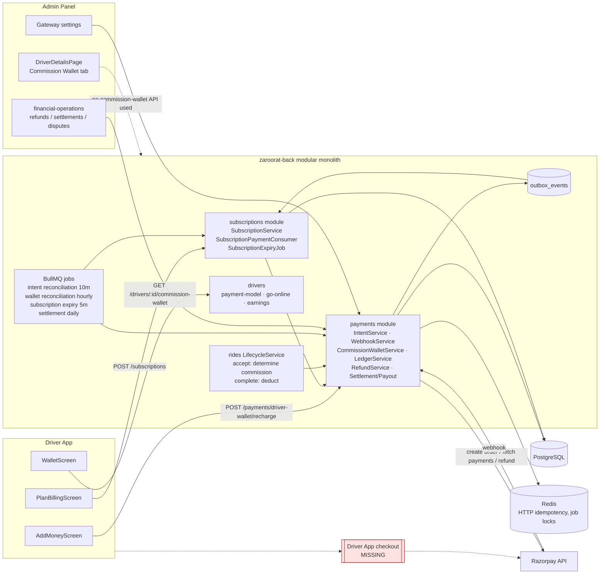

### 4.2 Deliverable 1 — Existing Architecture Report

| Component                           | Existing implementation                                                                                                                                                                                                                                                                      | Evidence                                                                                                                                                                                                                                          | Status                                                                                                                               | Risk or gap                                                                                                                      |
| ----------------------------------- | -------------------------------------------------------------------------------------------------------------------------------------------------------------------------------------------------------------------------------------------------------------------------------------------- | ------------------------------------------------------------------------------------------------------------------------------------------------------------------------------------------------------------------------------------------------- | ------------------------------------------------------------------------------------------------------------------------------------ | -------------------------------------------------------------------------------------------------------------------------------- |
| Gateway purpose invariant           | Only `DRIVER_SUBSCRIPTION_PAYMENT` and `DRIVER_COMMISSION_RECHARGE` intents can be created; the purpose is checked before any provider call                                                                                                                                                  | `back/src/modules/payments/constants/payment.constants.ts:25-28`; `intent.service.ts:67-69`; test `tests/unit/payments/gateway-purpose-invariant.test.ts`                                                                                         | EXISTING                                                                                                                             | —                                                                                                                                |
| Payment intent model                | `payment_intents`: amount `Decimal(10,2)`, currency `CHAR(3)` default INR, free-text `status`, `idempotency_key` UNIQUE (global), `gateway_intent_id` **not unique**, `purpose`                                                                                                              | `back/prisma/schema/modules/payment/payment.prisma:58-87`; init migration index list                                                                                                                                                              | EXISTING                                                                                                                             | G-13 (key not user-scoped), G-15 (no unique on provider order id)                                                                |
| Intent state machine                | `CREATED→PENDING/PROCESSING/CANCELLED`, `PENDING→PROCESSING/SUCCEEDED/FAILED/CANCELLED`, `FAILED→SUCCEEDED` (late capture), `SUCCEEDED→REFUND_PENDING/REFUNDED`. Rows are written as `PENDING`                                                                                               | `intent.service.ts:25-34`; `back/src/modules/payments/repositories/intent.repository.ts:32-37`                                                                                                                                                    | EXISTING                                                                                                                             | G-17 (`SUCCEEDED→FAILED` throws on out-of-order webhook), G-18 (no expiry)                                                       |
| Intent creation                     | Provider order created **outside** the DB transaction, then the intent row and an outbox event in one transaction; replay by idempotency key returns the existing intent if the purpose matches                                                                                              | `intent.service.ts:53-116`                                                                                                                                                                                                                        | EXISTING                                                                                                                             | G-13: lookup at :70-77 ignores `userId` (subscription scopes its key, recharge does not, `commission-wallet.controller.ts:68`)   |
| Confirmation (`applyConfirmation`)  | `SELECT … FOR UPDATE` on intent; non-terminal provider status is a no-op; status-equal is a no-op; otherwise transition plus `payment_transactions` row; SUCCEEDED dispatches by purpose to credit wallet or emit subscription event; ledger group in same tx                                | `intent.service.ts:146-322`                                                                                                                                                                                                                       | EXISTING                                                                                                                             | G-14: provider amount/currency never compared; G-03: `confirmIntent` passes the order id as `gatewayTxnId` (:137-143)            |
| Razorpay adapter                    | Orders API create (amount ×100, `receipt` = idempotency key); confirm via `GET /payments?order_id=` choosing first `captured`/`authorized`/`failed`; refunds via `POST /payments/:id/refund` with find-before-create                                                                         | `back/src/integrations/razorpay/razorpay.client.ts:108-177`                                                                                                                                                                                       | EXISTING                                                                                                                             | G-03 (undocumented filter, no order-id/amount check), G-29 (refund idempotency header unused)                                    |
| Razorpay payment-signature verifier | `HMAC_SHA256(order_id\|payment_id, key_secret)` implemented, **no caller**                                                                                                                                                                                                                   | `razorpay.client.ts:212-221`                                                                                                                                                                                                                      | EXISTING (unused)                                                                                                                    | Needed for checkout callback (G-01)                                                                                              |
| Stripe adapter                      | Present; webhook verification with tolerance                                                                                                                                                                                                                                                 | `back/src/integrations/stripe/stripe.client.ts`; `webhook.service.ts:129-136`                                                                                                                                                                     | EXISTING                                                                                                                             | Stripe India is invite-only (§6.6). `clientSecret` never returned to clients                                                     |
| Mock gateway guard                  | `mock` refused in staging/production                                                                                                                                                                                                                                                         | `back/src/config/payment/payment.config.ts:17-27,70-84`                                                                                                                                                                                           | EXISTING                                                                                                                             | —                                                                                                                                |
| Webhook ingestion                   | Per-provider route with raw body; HMAC verify (timing-safe); event id required (Razorpay `X-Razorpay-Event-Id`); freshness check; DB find-or-create on UNIQUE `(gateway, gateway_event_id)`; apply in same tx; mark processed                                                                | `back/src/modules/payments/controllers/webhook.controller.ts:32-64`; `back/src/modules/payments/services/webhook/webhook.service.ts:62-123`; `back/src/modules/payments/repositories/webhook.repository.ts:7-43`; schema `payment.prisma:119-132` | EXISTING                                                                                                                             | G-02 (freshness rejects Razorpay retries), G-17, G-32                                                                            |
| Webhook replay window               | `PAYMENT_WEBHOOK_TOLERANCE_SEC` default 300, min 30, **max 3600**, compared with payload `created_at` (Razorpay) / `created` (Stripe)                                                                                                                                                        | `payment.config.ts:156-160`; `webhook-payload-parser.ts:106`; `webhook.service.ts:147-157`                                                                                                                                                        | EXISTING                                                                                                                             | **G-02**                                                                                                                         |
| HTTP idempotency                    | Redis `SET NX` "in flight" → result stored for TTL (24 h default), payload-hash check, scoped `userId:route:key`                                                                                                                                                                             | `back/src/modules/payments/repositories/idempotency.repository.ts:31-65`; `back/src/core/cache/stores/IdempotencyStore.ts:44-69`                                                                                                                  | EXISTING                                                                                                                             | Redis-only. DB unique on intent key is the only durable backstop (G-13)                                                          |
| Subscription plan                   | `subscription_plans`: `billing_period` DAILY/WEEKLY/MONTHLY (free text), `price Decimal(10,2)`, `currency`, `status`; create-only via `POST /subscriptions/plans` (`finance:execute`), audited                                                                                               | `back/prisma/schema/modules/subscription/subscription.prisma:5-19`; `back/src/modules/subscriptions/services/subscription.service.ts:34-57`; routes `subscription.routes.ts:15-16`                                                                | EXISTING                                                                                                                             | No deactivate/edit route (G-22); currency not validated against gateway INR (G-31); no seed plans                                |
| Driver subscription                 | `driver_subscriptions`: status `PENDING_PAYMENT/ACTIVE/EXPIRED/CANCELLED` (+`REFUNDED` written by refund), `payment_status`, `auto_renew`, `cancel_requested`, `pending_plan_id`, single `payment_intent_id`; partial UNIQUE one ACTIVE and one PENDING_PAYMENT per driver                   | `subscription.prisma:21-44`; migrations `20260909100000_…` and `20260919120000_…`                                                                                                                                                                 | EXISTING                                                                                                                             | G-11 (inert flags), G-12 (single intent link)                                                                                    |
| Subscription purchase               | Locks driver row; ACTIVE + same plan → 409; ACTIVE + other plan → stage `pendingPlanId`; PENDING with live intent → reuse; otherwise new PENDING_PAYMENT row; intent created outside tx with key `subscription:{driverId}:{key}`                                                             | `subscription.service.ts:72-152`                                                                                                                                                                                                                  | EXISTING                                                                                                                             | G-12 (REUSE ignores a changed `planId`), G-11                                                                                    |
| Subscription activation             | Outbox consumer on `DRIVER_SUBSCRIPTION_PAYMENT_COMPLETED`; `activateIfPending` conditional claim; start = now, expiry = now + period (UTC calendar arithmetic); sets `Driver.paymentModel=SUBSCRIPTION`                                                                                     | `subscription-payment.consumer.ts:9-23,67-112`; `driver-subscription.repository.ts:73-84`                                                                                                                                                         | EXISTING                                                                                                                             | G-04 (backstop unscheduled)                                                                                                      |
| Subscription expiry                 | Every 5 min: ACTIVE with `expiry_date ≤ now` → EXPIRED; applies staged `pendingPaymentModel=COMMISSION`                                                                                                                                                                                      | `back/src/modules/subscriptions/jobs/subscription-expiry.job.ts:22-60`; schedule `back/src/jobs/scheduler/index.ts:117-120`                                                                                                                       | EXISTING                                                                                                                             | Accept also re-checks `expiryDate > now` (`lifecycle.service.ts:435-441`)                                                        |
| Subscription reconciliation         | Activates PENDING_PAYMENT whose intent is SUCCEEDED                                                                                                                                                                                                                                          | `back/src/modules/subscriptions/jobs/subscription-reconciliation.job.ts`; DI only `back/src/modules/subscriptions/index.ts:25`                                                                                                                    | **EXISTING but never scheduled** — absent from `JOB_NAMES`/scheduler/`MAINTENANCE_HANDLERS` (`back/src/jobs/workers/index.ts:41-61`) | **G-04**                                                                                                                         |
| Subscription refund                 | Full refund only, finance-only; on `REFUND_PROCESSED` the subscription becomes `REFUNDED`                                                                                                                                                                                                    | `refund.service.ts:248-253`; `subscription-payment.consumer.ts:57-65`; `driver-subscription.repository.ts:91-98`                                                                                                                                  | EXISTING                                                                                                                             | Pro-rata not supported (ADR-10)                                                                                                  |
| Commission wallet                   | `driver_commission_wallets` (one per driver, `balance Decimal(12,2)`, **no CHECK constraint**) + immutable-by-convention `driver_commission_wallet_transactions` (signed amount, `balance_after`, `txn_type` free text)                                                                      | `back/prisma/schema/modules/wallet/wallet.prisma:161-200`                                                                                                                                                                                         | EXISTING                                                                                                                             | G-16 (no balance floor, no append-only enforcement)                                                                              |
| Recharge initiation                 | Only `COMMISSION` drivers or those with staged switch; option id or custom amount within ₹50–₹50,000 (env); creates intent `methodType:'CARD'`                                                                                                                                               | `commission-wallet.controller.ts:27-93`; `payment.config.ts:182-187`; schema `back/src/modules/payments/schemas/payment.schemas.ts:6-13`                                                                                                          | EXISTING                                                                                                                             | G-31 (no 2-dp validation), G-13, G-01                                                                                            |
| Recharge options                    | `wallet_recharge_options` (amount, label, status, sort) read-only list endpoint                                                                                                                                                                                                              | `wallet.prisma:205-216`; `commission-wallet.controller.ts:95-105`                                                                                                                                                                                 | EXISTING (read)                                                                                                                      | No admin CRUD, no seed (G-22)                                                                                                    |
| Wallet credit                       | `creditInTx` locks wallet, adds amount, writes `MANUAL_RECHARGE` txn, outbox `CREDITED` event; ledger `GATEWAY_CLEARING DR / DRIVER_COMMISSION_WALLET CR`                                                                                                                                    | `back/src/modules/payments/services/commission-wallet/commission-wallet.service.ts:53-95`; `intent.service.ts:194-233`                                                                                                                            | EXISTING                                                                                                                             | No DB unique "one credit per intent" (G-15); correctness relies on the intent row lock + transition                              |
| Commission determination            | At accept, COMMISSION driver: `calculateFinalFare(estimatedDistance, estimatedDuration, vehicleType, pricingRuleId)` → `platformCommission` stored on `rides.commission_amount`; balance must be ≥ amount (read-only, no reservation)                                                        | `lifecycle.service.ts:442-461,481-482`                                                                                                                                                                                                            | EXISTING                                                                                                                             | **G-09** (no surge, waiting, discount or boost in the inputs)                                                                    |
| Commission deduction                | In `completeRide` tx: lock wallet → existence check → full amount or nothing; partial UNIQUE `(ride_id) WHERE txn_type='RIDE_COMMISSION'`; ledger `DRIVER_COMMISSION_WALLET DR / PLATFORM_COMMISSION CR`; insufficient → error log, metric, outbox `COLLECTION_FAILED`, ride still completes | `commission-wallet.service.ts:171-235`; `lifecycle.service.ts:1013-1081`; migration `20260909100000_…`                                                                                                                                            | EXISTING                                                                                                                             | ADR-04 (shortfall is forgiven), G-20                                                                                             |
| Subscription driver eligibility     | Accept requires ACTIVE with `expiryDate > now`; wallet never consulted                                                                                                                                                                                                                       | `lifecycle.service.ts:430-441`                                                                                                                                                                                                                    | EXISTING                                                                                                                             | G-19 (offers still dispatched to ineligible drivers)                                                                             |
| Go-online gate                      | Verified, not suspended, documents, vehicle, `paymentModel` non-null                                                                                                                                                                                                                         | `back/src/modules/drivers/services/status/status.service.ts:40-71`                                                                                                                                                                                | EXISTING                                                                                                                             | Does not check subscription/balance (G-19)                                                                                       |
| Payment model selection             | First COMMISSION immediate; SUBSCRIPTION→COMMISSION staged while ACTIVE; COMMISSION→SUBSCRIPTION only on activation                                                                                                                                                                          | `back/src/modules/drivers/services/payment-model/payment-model.service.ts:26-69`; consumer :97-102                                                                                                                                                | EXISTING                                                                                                                             | —                                                                                                                                |
| Ride-fare recording                 | Customer picks CASH/UPI/CARD; ride `payment_status=PAID` at completion (flag off)                                                                                                                                                                                                            | `customer/src/components/ride/PaymentMethodSheet.tsx:21-36`; `back/src/modules/rides/constants/ride.constants.ts:37`; `lifecycle.service.ts:960-962`                                                                                              | EXISTING                                                                                                                             | "PAID" means "driver collected"; G-07                                                                                            |
| Ride-fare ledger                    | Driver-collected: `DRIVER_PAYABLE DR (tax+fee) / TAX_PAYABLE CR / PLATFORM_FEE CR`; commission redistributed to driver earning for model rides                                                                                                                                               | `ledger.service.ts:111-205`; pricing defaults `pricing.config.ts:47-49`                                                                                                                                                                           | EXISTING                                                                                                                             | **G-07**                                                                                                                         |
| Settlement & payout                 | Daily per-driver settlement; non-WALLET rides contribute only "owed" (tax+fee); negative carried forward; manual bank payouts                                                                                                                                                                | `settlement.service.ts:23-171`; `back/src/modules/payments/repositories/settlement.repository.ts:69-165`                                                                                                                                          | EXISTING                                                                                                                             | **G-08**                                                                                                                         |
| Ledger                              | `payment_ledger_entries` (group UUID, account string, direction, amount `Decimal(12,2)`); balance check per group; positive amounts only                                                                                                                                                     | `payment.prisma:191-207`; `back/src/modules/payments/repositories/ledger.repository.ts:18-54`; `ledger.service.ts:99-110`                                                                                                                         | EXISTING                                                                                                                             | G-16 (mutable table, no posting idempotency key); `PLATFORM_FEE` account not in `LEDGER_ACCOUNTS` (`payment.constants.ts:30-64`) |
| Refund lifecycle                    | PENDING → reserve (debit source balance into `REFUND_IN_TRANSIT`) → PROCESSING → provider → SUCCEEDED/FAILED; unknown outcome stays PROCESSING; reconciliation every 5 min                                                                                                                   | `refund.service.ts:91-505`; schedule `scheduler/index.ts:79-82`                                                                                                                                                                                   | EXISTING                                                                                                                             | G-21 (admin amount edit after reserve), G-29                                                                                     |
| Intent reconciliation               | Every 10 min: up to 100 PENDING/PROCESSING intents older than 15 min → `confirmIntent`                                                                                                                                                                                                       | `back/src/modules/payments/jobs/payment-intent-reconciliation.job.ts:14,51-58`; `scheduler/index.ts:75`                                                                                                                                           | EXISTING                                                                                                                             | G-03, G-18 (no ordering, no expiry)                                                                                              |
| Wallet reconciliation               | Hourly: first 100 customer wallets and first 100 driver **earnings** wallets; writes `wallet_reconciliations`                                                                                                                                                                                | `back/src/modules/payments/jobs/reconciliation.job.ts:38,107`; `scheduler/index.ts:67`                                                                                                                                                            | PARTIAL                                                                                                                              | **G-05** (commission wallets excluded; no cursor)                                                                                |
| Provider settlement reconciliation  | None (`GATEWAY_CLEARING` never cleared; `gateway_fee` always 0)                                                                                                                                                                                                                              | grep: no settlement-report consumer                                                                                                                                                                                                               | MISSING                                                                                                                              | G-26                                                                                                                             |
| Outbox                              | 8 attempts, backoff 1 s→30 s, then FAILED (dead letter); all subscribers of an event retried together                                                                                                                                                                                        | `back/src/core/events/OutboxRelay.ts:7-9,44-96`                                                                                                                                                                                                   | EXISTING                                                                                                                             | Consumers must be idempotent (they are). Dead letter ⇒ G-04                                                                      |
| Admin finance                       | Transactions list/reconcile flag, refunds workflow, settlements, driver earnings ledger, disputes, audit logs (`finance:read`/`finance:execute`)                                                                                                                                             | `back/src/modules/admin/payment-management/payment-management.routes.ts:58-178`; `finance.service.ts`                                                                                                                                             | PARTIAL                                                                                                                              | G-21, G-22; list filters applied after pagination (`finance.service.ts:298-305`)                                                 |
| Admin commission wallet tab         | Displays earnings-wallet balance with `\|\| 1250` fallback, client-side 7%/93% split, top-up modal with success toast and **no API call**                                                                                                                                                    | `admin/src/modules/driver-management/pages/drivers/DriverDetailsPage.tsx:258-277,1999,2265-2273`                                                                                                                                                  | **UNSAFE**                                                                                                                           | **G-06**                                                                                                                         |
| Admin gateway settings              | Credentials encrypted at rest (`enc:` AES, `ENCRYPTION_KEY` required in prod/staging), masked on read; editable with generic `settings:write`                                                                                                                                                | `back/src/modules/admin/system-settings/routes/system-settings.routes.ts:30-40`; `back/src/shared/crypto/encryption.util.ts:37-117`; `back/src/config/env/schema.ts:69-72`                                                                        | EXISTING                                                                                                                             | G-27                                                                                                                             |
| Driver App billing                  | Plan & Billing, Add Money, Wallet screens call real APIs; auto `Idempotency-Key` per request; **no checkout**                                                                                                                                                                                | `driver/src/features/billing/*.tsx`; `driver/src/services/api/client.ts:97-106,207-212`                                                                                                                                                           | PARTIAL                                                                                                                              | **G-01**, G-23, G-24, G-30                                                                                                       |
| Driver earnings summary             | `commissionOwed = SUM(COALESCE(rides.commission_amount, ride_fares.platform_commission, …))`                                                                                                                                                                                                 | `back/src/modules/drivers/services/earnings/earnings.service.ts:249-264`                                                                                                                                                                          | EXISTING                                                                                                                             | G-23: subscription rides report commission they never owe                                                                        |

---

## 5. Existing end-to-end payment flows

Each flow is traced from the Driver App to the final UI state. **⛔ BREAK** marks the point where the flow cannot be traced further or is broken today.

### 5.1 Subscription purchase (EXISTING up to intent creation)

1. Driver App opens Plan & Billing.
   - `GET /api/v1/subscriptions/plans`, `GET /api/v1/subscriptions` and `GET /api/v1/drivers/payment-model` are called (`driver/src/features/billing/PlanBillingScreen.tsx:57-73`).
   - If no plan is returned, the screen shows hardcoded prices ₹1,999/₹599/₹89 (`driver/src/features/billing/constants/plans.ts:7-11`, used at `PlanBillingScreen.tsx:303-308`). **GAP G-23.**
2. The driver taps Subscribe.
   - The app first calls `POST /drivers/payment-model {SUBSCRIPTION}` and swallows any error (`PlanBillingScreen.tsx:127`).
   - It then calls `POST /api/v1/subscriptions {planId}`. An auto-generated `Idempotency-Key` is attached (`driver/src/services/api/client.ts:207-212`).
3. Backend: `withIdempotency` (Redis), then `SubscriptionService.purchase` (`subscription.service.ts:72-152`). That method:
   - locks the driver row;
   - creates or reuses a `PENDING_PAYMENT` subscription;
   - outside the transaction, calls `IntentService.createIntent`, which creates a Razorpay Order (`razorpay.client.ts:108-122`) and inserts the `payment_intents` row (status `PENDING`) plus an outbox `INTENT_CREATED` event;
   - in a second transaction, writes `driver_subscriptions.payment_intent_id`.
4. Response: `{subscriptionId, status:'PENDING_PAYMENT', intentId}` (`back/src/modules/subscriptions/controllers/subscription.controller.ts:56-60`). The Razorpay key id, order id and amount needed by Checkout are **not** returned.
5. **⛔ BREAK (G-01).** The app shows "Complete payment in the checkout flow…". The code comment reads `// Payment gateway checkout would open here with intentId` (`PlanBillingScreen.tsx:139-144`). No checkout exists, and the app's `package.json` has no payment SDK.
6. (Unreachable today) Razorpay `payment.captured`/`order.paid` webhook, then `WebhookService` → `applyConfirmation`. That posts `GATEWAY_CLEARING DR / SUBSCRIPTION_REVENUE CR` and emits the outbox event `DRIVER_SUBSCRIPTION_PAYMENT_COMPLETED` (`intent.service.ts:234-266`).
7. (Unreachable today) `SubscriptionPaymentConsumer` activates the subscription and sets `paymentModel=SUBSCRIPTION` (`subscription-payment.consumer.ts:67-112`).
8. Final UI: Plan & Billing re-queries `GET /subscriptions` and shows "Active subscription" (`PlanBillingScreen.tsx:194-214`). No push or realtime notification of activation is wired to the app. **UNVERIFIED:** no consumer of `DRIVER_SUBSCRIPTION_PAYMENT_COMPLETED` beyond the subscription consumer was found.

### 5.2 Commission wallet recharge (EXISTING up to intent creation)

1. Wallet screen → Recharge → Add Money. Recharge options come from `GET /api/v1/payments/driver-wallet/recharge-options` (`driver/src/features/billing/AddMoneyScreen.tsx:78-88`). The amount defaults to ₹1,999, and the chips are subscription plan prices labelled "1 day plan" etc. (`AddMoneyScreen.tsx:75`, `constants/plans.ts:24-31`). **GAP G-23.**
2. Tapping **any** payment-method row (UPI, Card or QR) immediately calls `POST /api/v1/payments/driver-wallet/recharge` (`AddMoneyScreen.tsx:180-187`). The selected method is not sent; the backend hardcodes `methodType:'CARD'` (`commission-wallet.controller.ts:67`).
3. Backend:
   - `assertMayRecharge` checks the driver is COMMISSION or has a staged switch (`commission-wallet.controller.ts:87-93`);
   - `withIdempotency` wraps the call;
   - the amount is validated against the option list or the ₹50–₹50,000 bounds;
   - `createIntent(purpose:'DRIVER_COMMISSION_RECHARGE', idempotencyKey: <raw client key>)` runs. **GAP G-13.**
4. Response: `{intentId, intentStatus:'PENDING', gateway, gatewayIntentId, amount}`.
5. **⛔ BREAK (G-01).** An alert says "Payment intent created. Complete checkout to credit your wallet", then `router.back()` (`AddMoneyScreen.tsx:108-112`).
6. (Unreachable today) Webhook → `applyConfirmation` → ledger `GATEWAY_CLEARING DR / DRIVER_COMMISSION_WALLET CR`, then `creditInTx` (balance plus `MANUAL_RECHARGE` row) in the same transaction (`intent.service.ts:194-233`).
7. Final UI: the Wallet screen re-fetches the balance. The screen falls back to the **earnings** wallet balance if the commission wallet query has no balance (`driver/src/features/billing/WalletScreen.tsx:120-126`). **GAP G-23.**

### 5.3 Ride acceptance → completion → commission (EXISTING, end to end)

1. Driver goes online. The gate requires `paymentModel` non-null only (`status.service.ts:65-71`).
2. Dispatch offers rides. **UNVERIFIED** whether matching filters on subscription or balance; grep found no payment-model references under `back/src/modules/matching`. Offers can therefore reach drivers who will be refused at accept (G-19).
3. Accept (`lifecycle.service.ts:372-…`), inside one transaction:
   - lock the request; check the offer; check self-ride; check there is no active ride (backed by the unique index `rides_active_driver_key`); check the driver is ONLINE; check vehicle eligibility; refuse the WALLET method;
   - **payment-model gate (:425-461):**
     - no model → `PAYMENT_MODEL_NOT_SELECTED`;
     - SUBSCRIPTION → requires ACTIVE with `expiryDate > now`, else `DRIVER_SUBSCRIPTION_REQUIRED`;
     - COMMISSION → `commissionAmount = calculateFinalFare(estimate).platformCommission` (no surge, waiting, discount or boost), then `balance ≥ commissionAmount` (unlocked read) else `INSUFFICIENT_COMMISSION_BALANCE`;
   - create the ride with `driver_payment_model` and `commission_amount` pinned.
4. Complete (`lifecycle.service.ts:827-1159`), inside one transaction:
   - conditional status claim to COMPLETED; `payment_status = PAID` for CASH/UPI/CARD (flag off);
   - `ride_fares` row created from the measured fare;
   - if COMMISSION: `deductInTx(driverId, rideId, ride.commissionAmount)` takes the wallet row lock, checks idempotency, then either deducts the full amount or writes nothing (`commission-wallet.service.ts:171-235`); on success the ledger posts `DRIVER_COMMISSION_WALLET DR / PLATFORM_COMMISSION CR`;
   - `recordTripPayment` for driver-collected methods books `DRIVER_PAYABLE DR` for tax + platform fee (`lifecycle.service.ts:1101-1119`). **G-07.**
5. Final UI: the trip summary shows the fare. The commission deducted is shown only as a row in the Wallet activity list (`WalletScreen.tsx:48-60`). That list labels `REFUND` rows as credits (G-23).

### 5.4 Duplicate / out-of-order webhook (EXISTING)

| Case                                                                   | Behaviour today                                                                                                                                                                                                                                                          | Evidence                                                                   |
| ---------------------------------------------------------------------- | ------------------------------------------------------------------------------------------------------------------------------------------------------------------------------------------------------------------------------------------------------------------------ | -------------------------------------------------------------------------- |
| Same event id delivered twice                                          | Second delivery finds the `gateway_events` row and returns `isDuplicate:true`, 200, with no business effect                                                                                                                                                              | `webhook.service.ts:84-98`; test `payment-webhook.test.ts:153`             |
| Two distinct success events (`payment.captured` + `order.paid`)        | Second finds intent already SUCCEEDED, so it is a no-op                                                                                                                                                                                                                  | `intent.service.ts:164`; test `wallet-funding.test.ts:211`                 |
| `payment.failed` then `payment.captured` (retry inside the same order) | `FAILED → SUCCEEDED` allowed; credits once                                                                                                                                                                                                                               | `intent.service.ts:30`; test `payment-intent-h1.test.ts:149`               |
| `payment.captured` then a late `payment.failed` for an earlier attempt | `SUCCEEDED → FAILED` is invalid, so `InvalidStateTransitionError` (409) is thrown and the transaction (including the `gateway_events` insert) rolls back. Razorpay retries for 24 h, then the freshness check starts rejecting it. Financially safe, operationally noisy | `intent.service.ts:165`, `payment.errors.ts:30-39`. **G-17**               |
| Concurrent identical deliveries                                        | Second insert into `gateway_events` hits the unique index after the first commits; the transaction errors (5xx); the provider retries and the next attempt is a duplicate                                                                                                | `webhook.repository.ts:7-43`. **G-32** (P2)                                |
| Retry older than the replay window                                     | `WebhookReplayError` (`400 WEBHOOK_REPLAY_REJECTED`, `payment.errors.ts:78-83`) thrown; the event is never applied                                                                                                                                                       | `webhook.service.ts:147-157`; test `payment-webhook.test.ts:129`. **G-02** |

### 5.5 Provider success but backend failure (EXISTING, partly broken)

- If the webhook transaction fails (DB down, bug), nothing is persisted and Razorpay gets a non-2xx. Razorpay retries with exponential backoff for 24 h (§6.5). Any retry arriving more than 300 s after `created_at` is rejected by the replay window (G-02).
- The backstop is `PaymentIntentReconciliationJob`, which runs every 10 min (intents stale for more than 15 min). It calls `RazorpayGatewayProvider.confirmIntent`, which uses `GET /payments?order_id=…` (`razorpay.client.ts:128-131`).
  - Razorpay documents `GET /orders/{id}/payments` for this purpose. `order_id` is **not** a documented filter on `GET /payments` (§6.5).
  - The code takes the first `captured` item **without checking that its `order_id` matches**, and without checking the amount.
  - **UNVERIFIED and potentially critical:** if the API ignores the unknown parameter, the job could mark a stale intent SUCCEEDED from another driver's captured payment. **Must be checked in the Razorpay sandbox before any live use (G-03).**
- On success through this path, `applyConfirmation` receives the **order id** as `gatewayTxnId` (`intent.service.ts:137-143`). `RefundService` then refuses to refund it, because Razorpay refunds need a `pay_…` id (`refund.service.ts:511-516`).

### 5.6 Pending payment / lost connectivity (EXISTING, incomplete)

- An unpaid intent stays `PENDING` forever. No expiry exists, and the reconciliation job re-queries the same 100 rows (no `orderBy`) every 10 min (G-18).
- The Driver App keeps no persisted record of an in-flight payment. A relaunched app cannot show "payment pending" or "payment verification in progress" (G-30).
- `POST /payments/intents/:id/confirm` exists (owner-or-staff, idempotent; `back/src/modules/payments/controllers/intent.controller.ts:8-40`). It is the only client-triggerable status refresh, and it is a POST that calls the provider.

### 5.7 Refund / reversal (EXISTING for payments, MISSING for commission)

- Recharge refund (finance only): only **unused** balance can be refunded (`commission-wallet.service.ts:105-132`).
- Subscription refund: full only. It ends the entitlement (`refund.service.ts:248-253`).
- **Ride-commission reversal** (for example after an approved fare correction or dispute) does not exist. There is no `RIDE_COMMISSION_REVERSAL` transaction type and no service path. `PaymentDispute.adjustmentAmount` is recorded but moves no money (`finance.service.ts:1343-1386`). **⛔ BREAK (G-22).**

### 5.8 Admin review of a disputed payment

`/api/v1/admin/finance/disputes*` records status, assignment, timeline and `adjustmentAmount` (`finance.service.ts:1180-1392`). The dispute model is ride-centric (`PaymentDispute.rideId` required, `payment.prisma:261-291`). It cannot represent a dispute about a recharge or subscription payment. **⛔ BREAK (G-22).**

### 5.9 Customer fare recording (EXISTING)

The customer selects CASH, UPI or CARD (`customer/src/components/ride/PaymentMethodSheet.tsx:21-36`). The value is stored on `ride_requests.payment_method` and copied to `rides.payment_method` (`lifecycle.service.ts:472`). At completion `rides.payment_status` becomes `PAID` (flag `PAYMENT_CASH_CONFIRMATION_REQUIRED` off) or `PENDING` until driver acknowledgement (flag on, `back/src/modules/payments/services/collection/collection.service.ts:116-215`). No gateway is involved. **This correctly avoids treating the fare as platform money**, except for the tax and fee legs in G-07. "CARD" paid directly to a driver presumes the driver has a card terminal; **DECISION REQUIRED** whether CARD stays a selectable method (ADR-17).

### 5.10 Flows that cannot be traced end to end today

| Flow                                      | Breaks at                                   | Gap        |
| ----------------------------------------- | ------------------------------------------- | ---------- |
| Driver pays subscription or recharge      | App, after intent creation                  | G-01       |
| Subscription renewal                      | Not implemented                             | G-11       |
| Admin commission-wallet adjustment        | Admin UI fakes success; no backend endpoint | G-06, G-22 |
| Ride-commission reversal                  | No code path                                | G-22       |
| Provider settlement → bank reconciliation | No code path                                | G-26       |
| Dispute about a driver payment            | Model is ride-only                          | G-22       |

---

## 6. Ride-hailing industry and provider research

All sources were accessed on **2026-10-18**. "Not publicly verified" means no reliable public source was found. Nothing here describes any company's internal systems beyond what that company or a credible publication states publicly. Full URLs are in Appendix A.

### 6.1 Uber (India and general)

| Area                           | Publicly verified behavior                                                                                                                                                                                                                    | Source                                                             | Applicability to Zaroorat                                                                                                                                                               |
| ------------------------------ | --------------------------------------------------------------------------------------------------------------------------------------------------------------------------------------------------------------------------------------------- | ------------------------------------------------------------------ | --------------------------------------------------------------------------------------------------------------------------------------------------------------------------------------- |
| India auto model               | Since Feb 2025 Uber runs auto-rickshaws in India on a subscription (SaaS) model. Coverage says "all payments will be made directly to the driver partner", and that Uber will not charge commission, process transactions or track payments   | [S-U1] Indian Startup News, 18 Feb 2025; [S-U2] Inc42, 27 Jun 2025 | **Directly comparable** to R1 + R2. Confirms the "platform never touches the fare" pattern for a subscription model                                                                     |
| Subscription price form        | Secondary reporting: time-boxed "Driver Pass" (24 h / 72 h); a 72 h pass reported at ₹341 inclusive of 18% GST                                                                                                                                | [S-U3] search summary of NewsBytes (page blocked, 403)             | Short passes (daily/72 h) are common. The **GST-inclusive** price suggests GST is charged on the subscription fee: a finance/tax question for Zaroorat (ADR-16). Treat as **secondary** |
| Cash trips: service fee        | Uber driver pages (non-India markets): "The usual Uber service fee is deducted from the total, as with all trips. In the case of a Cash trip, this fee will be deducted from your earnings separately from the cash you take from the rider." | [S-U4] uber.com/ie cash trips                                      | Commission on cash rides is collected **from other earnings**, not from the cash. Zaroorat has no platform-held earnings, so a prepaid wallet is the analogue                           |
| Promotions on cash trips       | "Any difference between the total trip fare and the collected amount will be included in your weekly payout."                                                                                                                                 | [S-U4]                                                             | The **platform** funds promotions on cash trips. Zaroorat currently makes the **driver** fund them (G-10)                                                                               |
| Negative balance               | "You authorize Uber to automatically recover any negative balance by deducting earnings from your future deliveries that are paid digitally." "Cash deliveries may be paused if your negative balance gets too high." (US deliveries)         | [S-U5] Uber blog, 21 Jul 2026                                      | Pattern: allow bounded negative, recover from future funds, **restrict** (not cancel) when the bound is exceeded. Supports ADR-04 options B/C                                           |
| Ledger design                  | Money orders are immutable; "all entries in any money order sum to zero"; adjustments are new money orders; an entity changelog provides a complete audit trail                                                                               | [S-U6] Uber blog "Zero-Sum by Design", 6 Aug 2026                  | Supports ADR-02: immutable, balanced journal groups and corrections as new entries                                                                                                      |
| LedgerStore                    | "an immutable, ledger-style database storing business transactions"; append-only; corrections tracked through revisions                                                                                                                       | [S-U7] Uber blog, 10 Nov 2021                                      | Supports append-only enforcement (G-16)                                                                                                                                                 |
| India driver wallet / recharge | Not publicly verified                                                                                                                                                                                                                         | —                                                                  | —                                                                                                                                                                                       |

### 6.2 Ola

| Area                                     | Publicly verified behavior                                                                                         | Source                                      | Applicability                                                                             |
| ---------------------------------------- | ------------------------------------------------------------------------------------------------------------------ | ------------------------------------------- | ----------------------------------------------------------------------------------------- |
| Zero-commission subscription             | Ola extended a zero-commission, subscription model to cab drivers (June 2025): a 30-day pass at ₹2,010, or ₹67/day | [S-O1] MediaNama, 19 Jun 2025; [S-U2] Inc42 | Daily and monthly passes are both normal. Zaroorat's DAILY/WEEKLY/MONTHLY plan model fits |
| Prior model                              | Ola previously took a percentage commission (reported 15–20%)                                                      | [S-O2] search summary (multiple outlets)    | Context only                                                                              |
| Fare flow under subscription             | Not publicly verified in the fetched sources                                                                       | —                                           | —                                                                                         |
| Driver wallet, shortfall, reconciliation | Not publicly verified                                                                                              | —                                           | —                                                                                         |

### 6.3 Rapido

| Area                           | Publicly verified behavior                                                                                                | Source                        | Applicability                                                                                                                      |
| ------------------------------ | ------------------------------------------------------------------------------------------------------------------------- | ----------------------------- | ---------------------------------------------------------------------------------------------------------------------------------- |
| Subscription for autos         | Feb 2024: auto drivers pay a fixed daily "access fee" for unlimited rides instead of commission; ₹9–₹29 depending on city | [S-R1] MediaNama, 19 Feb 2024 | Same structure as Zaroorat's subscription model                                                                                    |
| Mixed model                    | Bike taxi stayed on commission, because a subscription could hurt part-time two-wheeler drivers                           | [S-R1]                        | Supports keeping **both** models (Zaroorat's dual model) and choosing per vehicle category or driver profile                       |
| Cab fee form                   | Reported ₹500/month once monthly earnings exceed ₹10,000                                                                  | [S-U2] Inc42                  | Earnings-conditional fees need the platform to know earnings, which it does not under direct pay. Not applicable without more data |
| Wallet, shortfall, eligibility | Not publicly verified                                                                                                     | —                             | —                                                                                                                                  |

### 6.4 Namma Yatri (open source; Juspay / Moving Tech)

| Area                          | Publicly verified behavior                                                                                                                                                                                                                                      | Source                                            | Applicability                                                                                                                        |
| ----------------------------- | --------------------------------------------------------------------------------------------------------------------------------------------------------------------------------------------------------------------------------------------------------------- | ------------------------------------------------- | ------------------------------------------------------------------------------------------------------------------------------------ |
| Fee model                     | Daily Unlimited (≈₹25/day) or per-trip (≈₹3.5 for the first 10 trips) for autos; Bengaluru cabs ₹90/day                                                                                                                                                         | [S-R1] MediaNama; [S-U2] Inc42                    | Demonstrates a **per-ride fixed fee** variant alongside a daily pass                                                                 |
| Dues with a credit limit      | Open-source PR #16930: when "a driver's due amount reaches the applicable plan credit limit", fees move to manual handling and related autopay invoices are deactivated; retries skip fees that already have successful invoices                                | [S-N1] github.com/nammayatri/nammayatri PR #16930 | Public evidence of a **bounded receivable** (credit limit) for driver platform fees, with idempotent retry. Supports ADR-04 option B |
| Wallet carrying fees and GST  | Open-source PR #17205 (**open, not merged**, 13 Oct 2026): "Centralizes subscription fees, ride GST, and recharges in the driver wallet, with Autopay used only for recharging"; nightly deduction; "The wallet may go negative"; city-specific, off by default | [S-N2] PR #17205                                  | Close to Zaroorat's commission wallet. It is still an unmerged proposal, so it is **not** evidence of production behaviour           |
| GST on subscription platforms | Karnataka AAR ruled for Namma Yatri/Juspay that Section 9(5) does not apply where the platform only provides software                                                                                                                                           | [S-T2] search summary; [S-T3] JurisHour           | Tax position for a subscription platform is **contested** (§6.7)                                                                     |

### 6.5 Payment providers

| Area                                    | Publicly verified behavior                                                                                                                                                                                                                                                       | Source                                                              | Applicability                                                                                                                   |
| --------------------------------------- | -------------------------------------------------------------------------------------------------------------------------------------------------------------------------------------------------------------------------------------------------------------------------------- | ------------------------------------------------------------------- | ------------------------------------------------------------------------------------------------------------------------------- |
| Razorpay: order per payment             | "An order should be created for every payment." "Payments made without an order_id cannot be captured and will be automatically refunded."                                                                                                                                       | [S-P1] Razorpay standard integration                                | EXISTING: one order per intent                                                                                                  |
| Razorpay: checkout signature            | `generated_signature = hmac_sha256(order_id + "\|" + razorpay_payment_id, secret)`; "You must verify the signature on your server before fulfilling the order."                                                                                                                  | [S-P1]                                                              | Verifier exists but is unused (G-01). Use it only as a **trigger** to fetch status server-side, never as the credit itself      |
| Razorpay: status fetch                  | `GET /v1/orders/{id}/payments` returns "all the authorised or failed payments for that order"; payment fields include `amount`, `currency`, `status ∈ {created, authorized, captured, refunded, failed}`, `order_id`                                                             | [S-P2] Fetch Payments for an Order                                  | **G-03:** code uses `GET /payments?order_id=`                                                                                   |
| Razorpay: fetch-all filters             | `GET /v1/payments` documents only `from`, `to`, `count`, `skip`; `order_id` appears only as a response field                                                                                                                                                                     | [S-P3] Fetch All Payments                                           | **G-03:** undocumented filter. UNVERIFIED behaviour                                                                             |
| Razorpay: capture                       | Default auto-capture; "All payments that are not captured within the manual timeout period will be auto-refunded"; ensure authorized payments are captured "within 3 days of creation"                                                                                           | [S-P4] Capture settings                                             | Dashboard must be set to auto-capture. `authorized` maps to PENDING in code, which is correct. **UNVERIFIED** dashboard setting |
| Razorpay: webhook retries               | "we retry the delivery in exponential backoff policy for 24 hours after event creation timestamp"; "Razorpay considers any non-2xx response as an event delivery failure"; 5-second response window; "you may not always receive the webhooks in order"; duplicates are expected | [S-P5] Webhook best practices                                       | **G-02** (replay window ≤1 h vs 24 h retries), **G-17** (ordering)                                                              |
| Razorpay: signature and secret rotation | HMAC-SHA256 over the unmodified body with the webhook secret ("Do not parse or cast the webhook request body"). Dedupe on `x-razorpay-event-id`. On rotation, "use the old secret for webhook signature validation while retrying older requests"                                | [S-P6] Validate and test webhooks                                   | EXISTING raw-body verification and event-id dedupe. **GAP:** a single secret means rotation breaks in-flight retries (ADR-13)   |
| Razorpay: refund idempotency            | Refund APIs accept an `X-Refund-Idempotency` header; retries with the same key are safe; 409 while a prior request is processing                                                                                                                                                 | [S-P7] Normal/instant refund idempotency                            | **G-29:** code comment says none exists (`razorpay.client.ts:146-148`)                                                          |
| Cashfree: webhooks                      | Signature = Base64(HMAC-SHA256(`x-webhook-timestamp` + raw body, secret)); raw body only. At-least-once delivery; dedupe on `cf_payment_id` or the idempotency header (2025-01-01+); treat only `SUCCESS` as final                                                               | [S-P8] Cashfree signature verification; [S-P9] Cashfree reliability | Future adapter (ADR-07). The header name differs between Cashfree pages: **UNVERIFIED**                                         |
| Cashfree: order idempotency             | `POST /orders` accepts `x-idempotency-key`; the first response is saved and replayed                                                                                                                                                                                             | [S-P10] Cashfree create order                                       | Same pattern as the internal idempotency key                                                                                    |
| Stripe India                            | Stripe accounts in India are invite-only (since May 2024)                                                                                                                                                                                                                        | [S-P11] Stripe support                                              | Keep Stripe adapter dormant (ADR-07)                                                                                            |
| RBI e-mandate (UPI AutoPay)             | 2026 consolidated framework: recurring debits up to ₹15,000 without additional factor of authentication; pre-debit notification at least 24 h before; users can pause/cancel mandates in their UPI app                                                                           | [S-G4] summaries of RBI e-mandate framework (primary text not read) | Needed only if subscriptions auto-renew (ADR-09). **UNVERIFIED** against RBI primary text                                       |

### 6.6 Engineering patterns

| Area             | Publicly verified behavior                                                                                                                                                   | Source                                         | Applicability                                      |
| ---------------- | ---------------------------------------------------------------------------------------------------------------------------------------------------------------------------- | ---------------------------------------------- | -------------------------------------------------- |
| Idempotency keys | The client generates a key per operation and **reuses it on retry**; the server stores the result and "simply replies with a cached result"; exponential backoff with jitter | [S-E1] Stripe blog, 22 Feb 2017                | **G-30:** the Driver App mints a new key per tap   |
| Ledger balances  | Separate posted/pending/available balances; double-entry enforced in the application; mutations recorded in audit logs; every ledger state reconstructible                   | [S-E2] Modern Treasury "How to Scale a Ledger" | Supports ADR-03 (stored projection + verification) |

### 6.7 Regulatory and tax research (questions, not conclusions)

| Area                                                                                     | Publicly reported position                                                                                                                                                                                                                                                                                                                                                        | Source                                              | Applicability (all DECISION REQUIRED, professional advice)                                                                                                                                           |
| ---------------------------------------------------------------------------------------- | --------------------------------------------------------------------------------------------------------------------------------------------------------------------------------------------------------------------------------------------------------------------------------------------------------------------------------------------------------------------------------- | --------------------------------------------------- | ---------------------------------------------------------------------------------------------------------------------------------------------------------------------------------------------------- |
| GST on rides via an e-commerce operator, Section 9(5)                                    | Rides booked through an ECO attract 5% GST payable by the ECO. Whether subscription/SaaS platforms are "ECOs through which the service is supplied" is **contested**: Karnataka AAR rulings went both ways; Karnataka HC (11 Dec 2025, _Uber India v. AAR_, WP 25294/2024) directed CBIC to clarify; a GST Council amendment was reported as recommended. Enactment not confirmed | [S-T1]–[S-T4]                                       | Zaroorat books `TAX_PAYABLE` on every ride (G-07). Whether that liability is Zaroorat's, the driver's or nobody's is a tax-counsel question                                                          |
| TDS on e-commerce participants (Income-tax Act 1961 s.194-O, or its successor provision) | ECO deducts 0.1% (from 1 Oct 2024) of gross sales. Payments made **directly** by the buyer to the participant are deemed credited by the ECO                                                                                                                                                                                                                                      | [S-T5] search summary (ClearTax and others)         | If Zaroorat is an ECO for these rides, TDS may apply **even though the customer pays the driver directly**, and the platform does not hold the money to deduct from. **UNVERIFIED**, high importance |
| Closed-system PPI                                                                        | Closed-system PPIs (usable only for the issuer's own goods/services, no cash-out) are not classified as payment systems requiring RBI authorisation (2017 text, carried into the 2021 Master Directions)                                                                                                                                                                          | [S-G1] secondary summaries of RBI MD-PPI            | The commission wallet _may_ fall in this category if it can only pay Zaroorat's commission and refunds go only to source. **Not assumed**: legal confirmation needed                                 |
| Motor Vehicle Aggregator Guidelines 2025                                                 | Issued by MoRTH on 1 Jul 2025. Driver on own vehicle to receive at least 80% of fare; fare band 50% below to 2× base fare; states to adopt                                                                                                                                                                                                                                        | [S-G2] MoRTH PDF (not opened) + secondary summaries | Default commission 20% of ride revenue **plus** ₹15 fee **plus** tax could push the driver's share of the customer total below 80% (G-34). State adoption varies                                     |
| DPDP Act / Rules                                                                         | DPDP Rules 2025 notified 13 Nov 2025; operative obligations from about 13 May 2027                                                                                                                                                                                                                                                                                                | [S-G3]                                              | Payment data minimisation, retention and breach duties (§16)                                                                                                                                         |

---

## 7. Existing implementation vs production patterns

| Pattern (evidence)                                                                                      | Zaroorat today                                                                                          | Verdict                                            |
| ------------------------------------------------------------------------------------------------------- | ------------------------------------------------------------------------------------------------------- | -------------------------------------------------- |
| Platform never handles the fare under a subscription model ([S-U1])                                     | No fare intent; no WALLET rides                                                                         | **Matches**. Accounting still books tax/fee (G-07) |
| Commission on cash rides collected from other platform-held funds ([S-U4])                              | Prepaid commission wallet, checked at accept, deducted at completion                                    | **Reasonable analogue**                            |
| Bounded negative balance, recovered from future funds, restrict on breach ([S-U5], [S-N1])              | Shortfall is logged and forgiven; no receivable; no restriction                                         | **Diverges**. ADR-04                               |
| Platform funds promotions ([S-U4])                                                                      | Driver funds the promotion on model rides                                                               | **Diverges**. G-10 / ADR-19                        |
| Immutable zero-sum journal; corrections as new entries ([S-U6], [S-U7])                                 | Balanced groups enforced in code; table mutable; no posting idempotency key                             | **Partial**. G-16                                  |
| Webhook primary, API fetch for user-facing flows; at-least-once; unordered; 24 h retry ([S-P1], [S-P5]) | Webhook primary, dedupe correct; replay window ≤1 h; out-of-order throws; poll uses undocumented filter | **Partial**. G-02, G-03, G-17                      |
| Verify order id, amount and currency of the provider payment ([S-P1], [S-P2])                           | Status only                                                                                             | **Missing**. G-14                                  |
| Provider refund idempotency ([S-P7])                                                                    | Find-before-create by `receipt`/`notes`                                                                 | **Partial**. G-29                                  |
| Client reuses idempotency key across retries ([S-E1])                                                   | New key per tap                                                                                         | **Diverges**. G-30                                 |
| Reconcile balances against journal; settle clearing accounts against provider reports ([S-E2])          | Customer/driver earnings wallets partly; commission wallets never; clearing never settled               | **Missing**. G-05, G-26                            |

---

## 8. Architecture gap analysis

Severity: **P0** = must fix before any live driver payment. **P1** = before scale/general availability. **P2** = hygiene. Status words: MISSING, PARTIAL, UNSAFE (can produce wrong money or wrong records), INCONSISTENT (contradicts business rules), UNVERIFIED.

| ID   | Sev | Status              | Gap                                                                                                                                                                                                                | Evidence                                                                                                                                           | Fix direction (PROPOSED)                                                                                                                                     | ADR            |
| ---- | --- | ------------------- | ------------------------------------------------------------------------------------------------------------------------------------------------------------------------------------------------------------------ | -------------------------------------------------------------------------------------------------------------------------------------------------- | ------------------------------------------------------------------------------------------------------------------------------------------------------------ | -------------- |
| G-01 | P0  | MISSING             | Driver App has no checkout. Backend returns neither key id nor checkout parameters; Stripe `clientSecret` discarded                                                                                                | `AddMoneyScreen.tsx:95-121`; `PlanBillingScreen.tsx:139-144`; `driver/package.json` (no SDK); `gateway.provider.ts` (`clientSecret` not persisted) | Razorpay Standard Checkout (native SDK) fed by a server `checkout` payload; client callback only triggers a server status fetch                              | ADR-07, ADR-08 |
| G-02 | P0  | UNSAFE              | Replay window (≤3600 s) on `created_at` rejects legitimate Razorpay retries (24 h)                                                                                                                                 | `payment.config.ts:156-160`; `webhook.service.ts:147-157`; [S-P5]                                                                                  | Remove the age check for Razorpay (signature + event-id dedupe is the replay defence) or raise it to at least 48 h; keep Stripe's signed-timestamp tolerance | ADR-08         |
| G-03 | P0  | UNSAFE / UNVERIFIED | Poll path uses undocumented `GET /payments?order_id=`, does not check `order_id`/amount, and stores the order id as provider payment id, making the payment unrefundable                                           | `razorpay.client.ts:124-141`; `intent.service.ts:137-143`; `refund.service.ts:511-516`; [S-P2], [S-P3]                                             | Use `GET /orders/{id}/payments`; select the payment where `order_id` matches, `status=captured`, and amount/currency match; persist `pay_…`                  | ADR-08         |
| G-04 | P0  | MISSING             | Subscription activation backstop job not scheduled; outbox dead-letters after 8 attempts, leaving money captured and the subscription stuck PENDING                                                                | `subscriptions/index.ts:25`; `jobs/workers/index.ts:41-61`; `OutboxRelay.ts:7`                                                                     | Schedule it (e.g. every 5 min) and alert on dead letters for payment event types                                                                             | ADR-12         |
| G-05 | P0  | MISSING             | Commission wallets never reconciled; wallet reconciliation reads the first 100 rows only                                                                                                                           | `reconciliation.job.ts:38,107`                                                                                                                     | Cursor-based full scan of all three wallet types: txn-sum and ledger-position checks                                                                         | ADR-12         |
| G-06 | P0  | UNSAFE              | Admin commission-wallet tab fabricates balance (₹1,250), commission (7%/93%) and top-up success                                                                                                                    | `DriverDetailsPage.tsx:258-277,1999,2265-2273`                                                                                                     | Remove; replace with read-only real data plus a maker-checker adjustment flow                                                                                | ADR-11         |
| G-07 | P0  | INCONSISTENT        | Per-ride tax (5%) and platform fee (₹15) booked as driver debt on every direct-paid ride; never collected                                                                                                          | `ledger.service.ts:146-178`; `pricing.config.ts:47-48`; `settlement.repository.ts:130-140`                                                         | Decide whether these exist; if not, stop posting; if yes, collect via the wallet                                                                             | ADR-17         |
| G-08 | P0  | INCONSISTENT        | Daily settlement and payout pipeline still settles direct-paid rides (negative carry-forward)                                                                                                                      | `settlement.service.ts:23-203`; `scheduler/index.ts:101-104`                                                                                       | Stop settling non-WALLET rides; keep for legacy WALLET rides only, or retire                                                                                 | ADR-18         |
| G-09 | P1  | INCONSISTENT        | Accept-time commission omits surge, waiting, discount and boost; differs from `RideFare.platformCommission`                                                                                                        | `lifecycle.service.ts:443-452` vs `:933-942`; `pricing.service.ts:295-315`                                                                         | Determine commission from the **accepted quote** (with surge) and store the basis; show one number                                                           | ADR-06         |
| G-10 | P1  | INCONSISTENT        | Driver funds customer promotions on model rides                                                                                                                                                                    | `lifecycle.service.ts:884-913,1013-1081`; `ledger.service.ts:139-178`                                                                              | Platform credits a promo subsidy to the driver's commission wallet, or disallow promos on direct-paid rides                                                  | ADR-19         |
| G-11 | P1  | MISSING             | No renewal; `autoRenew`, `cancelRequested` and `pendingPlanId` inert; cannot pre-buy the next period; driver ineligible the moment it expires                                                                      | `subscription.prisma:26-33`; `subscription.service.ts:89-97`; grep (no readers)                                                                    | Prepaid "next period" queue (SCHEDULED status); hide `autoRenew` until autopay exists                                                                        | ADR-09         |
| G-12 | P1  | UNSAFE              | Subscription↔intent link holds the latest intent only; a late success on an earlier intent fails in the consumer (dead letter); REUSE ignores a changed plan                                                       | `subscription.service.ts:100-117,144-149`; consumer `:71-77`                                                                                       | `payment_intents.subscription_id` FK (many intents per subscription); consumer resolves by FK; mismatch → refund case                                        | ADR-09         |
| G-13 | P1  | UNSAFE              | Recharge intent idempotency key not user-scoped; DB lookup returns another user's intent if keys collide; HTTP idempotency Redis-only, 24 h in-flight lock after a crash                                           | `commission-wallet.controller.ts:68`; `intent.service.ts:70-77`; `IdempotencyStore.ts:44-69`                                                       | Scope keys server-side (`recharge:{driverId}:{key}`) and check `existing.userId`; shorter in-flight TTL                                                      | —              |
| G-14 | P1  | MISSING             | Provider amount/currency/order id never compared with the intent                                                                                                                                                   | `webhook-payload-parser.ts:85-109`; `intent.service.ts:146-185`                                                                                    | Compare; mismatch → `MANUAL_REVIEW`, no credit                                                                                                               | ADR-08         |
| G-15 | P1  | MISSING             | No DB backstop for "one credit per intent"; `gateway_intent_id` not unique                                                                                                                                         | `wallet.prisma:181-200`; `payment.prisma:68`; `intent.repository.ts:62-68`                                                                         | Partial unique indexes (§15)                                                                                                                                 | ADR-02         |
| G-16 | P1  | MISSING             | No `balance ≥ floor` CHECK on commission wallet; ledger and wallet-txn tables mutable                                                                                                                              | migration `20260909100000_…`; `payment.prisma:191-207`                                                                                             | CHECK constraint + append-only triggers (precedent: `20261001120000_admin_audit_append_only`)                                                                | ADR-03, ADR-05 |
| G-17 | P1  | PARTIAL             | Out-of-order or late events throw (`SUCCEEDED→FAILED`, `CANCELLED→SUCCEEDED`) and roll back the event record                                                                                                       | `intent.service.ts:25-34,165`                                                                                                                      | Record event; ignore stale downgrades; late success on CANCELLED/EXPIRED → credit + alert                                                                    | ADR-08         |
| G-18 | P1  | MISSING             | Intents never expire; reconciliation has no ordering, so it starves                                                                                                                                                | `payment-intent-reconciliation.job.ts:51-58`                                                                                                       | `expires_at`; EXPIRED after provider confirms no payment; ordered keyset scan                                                                                | ADR-08         |
| G-19 | P1  | PARTIAL             | Eligibility checked only at accept; offers reach ineligible drivers; app has no UX for the three refusal codes                                                                                                     | `status.service.ts:65-71`; `lifecycle.service.ts:425-461`; driver grep (no handling)                                                               | One eligibility function used at go-online, dispatch and accept; `GET /drivers/me/payment-eligibility`                                                       | ADR-14         |
| G-20 | P1  | UNSAFE              | A recharge refund (or any future debit) during an active ride makes the completion deduction fail; commission silently forgiven                                                                                    | `commission-wallet.service.ts:105-132,197-207`                                                                                                     | Refund must keep `balance ≥ in-flight commission`; shortfall policy                                                                                          | ADR-04, ADR-10 |
| G-21 | P1  | UNSAFE (PLAUSIBLE)  | Admin `approveRefund` can change `amount` while the refund is already PROCESSING (reserved); no maker-checker                                                                                                      | `finance.service.ts:590-613,673-707`                                                                                                               | Reject amount edits unless `status=PENDING`; require approver ≠ requester above a threshold. **Needs a test to confirm**                                     | ADR-11         |
| G-22 | P1  | MISSING             | No admin commission-wallet API (view, adjust), no recharge-option CRUD, no plan deactivate, no commission reversal, dispute adjustments move no money                                                              | `payment-management.routes.ts`; `subscription.routes.ts`; `finance.service.ts:1343-1386`                                                           | Admin payment ops (§14.3)                                                                                                                                    | ADR-10, ADR-11 |
| G-23 | P1  | UNSAFE              | Driver App shows wrong financial info: 7% (backend default 20%), "keep ₹250" rule, earnings-wallet fallback, REFUND shown as credit, hardcoded plan prices, earnings "commission owed" includes subscription rides | `constants/plans.ts:3-11`; `WalletScreen.tsx:48-60,120-126,195-220`; `earnings.service.ts:249-264`; `en.ts:272-318`                                | Every amount, rate and rule from the backend; no fallbacks                                                                                                   | ADR-14         |
| G-24 | P1  | UNSAFE              | Tapping the Commission card immediately stages a model switch; `setPaymentModel` errors swallowed                                                                                                                  | `PlanBillingScreen.tsx:94-108,127`                                                                                                                 | Explicit confirm dialog; surface errors                                                                                                                      | —              |
| G-25 | P1  | DECISION            | Subscription revenue recognised fully at payment; GST on platform charges not modelled                                                                                                                             | `intent.service.ts:234-255`; `payment.constants.ts:61-63`                                                                                          | Finance decides deferral and GST treatment                                                                                                                   | ADR-16         |
| G-26 | P1  | MISSING             | `GATEWAY_CLEARING` never cleared against provider settlements; gateway fees not recorded                                                                                                                           | `payment.prisma:100` (`gateway_fee` default 0); no settlement-report code                                                                          | Daily provider settlement reconciliation                                                                                                                     | ADR-12         |
| G-27 | P2  | PARTIAL             | Gateway credentials editable with generic `settings:write`; single secret (no rotation overlap)                                                                                                                    | `system-settings.routes.ts:33-37`                                                                                                                  | Dedicated permission + dual control + dual-secret verification window                                                                                        | ADR-13         |
| G-28 | P2  | INCONSISTENT        | Customer copy promises wallet refunds within 15 minutes                                                                                                                                                            | `customer/src/components/custom/SmartChatDialog.tsx:100`                                                                                           | Correct the copy                                                                                                                                             | —              |
| G-29 | P2  | PARTIAL             | Razorpay refund idempotency header unused                                                                                                                                                                          | `razorpay.client.ts:146-161`; [S-P7]                                                                                                               | Send `X-Refund-Idempotency: <refund.id>`                                                                                                                     | —              |
| G-30 | P1  | MISSING             | App mints a new idempotency key per tap; no persisted pending-payment state; no return handling                                                                                                                    | `client.ts:97-106,207-212`                                                                                                                         | Persist `{intentId, key}` per attempt; resume on launch                                                                                                      | —              |
| G-31 | P2  | MISSING             | Custom recharge accepts more than 2 decimals; plan currency free-form while gateway hardcodes INR                                                                                                                  | `payment.schemas.ts:8`; `subscription.schemas.ts` `currency` optional; `intent.service.ts:87`                                                      | Validate 2-dp INR only                                                                                                                                       | —              |
| G-32 | P2  | PARTIAL             | Concurrent duplicate webhooks give a 5xx (unique violation)                                                                                                                                                        | `webhook.repository.ts:7-43`                                                                                                                       | `INSERT … ON CONFLICT DO NOTHING`                                                                                                                            | —              |
| G-33 | P2  | INCONSISTENT        | Three commission figures per ride (`commission_amount`, `ride_fares.platform_commission`, wallet txn) shown in different places                                                                                    | §5.3                                                                                                                                               | One authoritative `ride_commissions` record                                                                                                                  | ADR-06         |
| G-34 | P1  | UNVERIFIED          | Tax/regulatory exposure: GST 9(5), TDS on direct payments, PPI status, MVAG 80% share                                                                                                                              | §6.7                                                                                                                                               | Professional review before launch                                                                                                                            | ADR-16         |

---

## 9. Recommended target architecture

### 9.1 Is a modular monolith still appropriate? — **Yes (PROPOSED, ADR-01)**

- **Atomicity.** Every money effect here must commit atomically with a business state change: commission deduction with ride completion, wallet credit with intent confirmation, entitlement end with refund. A single PostgreSQL transaction gives this for free. Splitting payments into a service would replace that with sagas and new failure modes (a dual write on every ride completion) with no benefit at the current scale.
- **Existing discipline.** The codebase already enforces module ownership: "financial mutation belongs to payments". Examples are `back/src/modules/payments/repositories/commission-wallet.repository.ts:6-9`, and drivers only read the wallet through a view.
- **Recommended direction.** Sharpen the boundaries inside `payments`. Do not extract services.

### 9.2 Domain boundaries (PROPOSED; existing names in brackets)

| Domain                                                                                     | Responsibility                                                                                                     | Owns tables                                                                                                                    | Must never                                                                      |
| ------------------------------------------------------------------------------------------ | ------------------------------------------------------------------------------------------------------------------ | ------------------------------------------------------------------------------------------------------------------------------ | ------------------------------------------------------------------------------- |
| **Payment orchestration** [`IntentService`]                                                | Create a payment for a purpose, drive its state machine, dispatch the confirmed effect by purpose                  | `payment_intents`, (proposed) `payment_attempts`                                                                               | Credit a balance itself; trust a client status                                  |
| **Provider adapters** [`integrations/razorpay`, `stripe`, `PaymentGatewayResolverService`] | Translate to and from one provider: create order, fetch order payments, refund, verify signature, parse webhook    | none                                                                                                                           | Contain business rules; choose a purpose                                        |
| **Webhook ingestion** [`WebhookService`]                                                   | Verify, dedupe, persist raw event, hand a normalised event to orchestration                                        | `gateway_events`                                                                                                               | Reject on age alone (G-02); throw on stale state (G-17)                         |
| **Driver subscriptions** [`subscriptions` module]                                          | Plans, purchase, activation, scheduling of next periods, expiry, refund-driven termination                         | `subscription_plans`, `driver_subscriptions`                                                                                   | Call a provider directly (only through orchestration)                           |
| **Commission wallet** [`CommissionWalletService`]                                          | Prepaid credit: credit on confirmed recharge, debit on commission, refund of unused credit, approved adjustments   | `driver_commission_wallets`, `driver_commission_wallet_transactions`, `wallet_adjustments` (`wallet_type='DRIVER_COMMISSION'`) | Calculate commission                                                            |
| **Ride commission accounting** (PROPOSED, thin)                                            | Record the commission obligation per ride (amount, basis, rule version), its collection outcome, and reversals     | (proposed) `ride_commissions`                                                                                                  | Recalculate after determination                                                 |
| **Financial ledger** [`LedgerService`]                                                     | Balanced, append-only journal; posting idempotency; account catalogue                                              | `payment_ledger_entries`                                                                                                       | Be updated or deleted                                                           |
| **Ride lifecycle integration** [`LifecycleService`]                                        | Call one port: `CommissionPort.determine(ride)` at accept and `CommissionPort.collect(ride, tx)` at completion     | none                                                                                                                           | Contain wallet logic inline (today it does, `lifecycle.service.ts:1013-1081`)   |
| **Reconciliation** [jobs]                                                                  | Intents vs provider; wallets vs txns vs ledger; clearing vs provider settlement; subscriptions vs intents          | `wallet_reconciliations`, (proposed) `reconciliation_cases`, `provider_settlements`                                            | Move money automatically except through the normal idempotent confirmation path |
| **Notifications** [outbox consumers]                                                       | Driver notifications for confirmed outcomes only (activated, credited, deducted, failed, refunded)                 | —                                                                                                                              | Notify "success" before the confirmed state commits                             |
| **Admin payment operations** [`admin/payment-management`]                                  | Read models, refund workflow, adjustments with maker-checker, case resolution, plan and recharge-option management | —                                                                                                                              | Write balances directly; fake outcomes (G-06)                                   |

### 9.3 Target component view

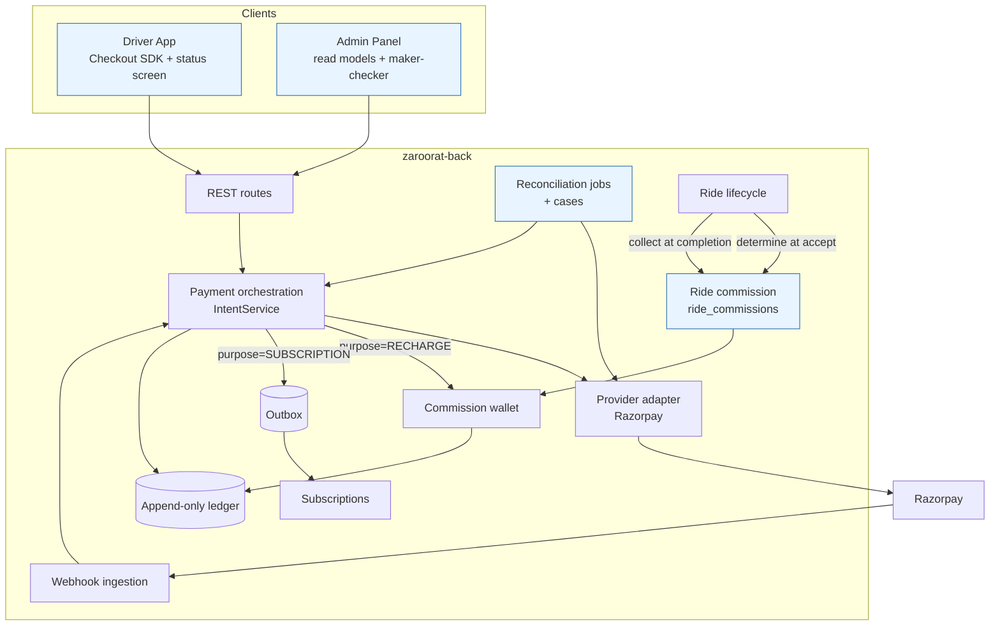

---

## 10. Financial ledger and accounting examples

### 10.1 Does the current model provide reliable financial accounting?

**Partially.** What exists:

- **EXISTING:** each `postGroup` call is balanced (`ledger.repository.ts:18-54`) and amounts are positive (`ledger.service.ts:99-110`).
- **EXISTING:** wallet movements and their ledger legs commit in the same transaction.

What is missing:

- **GAP:** nothing stops an `UPDATE`/`DELETE` on `payment_ledger_entries` or on wallet transaction rows.
- **GAP:** there is no posting idempotency key. A second, separate call for the same business event would post a second group. Today this is prevented only by the callers' own locks and claims.
- **GAP:** the account catalogue mixes liabilities, revenue and placeholder accounts. `PLATFORM_FEE` is posted but not declared (`payment.constants.ts:30-64`). Clearing accounts are never settled (G-26).
- **GAP:** the tax and fee legs (G-07) put a receivable on the books that has no collection path.

### 10.2 Record types and how they differ

| Record                                                 | What it represents                                                                    | Today                                                                                                                  | Mutable?                                                       |
| ------------------------------------------------------ | ------------------------------------------------------------------------------------- | ---------------------------------------------------------------------------------------------------------------------- | -------------------------------------------------------------- |
| Payment record (`payment_intents`)                     | Our request to collect a specific amount for a specific purpose from a specific payer | EXISTING                                                                                                               | Status only, via the state machine                             |
| Provider payment attempt (proposed `payment_attempts`) | One provider payment (`pay_…`) against our order: method, amount, status, fees        | Folded into `payment_transactions` rows, one per _our_ transition, with `gateway_txn_id` sometimes the order id (G-03) | Status, from provider facts only                               |
| Wallet balance (`driver_commission_wallets.balance`)   | A **projection**: the current sum of the wallet's transactions                        | EXISTING                                                                                                               | Yes, a projection updated in the same transaction as a txn row |
| Wallet transaction history                             | The driver-visible, per-wallet movement list (`balance_after`)                        | EXISTING                                                                                                               | **Should be append-only**                                      |
| Commission receivable (proposed)                       | Commission owed by a driver but not yet collected                                     | Does not exist; shortfall is forgiven (BD-1)                                                                           | Settled by later entries only                                  |
| Ledger entries                                         | The double-entry journal across all accounts, which the books are built from          | EXISTING                                                                                                               | **Must be append-only**                                        |
| Reconciliation records                                 | Evidence that two independent sources agree (or not) at a point in time               | EXISTING for some wallets (`wallet_reconciliations`)                                                                   | Append-only                                                    |

### 10.3 Is an immutable double-entry ledger appropriate? — **Yes, keep and harden the existing one (ADR-02)**

Zaroorat holds real stored value (prepaid commission credit is a liability to drivers) and recognises revenue from two streams. It also has a provider clearing balance to settle. That needs a journal. One already exists, so the recommendation is to **make it immutable and complete**, not to replace it:

- add an append-only trigger;
- add a `posting_key` UNIQUE so each business event posts exactly once;
- declare the account catalogue;
- add the missing clearing/settlement legs;
- add opening balances (§20).

### 10.4 Proposed chart of accounts (examples — **PROPOSED, finance approval required**)

These names illustrate the treatment. They are **not** established facts about Zaroorat's books. Which accounts are liabilities, deferred revenue or tax payables is for the finance team and auditors to confirm.

| Account (proposed)                         | Type               | Meaning                                                                                   | Existing equivalent                             |
| ------------------------------------------ | ------------------ | ----------------------------------------------------------------------------------------- | ----------------------------------------------- |
| `PSP_CLEARING:razorpay`                    | Asset              | Money captured by Razorpay, not yet settled to our bank                                   | `GATEWAY_CLEARING`                              |
| `BANK:operating`                           | Asset              | Money settled into the platform's bank account                                            | `BANK_CLEARING` (used for payouts)              |
| `PSP_FEES`                                 | Expense            | Provider MDR/fees and GST on fees                                                         | none (G-26)                                     |
| `DRIVER_COMMISSION_CREDIT`                 | **Liability**      | Unused prepaid commission credit owed back to drivers (refundable per policy)             | `DRIVER_COMMISSION_WALLET`                      |
| `DRIVER_COMMISSION_RECEIVABLE`             | Asset              | Commission determined but not collected (only if ADR-04 B/C)                              | none                                            |
| `COMMISSION_REVENUE`                       | Revenue            | Commission earned on completed rides                                                      | `PLATFORM_COMMISSION`                           |
| `SUBSCRIPTION_DEFERRED`                    | Liability          | Subscription fee paid for a period not yet served (only if finance chooses deferral)      | none                                            |
| `SUBSCRIPTION_REVENUE`                     | Revenue            | Subscription fee earned                                                                   | `SUBSCRIPTION_REVENUE` (recognised immediately) |
| `OUTPUT_GST_PAYABLE`                       | Liability          | GST on Zaroorat's own supplies (commission/subscription), **if** prices are GST-inclusive | none (ADR-16)                                   |
| `REFUND_IN_TRANSIT`                        | Liability (contra) | Refund reserved, provider not yet confirmed                                               | `REFUND_IN_TRANSIT`                             |
| `PROMO_SUBSIDY_EXPENSE`                    | Expense            | Platform-funded promotion given to drivers (ADR-19)                                       | none                                            |
| `ADJUSTMENT_EXPENSE` / `ADJUSTMENT_INCOME` | P&L                | Approved goodwill credits / approved debits                                               | none                                            |
| `SUSPENSE:unmatched_psp`                   | Liability          | Provider money we cannot match to an intent                                               | none                                            |

### 10.5 Journal examples (illustrative amounts; **PROPOSED** accounts)

**1. Successful commission-wallet recharge of ₹500** (one posting group, `posting_key = intent:{id}:captured`, committed with the wallet credit):

| Account                               |  Debit | Credit |
| ------------------------------------- | -----: | -----: |
| `PSP_CLEARING:razorpay`               | 500.00 |        |
| `DRIVER_COMMISSION_CREDIT` (driver D) |        | 500.00 |

When Razorpay settles (T+n, net of a ₹11.80 fee incl. GST — illustrative), `posting_key = psp_settlement:{settlement_id}:{payment_id}`:

| Account                 |  Debit | Credit |
| ----------------------- | -----: | -----: |
| `BANK:operating`        | 488.20 |        |
| `PSP_FEES`              |  11.80 |        |
| `PSP_CLEARING:razorpay` |        | 500.00 |

The recharge is **not revenue**. It is a liability until commission is earned.

**2. Commission deduction of ₹60 on ride R** (`posting_key = ride:{R}:commission_collected`, committed with ride completion):

| Account                        | Debit | Credit |
| ------------------------------ | ----: | -----: |
| `DRIVER_COMMISSION_CREDIT` (D) | 60.00 |        |
| `COMMISSION_REVENUE`           |       |  60.00 |

If GST-inclusive commission is decided (ADR-16), credit `COMMISSION_REVENUE` 50.85 and `OUTPUT_GST_PAYABLE` 9.15 instead (18% inclusive, illustrative only).

**3. Failed recharge** — **no posting at all.** The intent goes `PENDING → FAILED` and a `payment_attempts` row records the provider's failure. Money never reached us, so nothing enters the books. Posting a reversal for something never posted would double-count.

**4. Commission reversal of ₹60 on ride R after an approved correction** (`posting_key = ride:{R}:commission_reversed:{approval_id}`):

| Account                        | Debit | Credit |
| ------------------------------ | ----: | -----: |
| `COMMISSION_REVENUE`           | 60.00 |        |
| `DRIVER_COMMISSION_CREDIT` (D) |       |  60.00 |

The wallet receives a `RIDE_COMMISSION_REVERSAL +60.00` transaction referencing the original deduction. The original row and ledger group stay untouched.

**5. Administrator-approved goodwill adjustment of ₹100** (`posting_key = adjustment:{wallet_adjustment_id}`, only after `approved_by ≠ requested_by`):

| Account                        |  Debit | Credit |
| ------------------------------ | -----: | -----: |
| `ADJUSTMENT_EXPENSE`           | 100.00 |        |
| `DRIVER_COMMISSION_CREDIT` (D) |        | 100.00 |

An approved **debit** adjustment is the mirror image (`DRIVER_COMMISSION_CREDIT` DR / `ADJUSTMENT_INCOME` CR). It is never allowed to breach the balance floor (ADR-05).

**6. Subscription payment of ₹599 (weekly), if deferral is chosen:**

| When                               | Account                 |  Debit | Credit |
| ---------------------------------- | ----------------------- | -----: | -----: |
| Captured                           | `PSP_CLEARING:razorpay` | 599.00 |        |
|                                    | `SUBSCRIPTION_DEFERRED` |        | 599.00 |
| Each day served (or at period end) | `SUBSCRIPTION_DEFERRED` |  85.57 |        |
|                                    | `SUBSCRIPTION_REVENUE`  |        |  85.57 |

Today the code credits `SUBSCRIPTION_REVENUE` 599.00 immediately (`intent.service.ts:234-255`). Either treatment can be valid. **Finance decides (ADR-16).**

**7. Commission shortfall (only if ADR-04 option B)** — ride R commission ₹60, wallet holds ₹20:

| Account                            | Debit | Credit |
| ---------------------------------- | ----: | -----: |
| `DRIVER_COMMISSION_CREDIT` (D)     | 20.00 |        |
| `DRIVER_COMMISSION_RECEIVABLE` (D) | 40.00 |        |
| `COMMISSION_REVENUE`               |       |  60.00 |

On the next recharge of ₹500, the receivable is settled first: `DRIVER_COMMISSION_CREDIT` DR 40 / `DRIVER_COMMISSION_RECEIVABLE` CR 40.

### 10.6 Balances: derived, verified, corrected

- **Stored balance is a projection (ADR-03).** `driver_commission_wallets.balance` is updated in the same transaction as the wallet transaction row and the ledger group. Reads stay O(1) on the accept hot path.
- **Verification (PROPOSED, hourly, full keyset scan):** for every wallet, `balance = SUM(wallet_txn.amount)`. For wallets created after the ledger cutover, also `balance = ledger_position(DRIVER_COMMISSION_CREDIT, driverId)`. Mismatches open a `reconciliation_case`. They are **never auto-corrected**.
- **Corrections never rewrite history.** A wrong entry is fixed by a new, approved compensating entry that references the original. The append-only trigger makes this the only possibility. The existing `PAYMENT_LEDGER_CUTOVER_AT` pattern (`payment.config.ts:124-137`, `reconciliation.job.ts:160-177`) already handles pre-cutover history by reporting it, not rewriting it.
- **No double counting:**
  - every business event has one `posting_key` (UNIQUE);
  - failed payments post nothing;
  - provider settlement posts clear `PSP_CLEARING` and never touch revenue;
  - for model rides, commission lives only in the commission wallet path and is never also posted through `recordTripPayment` (this exclusion already exists, `ledger.service.ts:130-145`).

### 10.7 Matters requiring finance or legal approval

1. Whether prepaid commission credit is refundable on demand, on exit only, or never. This determines its liability classification and PPI analysis (§16.3).
2. Subscription revenue recognition: immediate or deferred.
3. Whether commission and subscription prices are GST-inclusive, and whether Zaroorat issues tax invoices to drivers for them (the admin invoice templates already include `subscription_invoice`, `admin/src/modules/pricing-management/invoices/pages/InvoiceGenerationPage.tsx:21`).
4. Whether the per-ride `TAX_PAYABLE` and `PLATFORM_FEE` legs reflect a real obligation (G-07).
5. Treatment of historical negative settlement balances (§20).

---

## 11. Payment and commission state machines

Conventions:

- **Authoritative source** = who may cause the transition.
- **DB changes** = rows written in the same transaction.
- **App** = what the Driver App shows.

### 11.1 Payment order (`payment_intents`) — PROPOSED revision of `intent.service.ts:25-34`

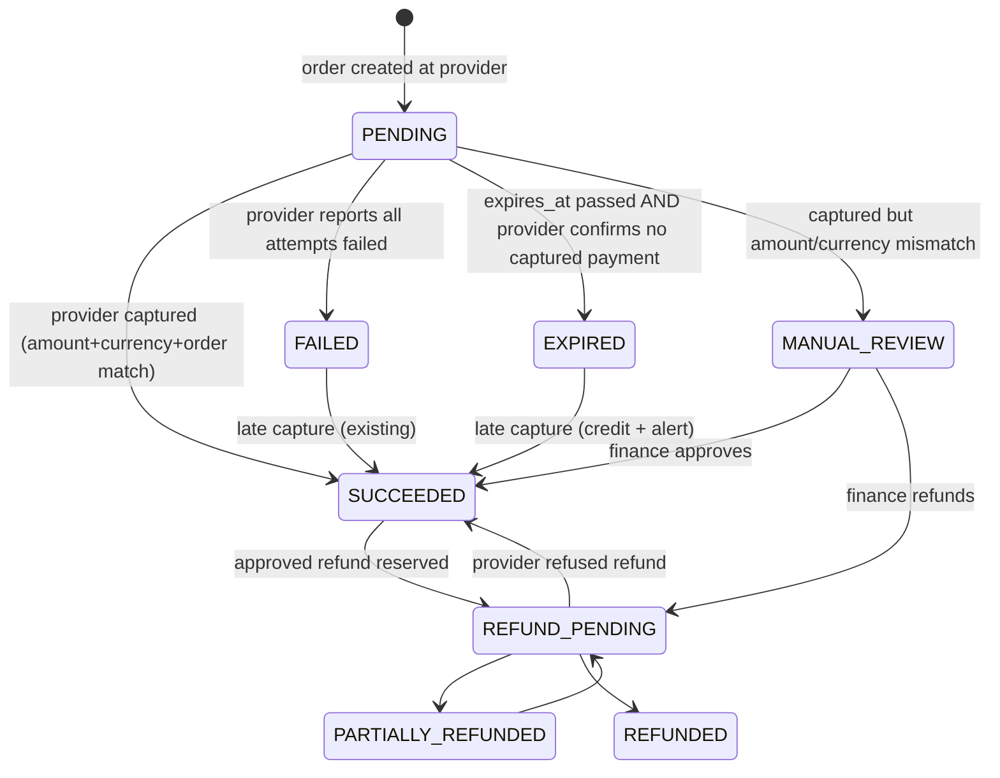

| State                         | Meaning                                             | Allowed next                              | Trigger           | Authoritative source                                               | Retry                                      | Timeout                                        | Reversible                       | DB changes                                                            | App                                                                                                                                  |
| ----------------------------- | --------------------------------------------------- | ----------------------------------------- | ----------------- | ------------------------------------------------------------------ | ------------------------------------------ | ---------------------------------------------- | -------------------------------- | --------------------------------------------------------------------- | ------------------------------------------------------------------------------------------------------------------------------------ |
| PENDING                       | Order exists at provider; no captured payment known | SUCCEEDED, FAILED, EXPIRED, MANUAL_REVIEW | Intent creation   | Backend after provider `POST /orders`                              | Client re-opens checkout on the same order | `expires_at` (proposed 30 min, ADR-08)         | n/a                              | intent row + outbox                                                   | "Waiting for payment" / "Verifying"                                                                                                  |
| SUCCEEDED                     | Provider captured the expected amount               | REFUND_PENDING                            | Webhook or poll   | Provider fact, verified server-side                                | Idempotent no-op on repeats                | —                                              | Only via refund                  | attempt row, ledger group, purpose effect (credit / activation event) | "Payment successful" (after the effect commits)                                                                                      |
| FAILED                        | Every attempt failed (provider said so)             | SUCCEEDED                                 | Webhook / poll    | Provider fact                                                      | Driver starts a **new** payment            | —                                              | Late capture → SUCCEEDED         | attempt row only                                                      | "Payment failed — no money taken" (wording must say _if money was deducted it will be refunded by your bank_, per provider practice) |
| EXPIRED (new)                 | Abandoned; provider confirms nothing captured       | SUCCEEDED                                 | Reconciliation    | Provider fact (`GET /orders/{id}/payments` empty or none captured) | New payment                                | —                                              | Late capture → SUCCEEDED + alert | status only                                                           | "Payment not completed"                                                                                                              |
| MANUAL_REVIEW (new)           | Money captured but does not match                   | SUCCEEDED, REFUND_PENDING                 | Mismatch detected | Finance                                                            | —                                          | SLA alert 24 h                                 | Yes                              | attempt row, `SUSPENSE` posting, case                                 | "We're checking your payment" + support id                                                                                           |
| REFUND_PENDING                | Refund reserved, provider asked                     | REFUNDED, PARTIALLY_REFUNDED, SUCCEEDED   | Approved refund   | Finance + provider                                                 | Reconciliation (existing)                  | Stays until provider answers (never auto-fail) | —                                | refund row, reservation group                                         | "Refund in progress"                                                                                                                 |
| REFUNDED / PARTIALLY_REFUNDED | Provider confirmed                                  | (partial → REFUND_PENDING)                | Provider          | Provider                                                           | —                                          | —                                              | No                               | refund settle group                                                   | "Refunded ₹x on date"                                                                                                                |

`CREATED`, `PROCESSING` and `CANCELLED` are kept for historical rows only. **DECISION:** keep or migrate them (§20).

### 11.2 Provider payment attempt (`payment_attempts`, PROPOSED)

Mirrors Razorpay payment status: `created → authorized → captured → refunded`, or `→ failed`. One row per provider `payment_id`, UNIQUE `(gateway, provider_payment_id)`. It stores `order_id`, `amount_paise`, `currency`, `method`, `fee`, `tax`, `error_code`, `captured_at`. **Only `captured` with matching order/amount/currency can move the intent to SUCCEEDED.** An `authorized` attempt is left for provider auto-capture (dashboard setting, [S-P4]). It is never treated as success.

### 11.3 Driver subscription — PROPOSED revision

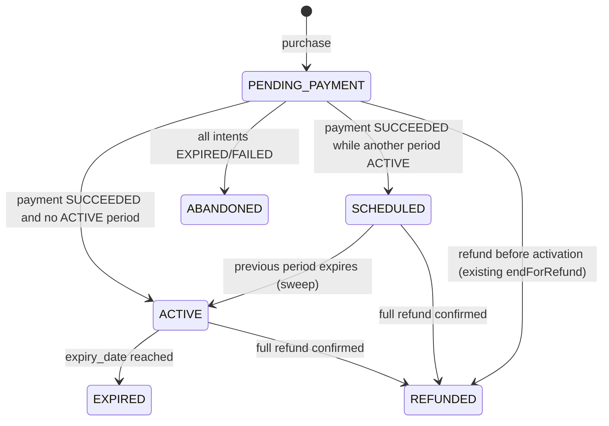

| State                             | Meaning                                                                                  | Trigger / source                  | Ride eligibility                                     | DB changes                                                                               | App                              |
| --------------------------------- | ---------------------------------------------------------------------------------------- | --------------------------------- | ---------------------------------------------------- | ---------------------------------------------------------------------------------------- | -------------------------------- |
| PENDING_PAYMENT                   | Purchase started; ≤1 per driver (existing unique)                                        | Driver request                    | None (existing rule)                                 | subscription row + intent(s) linked by `subscription_id`                                 | "Complete payment" / "Verifying" |
| SCHEDULED (new)                   | Paid next period queued behind the active one                                            | Payment confirmed while ACTIVE    | Not by itself                                        | `start_date` = previous `expiry_date`                                                    | "Next plan starts {date}"        |
| ACTIVE                            | Paid period in force; ≤1 per driver (existing unique)                                    | Confirmed payment / sweep         | **Eligible** if `expiry_date > now`                  | `start_date`, `expiry_date`, `payment_status=PAID`, `drivers.payment_model=SUBSCRIPTION` | "Active until {date}"            |
| EXPIRED                           | Period ended                                                                             | Sweep (5 min) + accept-time check | Not eligible                                         | status; apply staged model switch                                                        | "Expired — renew"                |
| ABANDONED (new)                   | No successful payment                                                                    | Reconciliation                    | n/a                                                  | status                                                                                   | "Payment not completed"          |
| REFUNDED                          | Entitlement ended by refund                                                              | Refund confirmed                  | Not eligible (already-accepted rides continue, BD-2) | status                                                                                   | "Refunded"                       |
| CANCELLED (existing enum, unused) | Proposed meaning: driver cancelled a SCHEDULED (unpaid → never) or turned off auto-renew | Driver                            | —                                                    | `cancel_requested`                                                                       | —                                |

Retry: activation is idempotent (conditional claim). Timeout: PENDING_PAYMENT older than `expires_at` + grace → ABANDONED once **all** linked intents are terminal.

### 11.4 Commission-wallet recharge

A recharge **is** a `payment_intents` row with `purpose=DRIVER_COMMISSION_RECHARGE` (no separate table; ADR-02). Its state is the intent state (11.1). Wallet effects:

| Intent transition                    | Wallet effect (same tx)                      | Ledger      | Unique backstop (PROPOSED)                               |
| ------------------------------------ | -------------------------------------------- | ----------- | -------------------------------------------------------- |
| → SUCCEEDED                          | `MANUAL_RECHARGE +amount`                    | Example 1   | `UNIQUE (reference_id) WHERE txn_type='MANUAL_RECHARGE'` |
| → FAILED / EXPIRED                   | none                                         | none        | —                                                        |
| SUCCEEDED → REFUND_PENDING           | `REFUND −amount` (≤ unused credit, existing) | reservation | existing refund idempotency key                          |
| REFUND_PENDING → SUCCEEDED (refused) | `REFUND_REVERSAL +amount` (existing)         | undo        | —                                                        |

### 11.5 Commission obligation and collection (`ride_commissions`, PROPOSED)

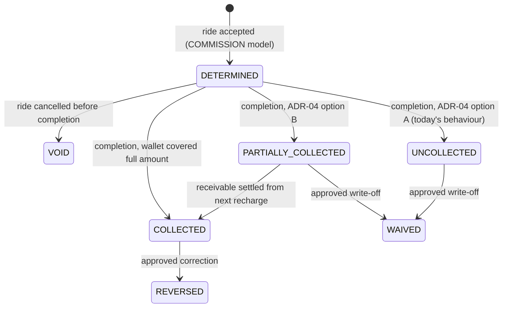

| State               | Meaning                                                                                                | Source            | Retry                       | Reversible            | DB changes                                | App                                                |
| ------------------- | ------------------------------------------------------------------------------------------------------ | ----------------- | --------------------------- | --------------------- | ----------------------------------------- | -------------------------------------------------- |
| DETERMINED          | Amount fixed at accept, with basis (`quoted_fare`, `surge`, `rate_pct`, `pricing_rule_id`, `rounding`) | Backend at accept | —                           | VOID on cancel        | `ride_commissions` row (UNIQUE `ride_id`) | Incoming-ride dialog: "Commission ₹x"              |
| COLLECTED           | Fully deducted                                                                                         | Completion tx     | Idempotent (existing index) | REVERSED via approval | wallet txn + ledger                       | Ride summary: "₹x deducted"                        |
| PARTIALLY_COLLECTED | Part deducted, rest receivable (option B)                                                              | Completion tx     | Next recharge settles first | WAIVED                | wallet txn + receivable                   | "₹y pending — recharge"                            |
| UNCOLLECTED         | Nothing deducted (option A)                                                                            | Completion tx     | None (today)                | WAIVED                | outbox `COLLECTION_FAILED`                | Must show "₹x could not be collected" (not silent) |
| REVERSED            | Approved correction returned it                                                                        | Finance           | Idempotent `posting_key`    | No                    | reversal txn + ledger                     | "₹x commission returned"                           |
| VOID                | Ride never completed                                                                                   | Cancellation      | —                           | No                    | status                                    | nothing                                            |

### 11.6 Refund / reversal

Existing (keep):

- `PENDING → PROCESSING → SUCCEEDED | FAILED` (`refund.service.ts:54-70`);
- unknown outcomes stay PROCESSING;
- reconciliation every 5 min.

PROPOSED additions:

- amount immutable once PROCESSING (G-21);
- maker-checker above a threshold;
- send `X-Refund-Idempotency` = refund id (G-29);
- the commission reversal (11.5) is a **separate** flow with no provider involved.

---

## 12. Sequence diagrams

Notes in each diagram mark **[EXISTING]** and **[PROPOSED]** steps.

### 12.1 Driver purchases a subscription

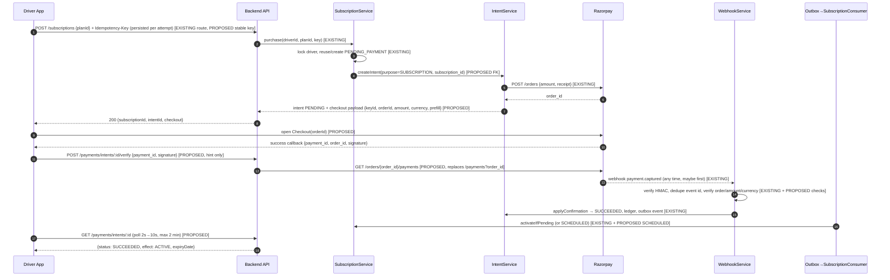

### 12.2 Driver recharges the commission wallet

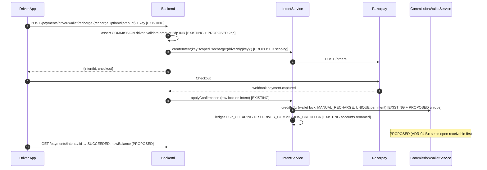

### 12.3 Ride completes and commission is accounted for

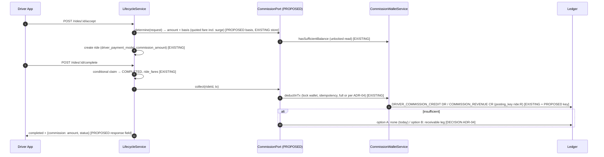

### 12.4 Provider sends duplicate webhooks

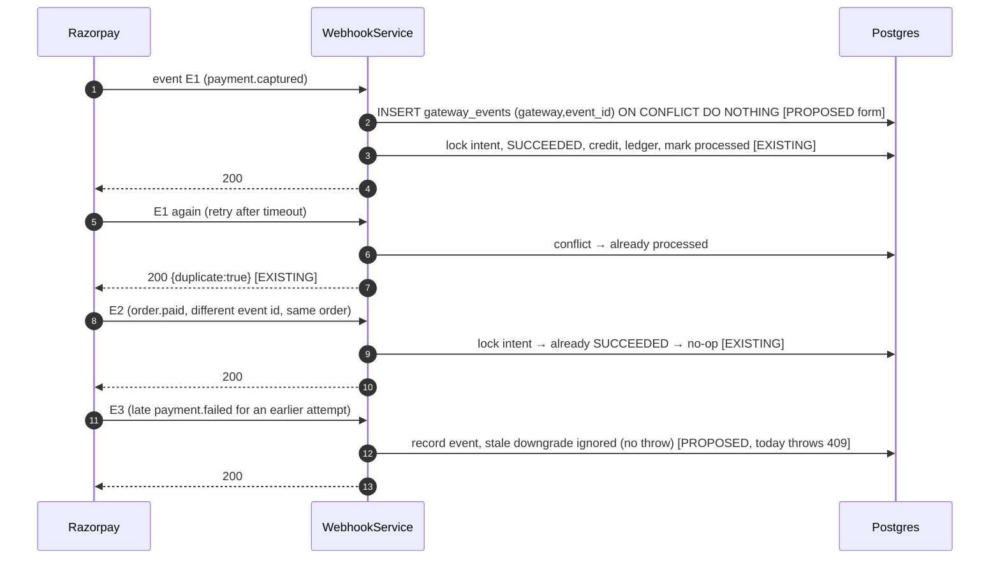

### 12.5 Provider success, backend temporarily fails

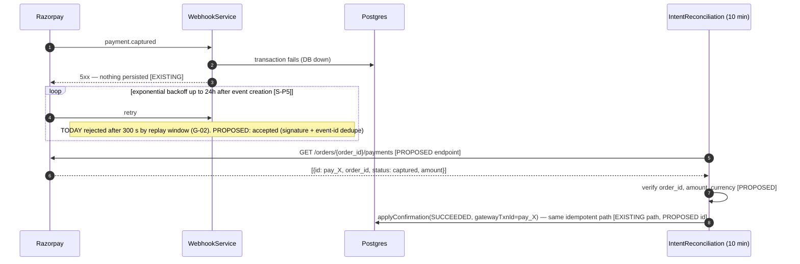

### 12.6 Payment pending / client loses connectivity

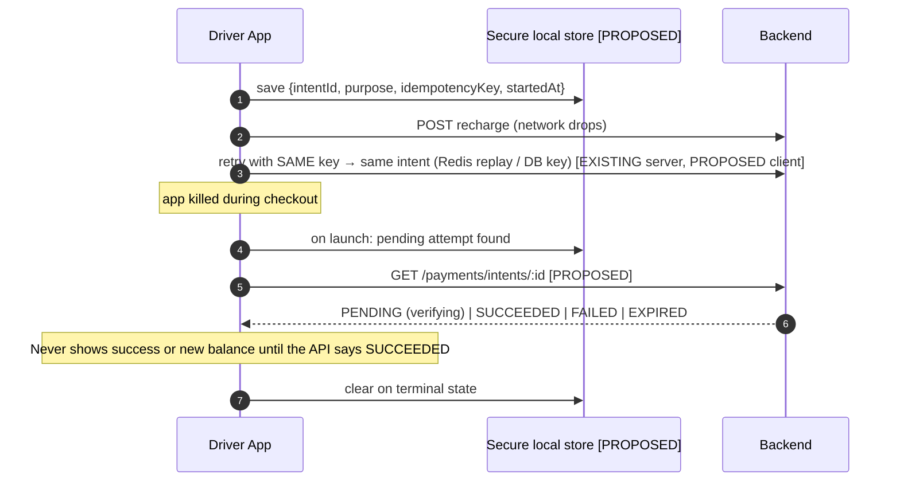

### 12.7 Approved refund or commission reversal

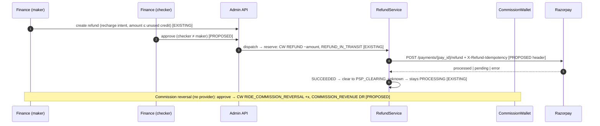

### 12.8 Administrator reviews and resolves a disputed payment

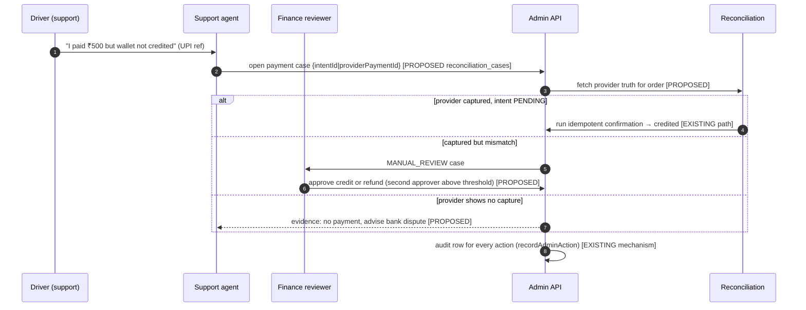

---

## 13. Driver App payment UX specification

This section specifies behaviour, not visual design. Layout and styling stay with the existing design system.

### 13.1 Audit of existing screens

| Screen (route)                           | File                                                                       | Today                                                                                                                                | Verdict                                                                                                        |
| ---------------------------------------- | -------------------------------------------------------------------------- | ------------------------------------------------------------------------------------------------------------------------------------ | -------------------------------------------------------------------------------------------------------------- |
| Account → Wallet (`/account/wallet`)     | `driver/src/features/billing/WalletScreen.tsx`                             | Real commission-wallet balance and transactions; falls back to earnings wallet; hardcoded 7% and "₹250" copy; REFUND shown as credit | **Retain, modify**: backend-driven rate and rules, no fallback, correct signs, pagination                      |
| Add Money (`/account/add-money`)         | `AddMoneyScreen.tsx`                                                       | Amount input, plan-priced chips, method rows that each trigger payment; no checkout                                                  | **Retain, modify**: chips from recharge options only; one Pay button; Checkout SDK; status screen              |
| Plan & Billing (`/account/plan-billing`) | `PlanBillingScreen.tsx`                                                    | Model cards, plan cycles (hardcoded fallback prices), subscribe/cancel, fee example with fixed numbers                               | **Retain, modify**: confirm dialogs, backend prices only, checkout, "next period" purchase, honest cancel copy |
| Account summary                          | `driver/src/features/account/AccountScreen.tsx:138-215`                    | Wallet balance subtitle; "{7}% commission per ride"                                                                                  | **Modify**: rate from backend                                                                                  |
| Earnings                                 | `driver/src/features/earnings/EarningsScreen.tsx`; strings `en.ts:272-291` | Settlement-era copy ("netted from wallet bonuses"); "Commission (7%)"                                                                | **Modify**: copy reflects direct pay; commission from `ride_commissions`                                       |
| Incoming ride dialog / accept errors     | `driver/src/features/trip/IncomingRideDialog.tsx`                          | No handling for `INSUFFICIENT_COMMISSION_BALANCE`, `DRIVER_SUBSCRIPTION_REQUIRED`, `PAYMENT_MODEL_NOT_SELECTED`                      | **Modify**                                                                                                     |
| Payment status                           | —                                                                          | none                                                                                                                                 | **Add** `/account/payment/[intentId]`                                                                          |
| Subscription history                     | —                                                                          | API exists (`GET /subscriptions/invoices`), no screen                                                                                | **Add**                                                                                                        |
| Home eligibility banner                  | `driver/src/features/home/HomeScreen.tsx`                                  | none                                                                                                                                 | **Add** (from eligibility endpoint)                                                                            |

### 13.2 Rules that apply to every payment screen (PROPOSED)

1. **Never fabricate.** No success state, balance, rate, price or rule is displayed unless it came from the backend in this session or from a cache labelled with its timestamp. Remove every hardcoded financial constant (`constants/plans.ts`).
2. **Money-moving actions are safe to repeat by construction.** One persisted attempt record `{attemptId, purpose, idempotencyKey, intentId?, startedAt}` per user action, kept in secure storage and reused on retry and after relaunch (G-30).
3. **Loading:** skeletons for reads. For actions, a disabled primary button with a spinner, and no second submission while in flight.
4. **Offline:** reads show the cached value with "Last updated {time}". Money actions are disabled with "You're offline". A pending attempt resumes when online.
5. **Accessibility:** every amount has an `accessibilityLabel` in words ("five hundred rupees"). Status is conveyed by text plus icon, not colour alone. Touch targets are at least 48 dp. Screen-reader announcements on status changes. Respect font scaling. Strings are localised (en/hi/ur exist).
6. **Errors:** map backend `code` to copy. Show `requestId` / support reference on payment errors.

### 13.3 Subscription states

| State                    | Entry condition                                        | Backend data / API                                                                 | Loading                       | Success                                  | Failure                                                            | Retry (safe?)                                            | Empty                                               | Offline               | A11y                                          | Navigation                         |
| ------------------------ | ------------------------------------------------------ | ---------------------------------------------------------------------------------- | ----------------------------- | ---------------------------------------- | ------------------------------------------------------------------ | -------------------------------------------------------- | --------------------------------------------------- | --------------------- | --------------------------------------------- | ---------------------------------- |
| No active subscription   | `GET /subscriptions` → `current=null`                  | plans from `GET /subscriptions/plans`                                              | skeleton cards                | —                                        | inline error + retry                                               | read: yes                                                | "No plans available right now" (no fallback prices) | cached plans + banner | plan cards as radio group                     | → Plan details                     |
| Available plans          | plans non-empty                                        | `{id, name, billingPeriod, durationLabel, price, currency, taxInclusive}`          | skeleton                      | —                                        | as above                                                           | yes                                                      | —                                                   | cached                | price read in words                           | select → details                   |
| Plan details & price     | plan selected                                          | same + eligibility effect ("You can take rides until {date}")                      | —                             | —                                        | —                                                                  | —                                                        | —                                                   | —                     | —                                             | Pay → initiation                   |
| Payment initiation       | tap Pay (confirm dialog)                               | `POST /subscriptions {planId}` + persisted key → `{intentId, checkout}`            | button spinner                | open Checkout                            | `PLAN_NOT_FOUND`, `SUBSCRIPTION_ALREADY_ACTIVE` copy               | **yes, same key**                                        | —                                                   | disabled              | dialog focus trapped                          | → Checkout                         |
| Payment pending          | Checkout dismissed / no callback                       | `GET /payments/intents/:id` = PENDING                                              | —                             | —                                        | —                                                                  | "Resume payment" re-opens Checkout on the **same order** | —                                                   | resumes on reconnect  | announce "Payment pending"                    | stays on status screen             |
| Verification in progress | Checkout success callback                              | `POST /payments/intents/:id/verify`, then poll `GET` (2 s→10 s backoff, 2 min max) | progress + "Do not pay again" | → success                                | → pending (after 2 min: "We'll notify you")                        | polling: yes                                             | —                                                   | resume poll           | live region                                   | back disabled while polling < 10 s |
| Payment success          | intent SUCCEEDED **and** subscription ACTIVE/SCHEDULED | `{status, subscription:{status, startDate, expiryDate}}`                           | —                             | "Active until {date}" or "Starts {date}" | —                                                                  | —                                                        | —                                                   | —                     | announce                                      | → Plan & Billing                   |
| Payment failure          | intent FAILED/EXPIRED                                  | `{status, reason}`                                                                 | —                             | —                                        | "Payment failed. If money left your account, your bank returns it" | "Try again" = **new** attempt (new key)                  | —                                                   | —                     | —                                             | —                                  |
| Active subscription      | ACTIVE                                                 | `{expiryDate, scheduledNext?}`                                                     | —                             | —                                        | —                                                                  | —                                                        | —                                                   | cached + timestamp    | —                                             | "Buy next period" / History        |
| Expired                  | latest EXPIRED, none ACTIVE                            | eligibility `SUBSCRIPTION_EXPIRED`                                                 | —                             | —                                        | —                                                                  | —                                                        | —                                                   | —                     | —                                             | Renew → plans                      |
| History                  | tap History                                            | `GET /subscriptions/invoices?cursor`                                               | list skeleton                 | —                                        | retry                                                              | yes                                                      | "No payments yet"                                   | cached                | rows read as "Weekly plan, ₹599, paid 12 Oct" | → receipt                          |
| Retry & recovery         | app launch with pending attempt                        | `GET /payments/intents/:id`                                                        | —                             | per result                               | —                                                                  | yes                                                      | —                                                   | on reconnect          | —                                             | deep-link to status                |

### 13.4 Commission wallet states

| State                     | Entry                                                                      | Backend data / API                                                                                                                    | Loading       | Success                                    | Failure                                                      | Retry (safe?)     | Empty                                    | Offline            | A11y                               | Navigation            |
| ------------------------- | -------------------------------------------------------------------------- | ------------------------------------------------------------------------------------------------------------------------------------- | ------------- | ------------------------------------------ | ------------------------------------------------------------ | ----------------- | ---------------------------------------- | ------------------ | ---------------------------------- | --------------------- |
| Current balance           | open Wallet                                                                | `GET /drivers/me/commission-wallet` → `{balance, minimumForNextRide?, receivable?, rate:{pct, basis}}`                                | skeleton      | —                                          | error + retry (**no earnings-wallet fallback**)              | yes               | ₹0.00 + "Recharge to start taking rides" | cached + timestamp | balance in words                   | Recharge              |
| Recharge amount           | tap Recharge                                                               | `GET /payments/driver-wallet/recharge-options`                                                                                        | chip skeleton | —                                          | —                                                            | yes               | custom amount only                       | disabled           | chips as buttons                   | —                     |
| Custom amount             | type amount                                                                | min/max from options response `{min, max}`                                                                                            | —             | —                                          | inline "Enter ₹50–₹50,000" (from backend)                    | —                 | —                                        | —                  | error announced                    | —                     |
| Payment initiation        | tap Pay                                                                    | `POST /payments/driver-wallet/recharge` + persisted key → `{intentId, checkout}`                                                      | spinner       | Checkout                                   | `COMMISSION_RECHARGE_NOT_ALLOWED`, `INVALID_RECHARGE_AMOUNT` | **yes, same key** | —                                        | disabled           | —                                  | Checkout              |
| Pending recharge          | as 13.3                                                                    | intent PENDING                                                                                                                        | —             | —                                          | —                                                            | resume same order | —                                        | —                  | —                                  | status screen         |
| Successful recharge       | intent SUCCEEDED                                                           | `{status, wallet:{balance}}`                                                                                                          | —             | "₹500 added. Balance ₹620" (server values) | —                                                            | —                 | —                                        | —                  | announce                           | Wallet                |
| Failed recharge           | FAILED/EXPIRED                                                             | —                                                                                                                                     | —             | —                                          | as 13.3                                                      | new attempt       | —                                        | —                  | —                                  | —                     |
| Transaction history       | Wallet list                                                                | `GET /drivers/me/commission-wallet/transactions?cursor&limit` → `{type, amount(signed), balanceAfter, rideId?, intentId?, createdAt}` | skeleton      | —                                          | retry                                                        | yes               | "No activity yet"                        | cached             | sign spoken ("minus sixty rupees") | row → ride or payment |
| Commission deductions     | row type RIDE_COMMISSION                                                   | ride link                                                                                                                             | —             | —                                          | —                                                            | —                 | —                                        | —                  | —                                  | → ride summary        |
| Insufficient balance      | eligibility `INSUFFICIENT_COMMISSION_BALANCE` or accept error              | `{required, balance}`                                                                                                                 | —             | —                                          | banner on Home: "Add ₹x to accept rides"                     | —                 | —                                        | —                  | —                                  | → Recharge prefilled  |
| Reconciliation / reversal | rows `RIDE_COMMISSION_REVERSAL`, `ADMIN_CREDIT/DEBIT`, `REFUND(_REVERSAL)` | `{reason, reference}`                                                                                                                 | —             | —                                          | —                                                            | —                 | —                                        | —                  | —                                  | → detail              |
| Support & dispute         | row → "Report a problem"                                                   | `POST /support/payment-cases {intentId\|txnId}` (PROPOSED)                                                                            | spinner       | case id shown                              | —                                                            | yes (key)         | —                                        | queued             | —                                  | → support             |

### 13.5 Ride commission states

| State                 | Entry                                                                                | Data                                                        | Shown where                 | Copy (example)                                                     |
| --------------------- | ------------------------------------------------------------------------------------ | ----------------------------------------------------------- | --------------------------- | ------------------------------------------------------------------ |
| Commission calculated | Incoming offer (COMMISSION model)                                                    | `offer.commission:{amount, pct, basis}` (PROPOSED field)    | Incoming-ride dialog        | "Commission ₹60 (20%) from wallet"                                 |
| Commission recorded   | Ride accepted                                                                        | `ride_commissions.status=DETERMINED`                        | Trip screen info            | "₹60 will be deducted when the trip ends"                          |
| Commission deducted   | COLLECTED                                                                            | wallet txn                                                  | Ride summary + Wallet       | "₹60 commission deducted. Balance ₹560"                            |
| Insufficient balance  | Accept refused                                                                       | error `INSUFFICIENT_COMMISSION_BALANCE {required, balance}` | Dialog                      | "Add ₹40 to accept this ride" → Recharge                           |
| Pending collection    | PARTIALLY_COLLECTED / UNCOLLECTED (ADR-04)                                           | `{collected, outstanding}`                                  | Ride summary, Wallet banner | "₹40 commission pending — settled from your next recharge"         |
| Failed processing     | completion succeeded but commission state unknown (should not happen; transactional) | —                                                           | —                           | "Trip completed. Commission is being processed" (no amount claims) |
| Corrected / reversed  | REVERSED                                                                             | reversal txn                                                | Wallet row + ride summary   | "₹60 commission returned (fare corrected)"                         |

---

## 14. API contract specification

### 14.1 Existing endpoints (verified routes)

| Method & route                                                              | Auth                                                       | Idempotency                                            | Notes                                                       |
| --------------------------------------------------------------------------- | ---------------------------------------------------------- | ------------------------------------------------------ | ----------------------------------------------------------- |
| `GET /api/v1/subscriptions/plans`                                           | Authenticated                                              | —                                                      | active plans, price asc (`subscription-plan.repository.ts`) |
| `POST /api/v1/subscriptions/plans`                                          | `finance:execute`                                          | optional key                                           | create-only, audited                                        |
| `POST /api/v1/subscriptions`                                                | driver (`actingDriverId`), rate-limited                    | **required** `Idempotency-Key` (Redis) + scoped DB key | returns `{subscriptionId, status, intentId}`                |
| `GET /api/v1/subscriptions`                                                 | driver                                                     | —                                                      | current ACTIVE only                                         |
| `POST /api/v1/subscriptions/cancel`                                         | driver                                                     | —                                                      | sets `cancel_requested` (no effect today, G-11)             |
| `GET /api/v1/subscriptions/invoices`                                        | driver                                                     | —                                                      | last 50, no cursor                                          |
| `GET /api/v1/payments/driver-wallet/recharge-options`                       | Authenticated                                              | —                                                      |                                                             |
| `POST /api/v1/payments/driver-wallet/recharge`                              | COMMISSION driver, rate-limited                            | required key (Redis) + **unscoped** DB key (G-13)      |                                                             |
| `POST /api/v1/payments/intents/:intentId/confirm`                           | owner or staff, rate-limited                               | required key                                           | calls provider                                              |
| `POST /api/v1/payments/refunds`                                             | caller; staff scope decides                                | required                                               | driver money: finance only                                  |
| `POST /api/v1/payments/webhooks/razorpay` / `/stripe`                       | **public**, signature, rate-limited (`rateLimits.webhook`) | event-id dedupe                                        | raw body                                                    |
| `GET /api/v1/drivers/:driverId/commission-wallet` (+`/transactions`)        | `authorizedDriverId`                                       | —                                                      | raw entity; transactions fixed 50, no cursor                |
| `POST/GET /api/v1/drivers/payment-model`                                    | driver                                                     | —                                                      |                                                             |
| `GET/POST /api/v1/admin/finance/*`                                          | `finance:read` / `finance:execute`                         | some                                                   | refunds, settlements, disputes, transactions                |
| `GET/PUT /api/v1/admin/settings/integrations/payment` (+`/test`, `/health`) | `settings:read` / `settings:write`                         | —                                                      | G-27                                                        |

### 14.2 Driver-facing contracts (PROPOSED changes; reuse routes where they exist)

Common to all: JSON envelope `{data}` / `{error:{code,message,details?}, requestId}` (existing). Amounts are decimal strings with 2 dp in responses (e.g. `"500.00"`). Today they are JS numbers; PROPOSED is strings, to avoid float drift. `currency:"INR"`.

**A. `POST /api/v1/payments/driver-wallet/recharge`** (existing, extended)

- **Auth:** driver whose `paymentModel=COMMISSION` or `pendingPaymentModel=COMMISSION` (existing).
- **Request:** `{rechargeOptionId}` xor `{amount: "500.00"}`. Validation: positive, at most 2 dp, between the configured min and max, INR only.
- **Idempotency:** `Idempotency-Key` required. The server scopes it to `recharge:{driverId}:{key}` (G-13). A replay returns the same intent; a different payload with the same key returns `409 DUPLICATE_IDEMPOTENCY_KEY`.
- **Transaction boundary:** the provider order is created **before** the DB transaction (existing). The intent row and outbox event are written in one transaction.
- **Response 200:** `{intentId, status:"PENDING", amount:"500.00", currency, expiresAt, checkout:{provider:"razorpay", keyId:<public key id>, orderId, amountPaise, currency, name, description, prefill:{contact}}}`. The key secret **never** leaves the server.
- **Errors:** `400 IDEMPOTENCY_KEY_REQUIRED`, `403 COMMISSION_RECHARGE_NOT_ALLOWED`, `404 RECHARGE_OPTION_NOT_FOUND`, `422 INVALID_RECHARGE_AMOUNT`, `409 IDEMPOTENCY_IN_PROGRESS`, `503 PAYMENT_GATEWAY_UNAVAILABLE` (safe to retry with the same key).
- **Audit:** outbox `INTENT_CREATED` (existing). No admin audit.

**B. `POST /api/v1/subscriptions`** (existing, extended)

- **Request:** `{planId}`.
- **Response:** `{subscriptionId, status, intentId|null, staged:{pendingPlanId}|null, checkout|null}`.
- **Behaviour change:** if ACTIVE and the same plan is requested, create a SCHEDULED next period instead of `409` (ADR-09). REUSE only when the pending subscription's `planId` equals the request; otherwise void the old pending row and start new (G-12).
- **Errors:** add `409 SUBSCRIPTION_PENDING_PAYMENT_DIFFERENT_PLAN` (if the void policy is rejected).

**C. `GET /api/v1/payments/intents/:intentId`** (PROPOSED, read-only)

- **Auth:** owner (`intent.userId = caller`) or staff.
- **Response:** `{intentId, purpose, status, amount, currency, createdAt, expiresAt, effect}`. `effect` is `{walletBalance}` for a recharge and `{subscriptionId, subscriptionStatus, startDate, expiryDate}` for a subscription.
- No provider call, so polling is cheap. Rate limit 30/min per user.

**D. `POST /api/v1/payments/intents/:intentId/verify`** (PROPOSED; replaces client use of `/confirm`)

- **Request:** `{providerPaymentId, providerSignature}`, from the Razorpay Checkout callback.
- **Behaviour:**
  - verify the signature with `verifyRazorpayPaymentSignature` (existing, unused);
  - if valid, fetch `GET /orders/{orderId}/payments` and apply the matching captured payment through the **same** `applyConfirmation` path;
  - if invalid, `400 PAYMENT_SIGNATURE_INVALID` and log a security event.
- The signature is **never** sufficient on its own to credit (ADR-08).
- **Idempotency:** naturally idempotent (state machine). Key optional.
- **Response:** as C.

**E. `GET /api/v1/drivers/me/commission-wallet`** and **`…/transactions?cursor&limit≤100`** (PROPOSED `me` aliases of the existing `/:driverId` routes)

- **Response:** `{balance, currency, receivable, minimumRequiredForTypicalRide?, updatedAt}`.
- **Transactions:** `{items:[{id, type, amount(signed), balanceAfter, rideId?, intentId?, refundId?, adjustmentId?, description, createdAt}], nextCursor}`.

**F. `GET /api/v1/drivers/me/payment-eligibility`** (PROPOSED, ADR-14)

- **Response:** `{eligible, model, reasons:[{code, message, action}], subscription?:{status, expiryDate, scheduledNext?}, wallet?:{balance, receivable, required?}}`.
- **Codes:** `PAYMENT_MODEL_NOT_SELECTED`, `SUBSCRIPTION_REQUIRED`, `SUBSCRIPTION_EXPIRED`, `SUBSCRIPTION_PENDING_PAYMENT`, `INSUFFICIENT_COMMISSION_BALANCE`, `COMMISSION_RECEIVABLE_LIMIT`, `DRIVER_SUSPENDED`.

**G. Ride commission detail** — add `commission:{status, amount, collected, outstanding, reversedAmount}` to the existing driver ride-detail response (no new route).

**H. `POST /api/v1/payments/webhooks/razorpay`** (existing; behaviour changes)

- remove the age rejection (G-02);
- `ON CONFLICT DO NOTHING` (G-32);
- record stale events without throwing (G-17);
- verify order, amount and currency (G-14);
- support two active secrets during rotation (ADR-13).
- **Response:** always `200` once the signature is verified and the event is persisted, **including** a business effect of "ignored/manual review". `5xx` only when persistence itself fails, so the provider retries.

### 14.3 Admin contracts (PROPOSED)

All under `/api/v1/admin/finance`, with `finance:read` for GET and `finance:execute` for POST. New permission `finance:approve` for the checker role. Every POST requires `Idempotency-Key` and writes `recordAdminAction` in the same transaction (existing helper).

| Route                                                         | Purpose                                                                            | Key rules                                                                            |
| ------------------------------------------------------------- | ---------------------------------------------------------------------------------- | ------------------------------------------------------------------------------------ |
| `GET /drivers/:driverId/commission-wallet` (+`/transactions`) | Real balance, receivable, history                                                  | Replaces fabricated tab (G-06)                                                       |
| `POST /wallet-adjustments`                                    | Request credit/debit `{driverId, direction, amount, reasonCode, notes, reference}` | Creates `wallet_adjustments` PENDING; no money moves                                 |
| `POST /wallet-adjustments/:id/approve` / `reject`             | Checker decision                                                                   | `approved_by ≠ requested_by` (DB CHECK); debit may not breach floor; posts example 5 |
| `POST /rides/:rideId/commission-reversal`                     | Request reversal `{amount ≤ collected − reversed, reason}`                         | Maker-checker; posts example 4                                                       |
| `GET /payment-intents?status&purpose&driverId&cursor`         | Driver payment search                                                              | Server-side filters before pagination (fixes `finance.service.ts:298-305` pattern)   |
| `POST /payment-intents/:id/reconcile`                         | Trigger provider check (same path as job)                                          | Never sets a status directly                                                         |
| `GET/POST /reconciliation-cases` (+`/:id/resolve`)            | Mismatch queue                                                                     | Resolution = one of the approved actions; audit                                      |
| `GET/POST/PATCH /recharge-options`                            | CRUD; deactivate only (no delete)                                                  | Audit                                                                                |
| `PATCH /subscription-plans/:id/status`                        | Activate/deactivate (price stays immutable)                                        | Audit                                                                                |
| `POST /refunds/:id/approve` (existing)                        | —                                                                                  | Reject amount change unless `status=PENDING` (G-21); checker ≠ maker above threshold |

### 14.4 Error-code catalogue additions (PROPOSED)

`PAYMENT_SIGNATURE_INVALID (400)`, `PAYMENT_AMOUNT_MISMATCH (internal → MANUAL_REVIEW)`, `PAYMENT_EXPIRED (409)`, `SUBSCRIPTION_PENDING_PAYMENT_DIFFERENT_PLAN (409)`, `COMMISSION_RECEIVABLE_LIMIT (409, accept)`, `ADJUSTMENT_SELF_APPROVAL (403)`, `ADJUSTMENT_WOULD_BREACH_FLOOR (422)`, `REFUND_AMOUNT_LOCKED (409)`.

---

## 15. Database and migration design

### 15.1 Current schema (EXISTING facts)

| Table                                   | Key columns / precision                                                                                              | Constraints and indexes                                                                                     | Notes                                              |
| --------------------------------------- | -------------------------------------------------------------------------------------------------------------------- | ----------------------------------------------------------------------------------------------------------- | -------------------------------------------------- |
| `payment_intents`                       | `amount DECIMAL(10,2)`, `currency CHAR(3)`, `status TEXT`, `purpose TEXT` default `CUSTOMER_WALLET_TOPUP`            | PK; UNIQUE `idempotency_key`; idx `ride_id`, `user_id`; FK user, ride, method                               | No unique on `gateway_intent_id`; status free text |
| `payment_transactions`                  | `amount DECIMAL(10,2)`, `gateway_txn_id`, `gateway_fee DECIMAL(10,2)` default 0                                      | idx `intent_id`, `ride_id`                                                                                  | One row per _our_ transition                       |
| `gateway_events`                        | `payload JSONB`, `processed`                                                                                         | UNIQUE `(gateway, gateway_event_id)`                                                                        | Dedupe backstop                                    |
| `refunds`                               | `amount DECIMAL(10,2)`, `status`, `workflow_status`                                                                  | UNIQUE `idempotency_key`, UNIQUE `gateway_refund_id`                                                        | Two status columns (provider vs admin workflow)    |
| `payment_ledger_entries`                | `amount DECIMAL(12,2)`, `direction`, `account TEXT`                                                                  | idx `entry_group`, `(account, account_ref_id, created_at)`                                                  | No immutability; no posting key                    |
| `subscription_plans`                    | `price DECIMAL(10,2)`, `billing_period TEXT`, `status TEXT`                                                          | idx `status`                                                                                                | No CHECK on enums                                  |
| `driver_subscriptions`                  | `status`, `payment_status`, `start_date`, `expiry_date`, single `payment_intent_id` (no FK)                          | partial UNIQUE one ACTIVE, one PENDING_PAYMENT per driver; idx `(driver_id,status)`, `(status,expiry_date)` |                                                    |
| `driver_commission_wallets`             | `balance DECIMAL(12,2)`                                                                                              | UNIQUE `driver_id`                                                                                          | **No CHECK**                                       |
| `driver_commission_wallet_transactions` | signed `amount DECIMAL(12,2)`, `balance_after`, `txn_type TEXT`, `reference_type/id`                                 | partial UNIQUE `(ride_id) WHERE txn_type='RIDE_COMMISSION'`; idx wallet/driver × created                    | No per-intent unique; mutable                      |
| `wallet_recharge_options`               | `amount DECIMAL(12,2)`                                                                                               | idx `(status, sort_order)`                                                                                  |                                                    |
| `wallet_adjustments`                    | `direction`, `amount DECIMAL(12,2)`, `requested_by`, `approved_by`, `status`                                         | idx                                                                                                         | Present, **unused** for commission wallets         |
| `wallet_reconciliations`                | stored/computed/difference `DECIMAL(14,2)`                                                                           | idx                                                                                                         | Commission wallets never written                   |
| `rides`                                 | `driver_payment_model TEXT` (CHECK), `commission_amount DECIMAL(12,2)`, `payment_method` enum, `payment_status` enum | partial UNIQUE active ride per driver                                                                       |                                                    |
| `ride_fares`                            | all `DECIMAL(10,2)`, `platform_commission`                                                                           | UNIQUE `ride_id`                                                                                            |                                                    |
| `drivers`                               | `payment_model`, `pending_payment_model` (CHECK)                                                                     |                                                                                                             |                                                    |

Rounding: **EXISTING** pricing rounds every component to paise with `ROUND_HALF_UP` (`toPaise`, `back/src/modules/pricing/services/pricing.service.ts:45-47`). Commission is a residual of rounded components (`:315`), so it is exact to the paisa by construction. Razorpay amounts are converted with `amount.mul(100).toDecimalPlaces(0)` (`razorpay.client.ts:111`). That is exact only if the amount has at most 2 dp (G-31).

### 15.2 Proposed changes (PROPOSED — no migration is generated or applied in this audit)

| ID      | Change                                                                                                                                                                                                                                                    | Why                                                                   | Migration notes                                                                                               |
| ------- | --------------------------------------------------------------------------------------------------------------------------------------------------------------------------------------------------------------------------------------------------------- | --------------------------------------------------------------------- | ------------------------------------------------------------------------------------------------------------- |
| P-DB-01 | `CREATE UNIQUE INDEX … ON driver_commission_wallet_transactions (reference_id) WHERE txn_type='MANUAL_RECHARGE'`                                                                                                                                          | One credit per intent (G-15)                                          | Pre-check duplicates (§20 Q3); `CONCURRENTLY` for large tables                                                |
| P-DB-02 | `ALTER TABLE driver_commission_wallets ADD CONSTRAINT … CHECK (balance >= 0)` (or `>= -credit_limit` under ADR-05)                                                                                                                                        | Floor (G-16)                                                          | Pre-check `balance < 0`                                                                                       |
| P-DB-03 | `CREATE UNIQUE INDEX … ON payment_intents (gateway, gateway_intent_id) WHERE gateway_intent_id IS NOT NULL`                                                                                                                                               | One intent per provider order (G-15)                                  | Pre-check                                                                                                     |
| P-DB-04 | New `payment_attempts` (`intent_id FK`, `gateway`, `provider_payment_id`, `order_id`, `amount_paise BIGINT`, `currency`, `status`, `method`, `fee_paise`, `tax_paise`, `error_code`, `raw JSONB`, `captured_at`), UNIQUE `(gateway, provider_payment_id)` | Provider truth, refunds by `pay_…` (G-03)                             | Backfill from `payment_transactions` where `gateway_txn_id LIKE 'pay_%'`                                      |
| P-DB-05 | `payment_intents`: add `expires_at`, `subscription_id UUID FK NULL`, `provider_amount_paise`, `provider_currency`; scope idempotency (`UNIQUE (user_id, idempotency_key)` or server-prefixed keys)                                                        | G-12, G-13, G-14, G-18                                                | Additive; keep existing unique until keys are prefixed                                                        |
| P-DB-06 | Status CHECK constraints (or enums) for `payment_intents.status/purpose`, `driver_subscriptions.status/payment_status`, `subscription_plans.billing_period/status`, wallet `txn_type`                                                                     | Stop free-text drift (precedent `20260917120000_payment_model_check`) | `NOT VALID` then `VALIDATE`                                                                                   |
| P-DB-07 | New `ride_commissions` (`ride_id UNIQUE FK`, `driver_id`, `amount`, `basis JSONB`, `pricing_rule_id`, `rule_version`, `status`, `collected_amount`, `outstanding_amount`, `reversed_amount`, timestamps)                                                  | One authoritative commission record (G-09, G-33, ADR-04)              | Backfill from `rides.commission_amount` + wallet txns                                                         |
| P-DB-08 | `payment_ledger_entries`: add `posting_key TEXT`; UNIQUE `(posting_key, account, direction, account_ref_id)` (or a `ledger_postings` header table with UNIQUE `posting_key`); append-only trigger (deny UPDATE/DELETE); same trigger on wallet txn tables | Exactly-once posting, immutability (G-16)                             | Precedent `20261001120000_admin_audit_append_only` / `20261002130100_admin_audit_truncate_guard_runtime_role` |
| P-DB-09 | `wallet_adjustments`: CHECK `approved_by IS NULL OR approved_by <> requested_by`; `reason_code`; `posting_key`                                                                                                                                            | Maker-checker (ADR-11)                                                | Additive                                                                                                      |
| P-DB-10 | New `provider_settlements` / `provider_settlement_items` (settlement id, payment id, amount, fee, tax, utr, settled_at), UNIQUE `(gateway, settlement_id, payment_id)`                                                                                    | Clear `PSP_CLEARING` (G-26)                                           | New                                                                                                           |
| P-DB-11 | New `reconciliation_cases` (`type`, `subject_type/id`, `expected`, `observed`, `status`, `resolution`, `resolved_by`)                                                                                                                                     | Case queue (ADR-12)                                                   | New                                                                                                           |
| P-DB-12 | `driver_subscriptions`: status values `SCHEDULED`, `ABANDONED`; FK `payment_intent_id → payment_intents` (or move to P-DB-05 FK)                                                                                                                          | ADR-09                                                                | Additive                                                                                                      |

### 15.3 Migration considerations

- Follow the repository's existing rules: additive and forward-only, with a pre-check query in the header and `CONCURRENTLY` for large indexes (see the comments in `20260824214245_ride_payment_unique_success`).
- Order: 1) read-only inventory (§20); 2) data fixes approved by finance; 3) constraints `NOT VALID` → `VALIDATE`; 4) code that writes new columns; 5) backfills; 6) `NOT NULL` after drain.
- Earlier audits in this workspace found migration state differing between the dev and test databases. Each environment must be checked with `prisma migrate status` before deploying. **UNVERIFIED** for staging/production.

---

## 16. Security and compliance

### 16.1 Control audit

| Control                             | Existing                                                                                                                                                                                                | Evidence                                                                                                                       | Gap / PROPOSED                                                                                                          |
| ----------------------------------- | ------------------------------------------------------------------------------------------------------------------------------------------------------------------------------------------------------- | ------------------------------------------------------------------------------------------------------------------------------ | ----------------------------------------------------------------------------------------------------------------------- |
| Webhook signature verification      | **EXISTING:** Razorpay HMAC-SHA256 over raw body, timing-safe compare; Stripe signed header with tolerance; missing header → reject; raw-body parser scoped to webhook routes only                      | `razorpay.client.ts:227-242`; `webhook.controller.ts:20-64`; `payment.routes.ts:35-47`; tests `payment-webhook.test.ts:84-129` | Support two secrets during rotation ([S-P6]) (ADR-13)                                                                   |
| Server-side payment verification    | **EXISTING:** status always from the provider (webhook or API), never the client                                                                                                                        | `intent.service.ts:129-145`; recharge route never credits                                                                      | G-03 endpoint, G-14 amount check                                                                                        |
| Order ownership                     | **EXISTING:** credit target is `intent.userId → drivers.user_id`, never the payload; confirm route owner-or-staff                                                                                       | `intent.service.ts:201-206`; `intent.controller.ts:13-15`                                                                      | G-13 key collision across users                                                                                         |
| Amount verification                 | **GAP**                                                                                                                                                                                                 | —                                                                                                                              | Compare `amount_paise`, `currency`, `order_id` (G-14)                                                                   |
| Currency validation                 | **PARTIAL:** intents hardcode INR (`intent.service.ts:87`)                                                                                                                                              | `subscription.schemas.ts` currency optional                                                                                    | Restrict plans and recharges to INR (G-31)                                                                              |
| Provider transaction id uniqueness  | **PARTIAL:** `gateway_refund_id` UNIQUE; event id UNIQUE                                                                                                                                                | `refund_lifecycle` migration; `payment.prisma:130`                                                                             | P-DB-03, P-DB-04                                                                                                        |
| AuthN / AuthZ                       | **EXISTING:** routes authenticated except sanctioned public routes; driver identity via `actingDriverId` / `authorizedDriverId`; finance permissions on admin routes                                    | route-graph test referenced in `payment-webhook.test.ts:77`; `payment-management.routes.ts:58-74`                              | `finance:approve` for checker role; gateway credentials on a dedicated permission (G-27)                                |
| Rate limiting                       | **EXISTING:** `rateLimits.payment` on money POSTs; `rateLimits.webhook`                                                                                                                                 | `payment.routes.ts:17-46`; `subscription.routes.ts:18`                                                                         | Add for proposed polling GET                                                                                            |
| Replay protection                   | **EXISTING:** event-id dedupe; Redis HTTP idempotency                                                                                                                                                   | §5.4                                                                                                                           | G-02 (age window misapplied for Razorpay)                                                                               |
| Secrets management                  | **EXISTING:** settings secrets encrypted (`enc:` AES-GCM-style envelope), `ENCRYPTION_KEY` mandatory in prod/staging, masked on read; secrets never sent to apps                                        | `encryption.util.ts:37-117`; `env/schema.ts:69-72`; `admin-payment-settings.service.ts:99-114`                                 | Key-rotation runbook; consider a cloud secrets manager for `ENCRYPTION_KEY` and webhook secrets (ADR-13)                |
| PII and financial-data minimisation | **PARTIAL:** notes sent to Razorpay carry internal UUIDs only (`intent.service.ts:89`); `gateway_events.payload` stores the full provider payload (may include contact, email, VPA, card network/last4) | `webhook.service.ts:90`                                                                                                        | Retention and purge for `gateway_events.payload` (e.g. 180 days, then keep a hash plus normalised fields), DPDP-aligned |
| Secure logs                         | **EXISTING:** pino redaction (`back/src/shared/logger/redact.ts`); test asserts raw payload and secret not logged                                                                                       | `payment-webhook.test.ts:196`                                                                                                  | Add payment ids to structured logs, never signatures                                                                    |
| Admin role separation               | **PARTIAL:** read vs execute                                                                                                                                                                            | §14.1                                                                                                                          | Maker-checker (ADR-11); separate gateway-credentials role                                                               |
| Audit trails                        | **EXISTING:** `recordAdminAction` committed with the change; admin audit table append-only                                                                                                              | `subscription.service.ts:38-56`; `refund.service.ts:129-152`; migration `20261001120000_admin_audit_append_only`               | Extend to wallet adjustments, reversals, case resolutions                                                               |
| Provider failure handling           | **EXISTING:** 15 s timeout, mapped errors; order creation outside DB tx; unknown refund outcome kept PROCESSING                                                                                         | `razorpay.client.ts:12,66-106`; `refund.service.ts:342-366`                                                                    | Circuit breaker / "payments temporarily unavailable" flag (ADR-07)                                                      |
| Client tampering                    | **EXISTING:** client cannot submit balance, status or amount for an option; only `amount` for custom recharge, server-validated                                                                         | `commission-wallet.controller.ts:41-60`                                                                                        | —                                                                                                                       |

### 16.2 Provider configuration in the Admin Panel

Storing **non-secret** configuration (active provider, enabled flags, environment) in the Admin Panel is appropriate. **Secrets** may be stored there only because they are encrypted at rest and never returned unmasked (EXISTING).

PROPOSED (ADR-13):

- restrict writes to a dedicated permission held by very few roles;
- require a second approver for changes to live keys;
- record an audit row with masked before/after values;
- allow a "next" webhook secret alongside the "current" one during rotation;
- never expose `key_secret` to any client. Only the public `key_id` goes into the checkout payload.

### 16.3 India-specific questions requiring professional confirmation (DECISION REQUIRED, ADR-16)

| #     | Question                                                                                                                                                                                                                                              | Why it matters                                                                    | Who                         |
| ----- | ----------------------------------------------------------------------------------------------------------------------------------------------------------------------------------------------------------------------------------------------------- | --------------------------------------------------------------------------------- | --------------------------- |
| Q-L1  | Is Zaroorat an "electronic commerce operator" through which passenger transport is supplied (CGST s.9(5)) under its direct-pay subscription/commission model? What is the current status of the Karnataka HC direction and any GST Council amendment? | Determines whether `TAX_PAYABLE` on every ride is Zaroorat's liability (G-07)     | GST counsel                 |
| Q-L2  | GST on Zaroorat's own charges to drivers (subscription fee, commission): rate, inclusive vs exclusive pricing, invoicing to drivers, place of supply                                                                                                  | Ledger accounts, prices shown in app, invoices (§10.7)                            | GST counsel / CA            |
| Q-L3  | Does the e-commerce TDS provision (s.194-O of the 1961 Act, or its successor under the Income-tax Act, 2025) apply when customers pay drivers directly? If so, how is TDS deducted when the platform holds no driver funds?                           | Potential statutory liability on gross fares the platform never touches [S-T5]    | Income-tax counsel          |
| Q-L4  | Is the commission wallet a closed-system PPI (exempt from RBI authorisation) given its refund and transfer rules? What restrictions keep it so (no cash-out, no P2P, refunds only to source)?                                                         | Regulatory status of stored value [S-G1]                                          | Payments regulatory counsel |
| Q-L5  | MVAG 2025 as adopted by each operating state: driver's minimum fare share, fee caps, any rules on subscription fees, and disclosure duties                                                                                                            | Default 20% commission + ₹15 fee + tax may breach an 80% driver-share rule (G-34) | Regulatory counsel          |
| Q-L6  | Revenue recognition for subscriptions (immediate vs over the period) and treatment of unused prepaid credit (liability, breakage)                                                                                                                     | §10.5 examples 1 and 6                                                            | Statutory auditor           |
| Q-L7  | Record retention periods for payment and ledger records (the app already claims "eight years", `en.ts:393`) and their interaction with DPDP erasure                                                                                                   | Data model and retention jobs                                                     | Legal / DPO                 |
| Q-L8  | DPDP Rules 2025 obligations (operative about May 2027) for payment data: notice, purpose limitation, breach reporting                                                                                                                                 | Logs, `gateway_events.payload`, admin exports                                     | DPO                         |
| Q-L9  | If subscriptions auto-renew: RBI e-mandate requirements (AFA limits, 24 h pre-debit notice) and the provider product to use                                                                                                                           | ADR-09                                                                            | Payments counsel / provider |
| Q-L10 | Consumer-protection position on customer promotions when the platform does not collect the fare (who bears the discount; invoice to customer)                                                                                                         | ADR-19                                                                            | Legal                       |

---

## 17. Failure and recovery matrix

"Auto" = recovered by the system with no human decision. "Review" = needs operations or finance. **No uncertain transaction is ever marked FAILED while the provider may hold the money.** Unknown stays PENDING/PROCESSING until the provider answers.

| Scenario                                                   | Expected behaviour (PROPOSED unless marked)                                                                                                                   | Financial risk                                                  | Recovery mechanism               | Today                                           |
| ---------------------------------------------------------- | ------------------------------------------------------------------------------------------------------------------------------------------------------------- | --------------------------------------------------------------- | -------------------------------- | ----------------------------------------------- |
| Provider timeout on order creation                         | Request fails `503`; no intent row; client retries with the **same** key; any orphan provider order is harmless (no payment)                                  | None                                                            | Auto (client retry)              | EXISTING behaviour                              |
| Provider success, app times out                            | App shows "Verifying"; status poll; webhook or reconciliation applies the success                                                                             | Driver pays twice if the app invites a new payment              | Auto                             | Partial: no status screen (G-30)                |
| Duplicate webhook                                          | 200, no effect (EXISTING)                                                                                                                                     | None                                                            | Auto                             | EXISTING                                        |
| Invalid webhook signature                                  | `401 WEBHOOK_SIGNATURE_INVALID` (`payment.errors.ts:66-68`), nothing persisted, metric `webhook_failure_total{reason=invalid_signature}`; alert on spike      | Forged credit prevented                                         | Review if sustained              | EXISTING                                        |
| DB failure after provider success                          | Non-2xx → Razorpay retries up to 24 h; reconciliation polls the order after 15 min                                                                            | Delay only                                                      | Auto                             | **Broken by G-02/G-03**                         |
| Duplicate recharge request                                 | Same key → same intent (Redis + scoped DB key); new key → a second intent; only a captured one credits; at most one credit per intent (P-DB-01)               | Two real payments if the driver really pays twice → refund case | Auto + review for double payment | Partial (G-13, G-30)                            |
| Duplicate ride-completion event                            | Conditional status claim and per-ride unique index: one deduction (EXISTING)                                                                                  | None                                                            | Auto                             | EXISTING                                        |
| Concurrent wallet deductions                               | Row lock serialises; one active ride per driver (unique index); balance CHECK prevents negative (P-DB-02)                                                     | Overdraw                                                        | Auto                             | Lock EXISTING; CHECK missing                    |
| Recharge underpayment / amount mismatch                    | Intent → MANUAL_REVIEW; money to `SUSPENSE`; no credit; case opened                                                                                           | Crediting wrong amount                                          | Review                           | **Missing** (G-14)                              |
| Payment pending for extended period                        | After `expires_at` the reconciliation asks the provider: nothing captured → EXPIRED; `authorized` → wait (auto-capture ≤3 days, [S-P4]); captured → SUCCEEDED | Premature FAILED would strand money                             | Auto                             | **No expiry** (G-18)                            |
| Subscription expiration                                    | Sweep → EXPIRED; SCHEDULED next → ACTIVE; accept re-checks `expiry_date`; in-progress ride completes (BD-2)                                                   | None                                                            | Auto                             | EXISTING (no SCHEDULED)                         |
| Refund after commission deduction                          | Only unused credit refundable (EXISTING); PROPOSED: also keep `balance ≥ in-flight commission`                                                                | Commission forgiven (G-20)                                      | Auto block                       | Partial                                         |
| Redis unavailable                                          | HTTP idempotency fails closed (request errors, no money moves); DB unique keys remain the backstop; job locks skip a run; financial correctness unaffected    | Duplicate intents (no money)                                    | Auto                             | EXISTING design (locks are optimisation only)   |
| Background job retries                                     | Every job effect goes through idempotent claims (`activateIfPending`, intent row lock, refund lease)                                                          | None                                                            | Auto                             | EXISTING (subscription recon unscheduled, G-04) |
| Provider outage                                            | New payments return `PAYMENTS_TEMPORARILY_UNAVAILABLE`; existing PENDING intents wait; eligibility unaffected for drivers with balance; optional admin banner | Lost sales only                                                 | Auto + comms                     | Partial (no flag)                               |
| Manual admin adjustment                                    | Maker requests; checker approves; ledger example 5; audit; floor respected                                                                                    | Fraud / error                                                   | Review by design                 | **Fabricated UI** (G-06)                        |
| Reconciliation finds a mismatch                            | Case created; never auto-corrected; finance resolves with an approved compensating entry                                                                      | Silent drift                                                    | Review                           | Partial (no commission wallets, no cases)       |
| Outbox dead-letter (subscription activation)               | Alert; scheduled subscription reconciliation activates from the SUCCEEDED intent                                                                              | Paid but not active                                             | Auto                             | **Missing schedule** (G-04)                     |
| Late success on an earlier intent of the same subscription | Linked by FK; if the subscription is already ACTIVE from another intent → refund case for the duplicate                                                       | Double charge                                                   | Review                           | **Dead letter** (G-12)                          |
| Webhook secret rotation                                    | Verify against current, then previous, for 48 h                                                                                                               | Rejected genuine events                                         | Auto                             | Missing (single secret)                         |
| Driver switches model mid-ride                             | Ride stays on its pinned model (EXISTING)                                                                                                                     | None                                                            | Auto                             | EXISTING                                        |
| Commission shortfall at completion                         | Per ADR-04 (A: log; B: receivable; C: negative within limit)                                                                                                  | Revenue leakage (A)                                             | Auto + monitoring                | A (forgiven)                                    |

---

## 18. Testing and production-readiness plan

### 18.1 Strategy

| Layer                             | Scope                                                                                                                       | Tooling (existing)                                                                           | Notes                                                               |
| --------------------------------- | --------------------------------------------------------------------------------------------------------------------------- | -------------------------------------------------------------------------------------------- | ------------------------------------------------------------------- |
| Unit                              | State machines, amount/currency validation, parsers, ledger leg builders, eligibility function                              | `node:test` via `tsx` (`back/tests/unit/payments/*`)                                         | 136 tests today                                                     |
| Integration (real Postgres/Redis) | Transactions, locks, unique indexes, outbox, jobs                                                                           | `back/tests/integration/*` (`--test-concurrency=1`)                                          | Extend existing suites listed in §3.2                               |
| API contract                      | Request/response schemas for every route in §14                                                                             | Zod schemas + supertest-style HTTP tests (existing pattern `subscription-lifecycle.test.ts`) | Snapshot response shapes; amounts as strings                        |
| Provider sandbox                  | Razorpay test mode: order, UPI/card success, failure, timeout; `GET /orders/{id}/payments`; refunds with idempotency header | Manual + scripted against sandbox keys, **never live keys**                                  | Required before go-live (resolves G-03 UNVERIFIED)                  |
| Webhook signature                 | Valid, invalid, body mutated, key reordered, missing header, rotated secret, old event (24 h)                               | Existing `payment-webhook.test.ts` (extend)                                                  | Change the "replay window" test to accept 24 h-old Razorpay retries |
| Duplicate events                  | Same event id; distinct events same order; out-of-order failure after success                                               | Existing `wallet-funding.test.ts:193-211`, `payment-intent-h1.test.ts`                       | Add out-of-order case (G-17)                                        |
| DB transaction & concurrency      | Parallel completions, parallel credits, refund vs completion race, CHECK constraint                                         | Integration with `Promise.all` and real locks (pattern `wallet-funding.test.ts:276`)         |                                                                     |
| Driver App E2E                    | Recharge happy path, abandon, kill-and-resume, offline, failure, insufficient-balance accept                                | Maestro/Detox (**not present**: tooling decision) on emulator with sandbox                   | Never trigger real SMS (dev login sends real SMS)                   |
| Admin E2E                         | Adjustment maker-checker, refund approval, case resolution, no fabricated values                                            | Playwright (plugin available) against staging                                                |                                                                     |
| Failure & recovery                | Kill DB during webhook; drop webhooks; dead-letter outbox; Redis down                                                       | Integration + chaos in staging                                                               |                                                                     |
| Reconciliation                    | Seeded mismatches across all wallet types; rerun twice                                                                      | Integration                                                                                  |                                                                     |
| Load                              | Webhook bursts (100 rps), 1k concurrent completions, poll endpoint                                                          | k6 or similar (tooling decision)                                                             |                                                                     |
| Security                          | Authz matrix per route, IDOR on intents/wallets, signature fuzzing, secrets never in responses or logs                      | Existing BOLA review pattern (`back/docs/BOLA_REVIEW.md`)                                    |                                                                     |
| Staging validation                | Full flows with Razorpay test mode and production-like config                                                               | —                                                                                            |                                                                     |
| Production smoke                  | ₹1 internal recharge by staff driver account, refund, reconcile                                                             | Runbook, finance-approved                                                                    |                                                                     |
| Rollback                          | Feature flags per flow (checkout, new webhook rules, receivable model)                                                      | —                                                                                            | Constraint migrations are additive; rollback = disable code path    |

### 18.2 Concrete test cases

| #   | Test                                                                      | Given / When / Then                                                                                                                                                                                                                                                                  | Layer                               | Existing coverage                                                                  |
| --- | ------------------------------------------------------------------------- | ------------------------------------------------------------------------------------------------------------------------------------------------------------------------------------------------------------------------------------------------------------------------------------ | ----------------------------------- | ---------------------------------------------------------------------------------- |
| T1  | One recharge request creates at most one financial credit                 | Given one recharge intent; when the same captured webhook is delivered 3× **and** a distinct `order.paid` event **and** the reconciliation job runs concurrently; then exactly one `MANUAL_RECHARGE` row, one ledger group, balance +amount; a direct second insert violates P-DB-01 | Integration                         | Partial: `driver-payment-model-flow.test.ts:530`, `wallet-funding.test.ts:193,211` |
| T2  | One eligible ride creates at most one commission obligation and deduction | Given a COMMISSION ride; when `completeRide` runs twice concurrently and `deductInTx` is called again; then one `RIDE_COMMISSION` row, one `ride_commissions` row (P-DB-07), one ledger group                                                                                        | Integration                         | Partial: `driver-payment-model-flow.test.ts:458`                                   |
| T3  | A pending payment cannot activate a subscription                          | Given intent PENDING; when the provider returns `authorized`/`created`, or the client calls verify with a forged signature; then the subscription stays PENDING_PAYMENT and the driver is refused at accept                                                                          | Integration                         | Partial: `payment-intent-h1.test.ts:54`                                            |
| T4  | A forged payment-success response cannot credit a wallet                  | Given intent PENDING; when the client POSTs verify with a valid-looking but wrong signature, **or** a webhook signed with the wrong secret arrives, **or** a correctly signed event for a different order id arrives; then no credit, `400/401`, security metric                     | Integration                         | Partial: `payment-webhook.test.ts:92-119`                                          |
| T5  | A duplicated webhook cannot repeat a financial operation                  | As T1 plus subscription purpose: one activation                                                                                                                                                                                                                                      | Integration                         | `subscription-lifecycle.test.ts:302`                                               |
| T6  | Provider success followed by DB failure can be reconciled                 | Given a captured payment; when the webhook transaction is forced to fail; then after the reconciliation run the intent is SUCCEEDED with `pay_…` stored, credited once; and a later webhook retry (24 h old) is accepted as duplicate-safe                                           | Integration (provider stubbed)      | **Missing** (G-02/G-03)                                                            |
| T7  | Concurrent deductions cannot overdraw where negatives are prohibited      | Given balance 100 and two rides (forced via test fixture bypassing the active-ride index) with commission 60 each; when both complete concurrently; then exactly one deduction succeeds, balance 40, the other follows ADR-04 policy, CHECK never violated                           | Integration                         | Partial (lock only)                                                                |
| T8  | Subscription and commission eligibility are independent                   | Matrix: {model ∈ SUB, COMM, null} × {sub ∈ none, ACTIVE, EXPIRED, PENDING} × {balance ∈ 0, enough} × {suspended}; assert accept and eligibility endpoint results per ADR-14; SUB driver with ₹0 wallet accepted; COMM driver with ACTIVE sub row and ₹0 refused                      | Unit (eligibility fn) + integration | Partial: `driver-payment-model-flow.test.ts:423,630,647`                           |
| T9  | Refunds and reversals preserve an auditable history                       | When a recharge refund succeeds, fails and is retried, and a commission reversal is approved; then original rows unchanged (UPDATE/DELETE rejected by trigger), compensating rows reference originals, ledger nets correctly, audit rows present                                     | Integration                         | Partial: `refund-lifecycle.test.ts`                                                |
| T10 | A reconciliation run is safe to repeat                                    | Given seeded mismatches and one captured-but-pending intent; when reconciliation runs twice (and concurrently); then one credit, one case per mismatch (UNIQUE), no balance changes from wallet reconciliation itself                                                                | Integration                         | Partial: `payment-reconciliation.test.ts`                                          |

### 18.3 Production acceptance criteria (measurable)

1. 100% of T1–T10 green in CI on two consecutive runs. Razorpay sandbox checklist signed off.
2. In staging over 7 days of synthetic traffic: zero `reconciliation_mismatch_total` on live (post-cutover) wallets, and zero dead-lettered payment outbox events.
3. p95 time from capture to driver-visible success ≤ 10 s (webhook path) and ≤ 15 min (reconciliation path).
4. 0 intents in PENDING older than `expires_at` + 30 min that the provider reports as captured.
5. No fabricated value in Driver App or Admin Panel: a code search for hardcoded rates or prices in billing/finance screens returns none.
6. Every ADR in §21 marked approved or deferred-with-owner.

---

## 19. Observability and operational runbooks

### 19.1 Metrics (EXISTING names from `back/src/modules/payments/metrics/payment.metrics.ts`; PROPOSED additions in _italics_)

`payment_success_total`, `payment_failure_total`, `webhook_received_total`, `webhook_duplicate_total`, `webhook_failure_total{reason}`, `refund_total`, `refund_failure_total`, `reconciliation_mismatch_total`, `idempotency_replay_total`, `commission_deduction_total`, `commission_deduction_invariant_violation_total`, `commission_wallet_recharge_total`, `subscription_activated_total`, outbox `dead_lettered`; _`payment_intent_pending_age_seconds` (gauge, max and p95 by purpose)_, _`payment_amount_mismatch_total`_, _`subscription_pending_with_paid_intent` (gauge)_, _`commission_receivable_outstanding_inr` (gauge)_, _`psp_clearing_unsettled_inr` (gauge, by age bucket)_, _`reconciliation_cases_open` (gauge by type)_.

### 19.2 Alerts (PROPOSED)

| Alert                          | Condition                                                         | Severity                                 |
| ------------------------------ | ----------------------------------------------------------------- | ---------------------------------------- |
| Webhook signature failures     | `webhook_failure_total{reason=invalid_signature}` > 5 in 5 min    | Page (possible attack or rotated secret) |
| Webhooks stopped               | no `webhook_received_total` for 30 min while intents were created | Page                                     |
| Stale paid intent              | `subscription_pending_with_paid_intent` > 0 for 15 min            | Page                                     |
| Pending age                    | `payment_intent_pending_age_seconds{p95}` > 1800                  | Ticket                                   |
| Payment outbox dead letter     | any dead letter for `payments.*` / `subscriptions.*`              | Page                                     |
| Reconciliation mismatch        | any live mismatch                                                 | Page finance on-call                     |
| Commission invariant violation | `commission_deduction_invariant_violation_total` > 0              | Ticket (daily review)                    |
| Refund stuck                   | refund PROCESSING > 24 h                                          | Ticket                                   |
| Amount mismatch                | `payment_amount_mismatch_total` > 0                               | Page finance                             |

### 19.3 Dashboards (PROPOSED)

1. **Payments funnel:** intents created → captured → effect applied, by purpose; abandonment rate.
2. **Webhook health:** received/duplicate/failed by reason, latency, last event time.
3. **Wallet integrity:** total `DRIVER_COMMISSION_CREDIT` liability vs SUM(balances); receivable; mismatches.
4. **Subscriptions:** active, scheduled, expiring in 24 h, pending-with-paid.
5. **Clearing:** `PSP_CLEARING` by age; settled vs captured.

### 19.4 Runbooks (PROPOSED)

- **RB-1 Driver says "I paid but nothing happened".** Find the intent by driver plus time, or by provider payment id from the driver's UPI reference. Check provider truth via the admin reconcile action.
  - Captured: the run applies it idempotently.
  - Not captured: tell the driver the bank will reverse the debit; give the provider reference.
  - Never credit by hand.
- **RB-2 Webhook signature failures spike.** Check for a recent secret rotation. Confirm the previous secret is still accepted. Check the source IPs against Razorpay's published list. Do not disable verification.
- **RB-3 Payment outbox dead letter.** Read the error, fix the cause, then requeue (the existing outbox requeue path, or run the subscription reconciliation job). Verify the activation.
- **RB-4 Reconciliation mismatch.** Freeze adjustments for that wallet. Diff txn sum vs ledger vs balance. Find the first diverging row. Finance approves a compensating entry and links it to the case.
- **RB-5 Provider outage.** Enable "payments temporarily unavailable". Existing balances keep working. After recovery, watch the reconciliation backlog drain.
- **RB-6 Refund stuck PROCESSING.** Check `last_dispatch_error`. Use provider lookup by refund reference. Never create a second refund.
- **RB-7 Commission invariant violation.** Identify the cause (refund or adjustment during the ride). Apply the ADR-04 policy for recovery. Review whether the refund guard (G-20) held.

---

## 20. Historical data and migration strategy

### 20.1 Read-only inventory (to run on each environment before any change; **not executed in this audit**)

| Q   | Query intent (SQL sketch, read-only)                                                                                                                                                                                                                               |
| --- | ------------------------------------------------------------------------------------------------------------------------------------------------------------------------------------------------------------------------------------------------------------------ |
| Q1  | `SELECT purpose, status, gateway, count(*), sum(amount) FROM payment_intents GROUP BY 1,2,3`                                                                                                                                                                       |
| Q2  | Recharge intents SUCCEEDED without a `MANUAL_RECHARGE` row: `… LEFT JOIN driver_commission_wallet_transactions t ON t.reference_id = i.id AND t.txn_type='MANUAL_RECHARGE' WHERE i.purpose='DRIVER_COMMISSION_RECHARGE' AND i.status='SUCCEEDED' AND t.id IS NULL` |
| Q3  | Duplicate credits per intent (blocks P-DB-01): `SELECT reference_id, count(*) FROM driver_commission_wallet_transactions WHERE txn_type='MANUAL_RECHARGE' GROUP BY 1 HAVING count(*)>1`                                                                            |
| Q4  | Wallet drift: `SELECT w.id, w.balance, COALESCE(sum(t.amount),0) s FROM driver_commission_wallets w LEFT JOIN driver_commission_wallet_transactions t ON t.wallet_id=w.id GROUP BY w.id HAVING w.balance <> COALESCE(sum(t.amount),0)`                             |
| Q5  | Negative balances (blocks P-DB-02): `SELECT count(*) FROM driver_commission_wallets WHERE balance < 0`                                                                                                                                                             |
| Q6  | Subscriptions PENDING_PAYMENT with SUCCEEDED intent (G-04)                                                                                                                                                                                                         |
| Q7  | SUCCEEDED subscription intents not referenced by any subscription (G-12)                                                                                                                                                                                           |
| Q8  | COMMISSION rides completed with no `RIDE_COMMISSION` row (forgiven shortfalls) and their total                                                                                                                                                                     |
| Q9  | Duplicate `gateway_intent_id` (blocks P-DB-03)                                                                                                                                                                                                                     |
| Q10 | `payment_transactions` SUCCEEDED whose `gateway_txn_id` is not `pay_%` (unrefundable, G-03)                                                                                                                                                                        |
| Q11 | Sum of `driver_settlements.net_payable` by driver (negative carry-forward from G-07/G-08)                                                                                                                                                                          |
| Q12 | Ledger position per account vs zero-sum check: `SELECT entry_group FROM payment_ledger_entries GROUP BY 1 HAVING sum(CASE direction WHEN 'DEBIT' THEN amount ELSE -amount END) <> 0`                                                                               |

### 20.2 Strategy (PROPOSED, ADR-15)

1. **Cutover timestamp** for the new posting rules, reusing the `PAYMENT_LEDGER_CUTOVER_AT` pattern. History before it is reported, never rewritten (existing BD-7 principle).
2. **Opening balances.** For each commission wallet, post one `OPENING_BALANCE` group at cutover, equal to the verified balance (after Q2–Q5 are resolved by finance). Its `posting_key = opening:{walletId}`.
3. **Unrefundable historical payments (Q10).** Backfill `payment_attempts` by querying the provider for each order (sandbox-tested script, read-only on the provider side). Store `pay_…`.
4. **Forgiven shortfalls (Q8).** Finance decides: write off (record only) or convert to receivable under ADR-04 B. Never retroactive without approval.
5. **Settlement negatives (Q11).** Finance decides: void as not owed (if ADR-17 says the fee and tax do not exist), or keep as receivable with a collection plan.
6. **Legacy statuses** (`CREATED`, `PROCESSING`, `CANCELLED`, `CUSTOMER_WALLET_TOPUP`, `WALLET` rides): keep readable; new code never writes them.

---

## 21. Architecture Decision Register

"Approval required" names who must decide: **Owner** = you, the business owner; **Finance**; **Legal/Tax** = qualified professionals; **Eng** = engineering lead (a technical decision you may delegate). A recommendation is never a decision until approved.

| ID     | Decision                                                        | Current behavior                                                                                                                                                                                                   | Options                                                                                                                                                                                                                                                                                                               | Recommendation                                                                                                                                                                                   | Trade-offs                                                                                                                                                                 | Approval required                                           |
| ------ | --------------------------------------------------------------- | ------------------------------------------------------------------------------------------------------------------------------------------------------------------------------------------------------------------ | --------------------------------------------------------------------------------------------------------------------------------------------------------------------------------------------------------------------------------------------------------------------------------------------------------------------- | ------------------------------------------------------------------------------------------------------------------------------------------------------------------------------------------------ | -------------------------------------------------------------------------------------------------------------------------------------------------------------------------- | ----------------------------------------------------------- |
| ADR-01 | Payment architecture boundaries                                 | Modular monolith; payments module owns money; wallet logic inline in `LifecycleService`                                                                                                                            | A) keep as is; B) sharpen internal boundaries (ports for commission, provider adapter, webhook ingestion); C) extract a payments service                                                                                                                                                                              | **B** — evidence: every money effect needs the same DB transaction as a ride/subscription state change (§9.1)                                                                                    | B: small refactor, no new infra. C: sagas, dual writes, ops cost                                                                                                           | Eng                                                         |
| ADR-02 | Ledger                                                          | Balanced groups enforced in code; mutable table; no posting key                                                                                                                                                    | A) keep; B) harden existing (append-only trigger, `posting_key` UNIQUE, declared chart of accounts); C) adopt an external ledger product                                                                                                                                                                              | **B** — Uber's public design ([S-U6], [S-U7]) and Modern Treasury ([S-E2]) both stress immutability and zero-sum, which B achieves in place                                                      | B needs a migration and caller changes; C adds a vendor and a second source of truth                                                                                       | Eng + Finance (accounts)                                    |
| ADR-03 | Wallet balance storage                                          | Stored balance updated with each txn                                                                                                                                                                               | A) stored projection + scheduled verification + CHECK; B) derive from SUM on every read                                                                                                                                                                                                                               | **A** — accept-time check is on the hot path; verification catches drift (§10.6)                                                                                                                 | A can drift (detected, not prevented); B is slow at scale                                                                                                                  | Eng                                                         |
| ADR-04 | Insufficient balance at completion                              | BD-1 (reversed): deduct nothing, log, outbox `COLLECTION_FAILED`; commission forgiven                                                                                                                              | A) keep (forgive + alert); B) partial deduct + `DRIVER_COMMISSION_RECEIVABLE`, settled first from the next recharge, block new rides above a receivable limit; C) allow negative wallet down to a credit limit; D) refuse completion (rejected: punishes the rider and contradicts BD-2)                              | **B** — matches public patterns of bounded dues with restriction ([S-U5], [S-N1]); keeps the books truthful; the ride still completes                                                            | B reverses the 2026-09-08 BD-1 instruction ("no shortfall concept"); adds a receivable to manage. A leaks revenue silently. C is simpler but hides debt inside a "balance" | **Owner** (reverses a prior explicit instruction) + Finance |
| ADR-05 | Negative-balance policy                                         | Not reachable by code paths today; no DB floor                                                                                                                                                                     | A) prohibit (CHECK ≥ 0); B) allow down to −limit (with C of ADR-04)                                                                                                                                                                                                                                                   | **A** with ADR-04 B (debt lives in the receivable, not the balance)                                                                                                                              | A keeps "balance" meaning "spendable credit"                                                                                                                               | Owner + Finance                                             |
| ADR-06 | Commission calculation and rounding                             | Percentage of ride revenue (default 20%, per pricing rule), residual form; rounded half-up per component; determined at accept from **estimate without surge/discount/boost**; completion fare computed separately | A) keep; B) at accept, from the **accepted quote** (incl. surge) and pinned rule, stored with its basis; never recalculated; C) at completion from the final fare                                                                                                                                                     | **B** — keeps BD-7 (once, at accept) but bases it on what the rider was actually quoted; one number shown everywhere (G-09, G-33). Min/max commission stay undefined unless you choose otherwise | B: commission may differ from final fare if the trip changes materially. C: driver cannot know the commission before accepting                                             | **Owner** (pricing policy)                                  |
| ADR-07 | Provider choice and adapters                                    | Razorpay (live default in prod/staging, `payment.config.ts:74-75`), Stripe adapter, mock                                                                                                                           | A) Razorpay only, adapter interface kept; B) add Cashfree as a hot standby; C) multi-provider routing                                                                                                                                                                                                                 | **A** now, **B** later if provider-outage risk justifies it; Stripe dormant (invite-only in India, [S-P11])                                                                                      | A: single-provider outage stops new payments (existing balances still work)                                                                                                | Owner + Eng                                                 |
| ADR-08 | Payment verification and webhook processing                     | Webhook primary; age window ≤1 h; poll via undocumented filter; status-only verification                                                                                                                           | Proposed rules: (1) webhook primary, (2) poll `GET /orders/{id}/payments` as backstop, (3) verify order/amount/currency/`captured`, (4) no age rejection for Razorpay (dedupe + signature), (5) stale events recorded not thrown, (6) client signature = trigger only, (7) intents expire after 30 min (configurable) | Adopt all seven                                                                                                                                                                                  | Removing the age window relies on signature + event-id dedupe, which Razorpay itself recommends ([S-P5], [S-P6])                                                           | Eng                                                         |
| ADR-09 | Subscription activation and renewal                             | Activation on confirmed payment; no renewal; flags inert                                                                                                                                                           | A) manual renewal only after expiry (today); B) prepaid "next period" purchase while active (SCHEDULED), reminders before expiry; C) UPI AutoPay / provider subscriptions (e-mandate)                                                                                                                                 | **B** now; **C** only after legal review (Q-L9). Hide `autoRenew` until C exists; `cancel` = no further scheduled periods                                                                        | C requires mandate UX, pre-debit notices, failure handling ([S-G4])                                                                                                        | Owner                                                       |
| ADR-10 | Refund and commission reversal policy                           | Recharge: refund unused credit (finance only); subscription: full only; no commission reversal                                                                                                                     | Decide: (a) who may request/approve each; (b) subscription pro-rata or full-only; (c) whether drivers can request recharge refunds; (d) commission reversal triggers (fare correction, dispute, fraud) and limits; (e) block refunds that would leave less than in-flight commission (G-20)                           | Keep full-only subscription refunds, finance-only; add commission reversal with maker-checker; add the in-flight guard                                                                           | Pro-rata is fairer but needs per-day accounting                                                                                                                            | **Owner** + Finance                                         |
| ADR-11 | Admin adjustments and approvals                                 | Table exists, unused; admin UI fakes top-ups                                                                                                                                                                       | A) no adjustments; B) maker-checker via `wallet_adjustments`, reason codes, per-amount thresholds, audit                                                                                                                                                                                                              | **B**, and remove the fake UI immediately (G-06)                                                                                                                                                 | Slower ops; far safer                                                                                                                                                      | Owner + Finance                                             |
| ADR-12 | Reconciliation frequency and mismatch resolution                | Intents 10 min; wallets hourly (partial); refunds 5 min; subscriptions none; provider settlement none                                                                                                              | Intents 10 min (keep); subscriptions 5 min (schedule existing job); all wallets hourly with full keyset scan; provider settlements daily; mismatches → `reconciliation_cases`, never auto-corrected                                                                                                                   | Adopt                                                                                                                                                                                            | More jobs to watch; dashboards in §19                                                                                                                                      | Eng + Finance                                               |
| ADR-13 | Secrets and provider configuration                              | Encrypted DB settings + env fallback; `settings:write`                                                                                                                                                             | A) keep; B) dedicated permission + dual control + dual webhook secrets; C) move all payment secrets to a cloud secrets manager                                                                                                                                                                                        | **B** now; **C** when infra exists                                                                                                                                                               | C adds infra dependency                                                                                                                                                    | Eng + Owner (who holds the permission)                      |
| ADR-14 | Driver eligibility rules                                        | Accept-time only (model, active subscription, balance ≥ commission)                                                                                                                                                | Single eligibility function used at go-online, dispatch and accept; matrix below                                                                                                                                                                                                                                      | Adopt the matrix below                                                                                                                                                                           | Dispatch filter adds a query per candidate (cache per driver for seconds)                                                                                                  | **Owner** (rules) + Eng                                     |
| ADR-15 | Historical data and opening balances                            | Ledger cutover concept exists                                                                                                                                                                                      | Run §20 inventory; finance resolves anomalies; opening-balance postings; never rewrite history                                                                                                                                                                                                                        | Adopt                                                                                                                                                                                            | Requires finance time before go-live                                                                                                                                       | Finance                                                     |
| ADR-16 | Accounting, legal and regulatory review                         | None recorded                                                                                                                                                                                                      | Commission professional opinions on Q-L1…Q-L10 (§16.3) before live launch                                                                                                                                                                                                                                             | **Mandatory before live money**                                                                                                                                                                  | Cost and time; launching without it risks tax liability on fares never collected                                                                                           | **Owner + Legal/Tax + Finance**                             |
| ADR-17 | Per-ride tax and platform fee on direct-paid rides; CARD method | ₹15 fee and 5% tax computed into the fare and booked as driver debt; never collected; CARD offered as direct-to-driver                                                                                             | A) remove from direct-paid fares (fee = 0, tax per Q-L1); B) keep and collect via commission wallet; C) keep display-only, no ledger                                                                                                                                                                                  | **Decide after Q-L1**; until then, recommend **A for the platform fee** (no business rule defines it)                                                                                            | A changes customer prices; B makes subscription drivers also need a wallet                                                                                                 | **Owner** + Legal/Tax                                       |
| ADR-18 | Settlement and payout machinery                                 | Runs daily for all drivers                                                                                                                                                                                         | A) stop settling non-WALLET rides, keep for legacy WALLET only; B) retire entirely after legacy drain; C) keep                                                                                                                                                                                                        | **A**, then **B**                                                                                                                                                                                | Removes a misleading record type; legacy WALLET rides still need closure                                                                                                   | Owner + Finance                                             |
| ADR-19 | Promotion funding under direct pay                              | Driver effectively funds promotions                                                                                                                                                                                | A) platform credits a promo subsidy to the commission wallet (or reduces commission) per promoted ride; B) disallow promotions for direct-paid rides; C) keep                                                                                                                                                         | **A or B** — public evidence shows the platform funding promotions on cash trips ([S-U4])                                                                                                        | A costs the platform; B limits marketing                                                                                                                                   | **Owner**                                                   |

### 21.1 Proposed driver eligibility matrix (ADR-14)

| Condition                                     | Go online                                    | Receive offers                                      | Accept                                          | Complete an accepted ride                           |
| --------------------------------------------- | -------------------------------------------- | --------------------------------------------------- | ----------------------------------------------- | --------------------------------------------------- |
| Suspended / not verified                      | No (existing)                                | No                                                  | No                                              | **UNVERIFIED** today; proposed: yes (finish safely) |
| No payment model                              | No (existing)                                | No                                                  | No (existing)                                   | n/a                                                 |
| SUBSCRIPTION + ACTIVE, `expiry > now`         | Yes                                          | Yes                                                 | Yes (existing)                                  | Yes                                                 |
| SUBSCRIPTION + none / EXPIRED / REFUNDED      | **Proposed: No** (`SUBSCRIPTION_REQUIRED`)   | No                                                  | No (existing)                                   | Yes (BD-2, existing)                                |
| SUBSCRIPTION + PENDING_PAYMENT only           | No                                           | No                                                  | No                                              | n/a                                                 |
| SUBSCRIPTION + SCHEDULED only                 | No until it activates                        | No                                                  | No                                              | n/a                                                 |
| COMMISSION + balance ≥ ride commission        | Yes                                          | Yes                                                 | Yes (existing)                                  | Yes                                                 |
| COMMISSION + balance < this ride's commission | Yes                                          | **Proposed:** offers filtered to rides it can cover | No (existing `INSUFFICIENT_COMMISSION_BALANCE`) | Yes                                                 |
| COMMISSION + recharge PENDING                 | As per current balance (pending counts as 0) | same                                                | same                                            | Yes                                                 |
| COMMISSION + recharge FAILED                  | No effect                                    | —                                                   | —                                               | —                                                   |
| COMMISSION + receivable ≥ limit (ADR-04 B)    | Yes (to view app)                            | No                                                  | No (`COMMISSION_RECEIVABLE_LIMIT`)              | Yes                                                 |

Subscription status never affects a COMMISSION driver, and wallet balance never affects a SUBSCRIPTION driver (R5). This is existing behaviour and is kept.

---

## 22. Phased implementation roadmap

No durations are estimated: there is not enough evidence about team capacity, review cycles or provider onboarding. Each phase has entry and exit criteria. **Nothing starts without approval.**

| Phase                                 | Goal                                      | Contents (gap / ADR IDs)                                                                                                                                                                                                                                                                | Depends on                                              | Exit criteria                                                    |
| ------------------------------------- | ----------------------------------------- | --------------------------------------------------------------------------------------------------------------------------------------------------------------------------------------------------------------------------------------------------------------------------------------- | ------------------------------------------------------- | ---------------------------------------------------------------- |
| 0. Discovery validation               | Confirm the facts this spec could not     | §20 Q1–Q12 on each environment; Razorpay sandbox check of `GET /payments?order_id=` vs `GET /orders/{id}/payments`; dashboard auto-capture setting; professional review kickoff (ADR-16)                                                                                                | Approval of this spec                                   | Inventory results reviewed by finance; G-03 behaviour known      |
| 1. Foundational financial correctness | Stop every path that can mis-record money | G-02, G-03, G-04, G-05, G-13, G-14, G-15 (P-DB-01, P-DB-03), G-16 (P-DB-02, P-DB-08), G-17, G-18, G-20, G-21; remove fake admin top-up (G-06, UI-only change)                                                                                                                           | Phase 0; ADR-02, ADR-03, ADR-05, ADR-08, ADR-12         | T1–T7, T10 green; zero live reconciliation mismatches in staging |
| 2. Accounting alignment               | Books match the direct-pay model          | ADR-17, ADR-18, ADR-19 implementation; `ride_commissions` (P-DB-07); ADR-04 option; ADR-06 basis; chart of accounts; subscription revenue treatment                                                                                                                                     | ADR-04, ADR-06, ADR-16 (at least Q-L1, Q-L2), ADR-17–19 | Finance signs off journal examples on staging data               |
| 3. Provider integration hardening     | Production-grade Razorpay integration     | `payment_attempts` (P-DB-04); checkout payload; `verify` and status endpoints; refund idempotency header (G-29); dual webhook secrets; payments-unavailable flag                                                                                                                        | Phase 1; ADR-07, ADR-13                                 | Sandbox checklist (§18.1) complete                               |
| 4. Driver App and Admin integration   | Truthful, usable UIs                      | Checkout SDK (G-01); status screen and persisted attempts (G-30); eligibility endpoint and banners (G-19); remove hardcoded values (G-23, G-24); admin commission-wallet view, maker-checker adjustments, recharge-option CRUD, plan status (G-22); subscription SCHEDULED (G-11, G-12) | Phase 3; ADR-09, ADR-10, ADR-11, ADR-14                 | Driver/Admin E2E suites green; UX review against §13             |
| 5. Reconciliation                     | Independent proof the money is right      | Full wallet scans, provider settlement reconciliation (P-DB-10, G-26), `reconciliation_cases` (P-DB-11), dashboards and alerts (§19)                                                                                                                                                    | Phase 1–3                                               | Two clean daily settlement reconciliations in staging            |
| 6. Staging validation                 | Rehearse everything                       | Load, chaos (DB down during webhook, outbox dead letter, Redis down), security review, runbook drills                                                                                                                                                                                   | Phases 1–5                                              | §18.3 criteria met                                               |
| 7. Controlled production rollout      | Real money, small blast radius            | Feature flags; staff driver accounts first (₹1 recharge + refund); one city or cohort; daily finance review; expand when metrics hold                                                                                                                                                   | Phase 6; ADR-16 opinions received                       | 2 weeks (or as finance decides) without unexplained mismatch     |

### 22.1 Prioritised change list

| #   | Change                                                                                                                          | Reason                                                        | Depends on                 |
| --- | ------------------------------------------------------------------------------------------------------------------------------- | ------------------------------------------------------------- | -------------------------- |
| 1   | Verify G-03 in Razorpay sandbox; switch to `GET /orders/{id}/payments` with order/amount/currency match and `pay_…` persistence | Possible credit from the wrong payment; unrefundable payments | Phase 0                    |
| 2   | Remove the Razorpay webhook age rejection; accept retries up to 24 h+                                                           | Lost confirmations after any outage                           | ADR-08                     |
| 3   | Schedule `SubscriptionReconciliationJob`; alert on payment outbox dead letters                                                  | Paid-but-inactive subscriptions                               | —                          |
| 4   | Remove fabricated admin values (fake top-up, ₹1,250, 7%/93%)                                                                    | Staff act on false data                                       | —                          |
| 5   | DB constraints P-DB-01/02/03 + append-only triggers (P-DB-08)                                                                   | Structural exactly-once and immutability                      | Inventory Q3, Q5, Q9 clean |
| 6   | Scope recharge idempotency keys; amount/currency verification; intent expiry                                                    | Cross-user replay; mismatched captures; stale intents         | ADR-08                     |
| 7   | Reconcile commission wallets (full scan)                                                                                        | Commission wallets never checked                              | —                          |
| 8   | Decide ADR-17/18/19 and stop booking uncollectable driver debt                                                                  | Books contradict the business model                           | ADR-16 Q-L1                |
| 9   | Decide ADR-04/06; add `ride_commissions`                                                                                        | Revenue leakage and three commission numbers                  | Owner decision             |
| 10  | Driver App checkout + status screen + persisted attempts                                                                        | No driver can pay today                                       | 1, 2, 6                    |
| 11  | Eligibility endpoint, dispatch filter, accept-error UX                                                                          | Wasted dispatch; confused drivers                             | ADR-14                     |
| 12  | Subscription SCHEDULED periods; many-intents-per-subscription link                                                              | Forced gaps at expiry; dead letters on late success           | ADR-09                     |
| 13  | Admin maker-checker adjustments, commission reversal, recharge-option CRUD                                                      | No safe operational tools                                     | ADR-10, ADR-11             |
| 14  | Provider settlement reconciliation                                                                                              | `PSP_CLEARING` never cleared                                  | Phase 3                    |
| 15  | Secrets: dedicated permission, dual control, dual webhook secrets                                                               | Credential safety                                             | ADR-13                     |

---

## 23. Risks, unresolved questions and assumptions

### 23.1 Highest-priority risks

| #   | Risk                                                                                                                                                     | Likelihood / impact                      | Mitigation                                        |
| --- | -------------------------------------------------------------------------------------------------------------------------------------------------------- | ---------------------------------------- | ------------------------------------------------- |
| K-1 | The polling backstop credits a wallet from a payment that belongs to a different order (if Razorpay ignores the undocumented `order_id` query parameter) | **Unknown** / Critical                   | Do not enable live payments before resolving G-03 |
| K-2 | Provider captures money but the subscription never activates (webhook rejected by age window, outbox dead letter, no scheduled backstop)                 | Medium / High (driver paid, cannot work) | G-02, G-04                                        |
| K-3 | Tax liability on fares the platform never collects (GST 9(5), e-commerce TDS)                                                                            | Unknown / High                           | ADR-16 before launch                              |
| K-4 | Staff act on fabricated admin numbers (fake top-ups)                                                                                                     | High (UI exists) / High                  | Remove immediately (G-06)                         |
| K-5 | Default pricing may breach a state's adopted MVAG driver-share minimum                                                                                   | Unknown / High                           | Q-L5                                              |
| K-6 | Commission silently forgiven (refund during ride, shortfall)                                                                                             | Low–Medium / Medium                      | ADR-04, G-20                                      |
| K-7 | Drivers misled by hardcoded rates and rules (7%, ₹250)                                                                                                   | High / Medium (trust, complaints)        | G-23                                              |
| K-8 | Single provider outage blocks new payments                                                                                                               | Low / Medium                             | ADR-07 flag; balances keep working                |

### 23.2 Unresolved questions (owner)

1. ADR-04: forgive, receivable, or negative balance? Note that B or C reverses your 2026-09-08 instruction behind BD-1.
2. ADR-06: should commission include surge (accepted quote) or stay on the un-surged estimate?
3. ADR-17: does a per-ride platform fee exist in your business? If not, it should be removed from direct-paid fares.
4. ADR-19: who funds customer promotions?
5. ADR-09: is prepaid next-period purchase enough, or is autopay required at launch?
6. ADR-14: may a SUBSCRIPTION driver without an active plan go online?
7. Should CARD remain a customer payment option when the driver collects directly?
8. Who holds `finance:approve` and the gateway-credentials permission?

### 23.3 Assumptions

| #   | Assumption                                                                                                                                             | Basis                                                                         |
| --- | ------------------------------------------------------------------------------------------------------------------------------------------------------ | ----------------------------------------------------------------------------- |
| A-1 | Razorpay is the intended live provider                                                                                                                 | `payment.config.ts:74-75` (implied default in prod/staging)                   |
| A-2 | No real driver money has moved through these flows yet                                                                                                 | No checkout exists in the app (G-01). **UNVERIFIED** without database access  |
| A-3 | One active ride per driver remains a hard rule                                                                                                         | Partial unique index `rides_active_driver_key` (cited in `decisions.md` BD-4) |
| A-4 | INR is the only currency                                                                                                                               | Intents hardcode INR                                                          |
| A-5 | Decisions BD-2, BD-3, BD-5, BD-6, BD-7 and TD-1 of `specs/004-driver-subscription-wallet/decisions.md` remain approved unless an ADR here changes them | Prior approved spec                                                           |
| A-6 | The Customer App is out of scope beyond fare recording                                                                                                 | Your instructions                                                             |

---

## 24. Approval checklist

Mark each item before implementation starts. Items marked ⚖ need Finance/Legal/Tax sign-off in addition to yours.

- [ ] Specification accepted as an accurate description of the current system (§3–§8)
- [ ] ADR-01 Boundaries (modular monolith, internal ports)
- [ ] ADR-02 Harden existing ledger ⚖ (chart of accounts)
- [ ] ADR-03 Stored balance + verification
- [ ] ADR-04 Shortfall policy ⚖ — **reverses or keeps BD-1**
- [ ] ADR-05 Negative-balance policy ⚖
- [ ] ADR-06 Commission basis and rounding
- [ ] ADR-07 Provider choice
- [ ] ADR-08 Verification and webhook rules
- [ ] ADR-09 Subscription renewal approach
- [ ] ADR-10 Refund and reversal policy ⚖
- [ ] ADR-11 Admin adjustments with maker-checker ⚖
- [ ] ADR-12 Reconciliation frequency and case handling ⚖
- [ ] ADR-13 Secrets and provider configuration
- [ ] ADR-14 Eligibility matrix (§21.1)
- [ ] ADR-15 Historical data and opening balances ⚖
- [ ] ADR-16 Professional review commissioned (Q-L1…Q-L10) ⚖
- [ ] ADR-17 Per-ride tax / platform fee / CARD ⚖
- [ ] ADR-18 Settlement and payout machinery ⚖
- [ ] ADR-19 Promotion funding
- [ ] Phase 0 authorised (read-only inventory on named environments; Razorpay **sandbox** checks)
- [ ] Phase gates in §22 accepted as the go/no-go criteria

---

## Appendix A — External sources

All accessed **2026-10-18**. "Fetched" means the page itself was read. "Search" means only a search-result summary was available (page blocked or not opened), so treat it as secondary.

| ID    | Source                                                                                              | URL                                                                                                                                                                                                                                               | Access                                                                         |
| ----- | --------------------------------------------------------------------------------------------------- | ------------------------------------------------------------------------------------------------------------------------------------------------------------------------------------------------------------------------------------------------- | ------------------------------------------------------------------------------ |
| S-U1  | Indian Startup News — Uber zero-commission model for autos (18 Feb 2025)                            | https://indianstartupnews.com/news/american-ride-hailing-firm-uber-launches-zero-commission-model-for-auto-drivers-in-india-8733358                                                                                                               | Fetched                                                                        |
| S-U2  | Inc42 — "Ola, Uber & The Zero-Commission U-Turn" (27 Jun 2025)                                      | https://inc42.com/features/ola-uber-the-zero-commission-u-turn/                                                                                                                                                                                   | Fetched                                                                        |
| S-U3  | NewsBytes — Uber subscription model for drivers in India                                            | https://www.newsbytesapp.com/news/business/uber-introduces-subscription-based-model-for-drivers-in-india/story                                                                                                                                    | Search (403)                                                                   |
| S-U4  | Uber — Cash trips (driver basics, IE)                                                               | https://www.uber.com/ie/en/drive/basics/cash-trips/                                                                                                                                                                                               | Fetched                                                                        |
| S-U5  | Uber blog — Introducing cash payment for deliveries (21 Jul 2026)                                   | https://www.uber.com/us/en/blog/introducing-cash-payment-for-deliveries/                                                                                                                                                                          | Fetched                                                                        |
| S-U6  | Uber blog — "Zero-Sum by Design: 10 Years of Uber's Payments Platform" (6 Aug 2026)                 | https://www.uber.com/blog/ubers-payments-platform/                                                                                                                                                                                                | Fetched                                                                        |
| S-U7  | Uber blog — How Uber migrated financial data from DynamoDB to Docstore (10 Nov 2021)                | https://www.uber.com/blog/dynamodb-to-docstore-migration/                                                                                                                                                                                         | Fetched                                                                        |
| S-O1  | MediaNama — Ola expands zero-commission model to cab drivers (19 Jun 2025)                          | https://www.medianama.com/2025/06/223-ola-expands-zero-commission-model-to-cab-drivers/                                                                                                                                                           | Fetched                                                                        |
| S-O2  | MotorBeam / Outlook Business — Ola zero commission                                                  | https://www.motorbeam.com/ola-zero-commission-model-subscription/ ; https://www.outlookbusiness.com/start-up/news/ola-extends-zero-commission-model-to-cab-drivers-after-autos                                                                    | Search                                                                         |
| S-R1  | MediaNama — Why Rapido is moving to a subscription model (19 Feb 2024)                              | https://www.medianama.com/2024/02/223-rapido-subscription-model-auto-drivers/                                                                                                                                                                     | Fetched                                                                        |
| S-N1  | Namma Yatri open source — PR #16930 (autopay retry, credit limit)                                   | https://github.com/nammayatri/nammayatri/pull/16930                                                                                                                                                                                               | Fetched                                                                        |
| S-N2  | Namma Yatri open source — PR #17205 (wallet carrying subscription and GST; **open, unmerged**)      | https://github.com/nammayatri/nammayatri/pull/17205                                                                                                                                                                                               | Fetched (first 100k chars)                                                     |
| S-P1  | Razorpay — Standard web integration steps                                                           | https://razorpay.com/docs/payments/payment-gateway/web-integration/standard/integration-steps/                                                                                                                                                    | Fetched                                                                        |
| S-P2  | Razorpay API — Fetch payments for an order                                                          | https://razorpay.com/docs/api/orders/fetch-payments/                                                                                                                                                                                              | Fetched                                                                        |
| S-P3  | Razorpay API — Fetch all payments                                                                   | https://razorpay.com/docs/api/payments/fetch-all-payments/                                                                                                                                                                                        | Fetched                                                                        |
| S-P4  | Razorpay — Payment capture settings                                                                 | https://razorpay.com/docs/payments/payments/capture-settings/                                                                                                                                                                                     | Fetched                                                                        |
| S-P5  | Razorpay — Webhook best practices                                                                   | https://razorpay.com/docs/webhooks/best-practices/                                                                                                                                                                                                | Fetched                                                                        |
| S-P6  | Razorpay — Validate and test webhooks                                                               | https://razorpay.com/docs/webhooks/validate-test/                                                                                                                                                                                                 | Fetched                                                                        |
| S-P7  | Razorpay API — Normal / instant refund idempotency                                                  | https://razorpay.com/docs/api/refunds/normal-refunds-idempotent ; https://razorpay.com/docs/api/refunds/instant-refunds-idempotent                                                                                                                | Search (plus refunds overview fetched: https://razorpay.com/docs/api/refunds/) |
| S-P8  | Cashfree — Webhook signature verification                                                           | https://www.cashfree.com/docs/payments/online/webhooks/signature-verification                                                                                                                                                                     | Fetched                                                                        |
| S-P9  | Cashfree — Webhook reliability and idempotency                                                      | https://www.cashfree.com/docs/api-reference/webhooks/reliability-and-operations ; https://www.cashfree.com/docs/api-reference/payments/latest/webhooks/idempotency                                                                                | Search                                                                         |
| S-P10 | Cashfree API — Create order                                                                         | https://www.cashfree.com/docs/api-reference/payments/latest/orders/create                                                                                                                                                                         | Search                                                                         |
| S-P11 | Stripe — Stripe accounts are invite-only in India                                                   | https://support.stripe.com/questions/stripe-accounts-are-invite-only-in-india                                                                                                                                                                     | Search                                                                         |
| S-E1  | Stripe blog — Designing robust and predictable APIs with idempotency (22 Feb 2017)                  | https://stripe.com/blog/idempotency                                                                                                                                                                                                               | Fetched                                                                        |
| S-E2  | Modern Treasury — How to Scale a Ledger                                                             | https://www.moderntreasury.com/how-to-scale-a-ledger                                                                                                                                                                                              | Search                                                                         |
| S-T1  | Taxmann / Fox Mandal — GST on subscription-based cab aggregator models                              | https://www.taxmann.com/post/blog/analysis-gst-implications-of-subscription-based-models-for-drivers-in-the-cab-aggregator-industry ; https://foxmandal.in/e-commerce-operators-major-gst-changes-on-the-horizon/                                 | Search                                                                         |
| S-T2  | TaxO / SAG Infotech — GST clarity for cab aggregators                                               | https://taxo.online/latest-news/18-06-2025-govt-mulls-clarity-on-gst-for-cab-aggregators-amid-saas-vs-commission-model-divide/ ; https://blog.saginfotech.com/gst-council-may-clarify-tax-rules-uber-rapido-ride-hailing-apps                     | Search                                                                         |
| S-T3  | JurisHour — Karnataka HC directs CBIC on Uber subscription model and s.9(5) (published 25 Dec 2025) | https://www.jurishour.in/gst/gst-applicability-uber-subscription-passenger-transport-model/                                                                                                                                                       | Fetched                                                                        |
| S-T4  | BW Businessworld — GST on subscription ride-hailing platforms (Esya Centre)                         | https://www.businessworld.in/article/gst-on-subscription-ride-hailing-platforms-may-reduce-driver-earnings-report-613027                                                                                                                          | Search                                                                         |
| S-T5  | ClearTax — Section 194-O                                                                            | https://cleartax.in/s/section-194o                                                                                                                                                                                                                | Search                                                                         |
| S-G1  | Vinod Kothari / Law.asia — RBI Master Directions on PPIs (closed-system)                            | https://vinodkothari.com/2021/09/de-novo-master-directions-on-ppis/ ; https://law.asia/rbi-ppis-classifications/                                                                                                                                  | Search                                                                         |
| S-G2  | MoRTH — Motor Vehicles Aggregator Guidelines 2025 (PDF) + SCC Online summary                        | https://morth.gov.in/sites/default/files/circulars_document/MV-Aggregators-Guidelines-2025%20-%20English%20and%20Hindi.pdf ; https://www.scconline.com/blog/post/2025/07/04/motor-vehicle-aggregators-guidelines-pricing-safety-morth-india-2025/ | Search (PDF not opened)                                                        |
| S-G3  | AZB Partners / S.S. Rana — DPDP Rules 2025 notified, phased rollout                                 | https://www.azbpartners.com/bank/indias-digital-personal-data-protection-act-phased-rollout-and-key-compliance-milestones/ ; https://ssrana.in/articles/meity-notifies-final-digital-personal-data-protection-rules-2025/                         | Search                                                                         |
| S-G4  | RBI — Digital Payments E-mandate Framework 2026 (notification PDF) + summary                        | https://rbidocs.rbi.org.in/rdocs/notification/PDFs/396MDD002E435ECA145509929FC3ACBCFD0E9.PDF ; https://www.outlookbusiness.com/ampstories/news/rbi-e-mandate-framework-2026-new-rules-for-auto-pay-upi-cards-wallets                              | Search (PDF not opened)                                                        |

_End of specification. No implementation, migration, configuration or provider change has been made. Awaiting explicit approval._
