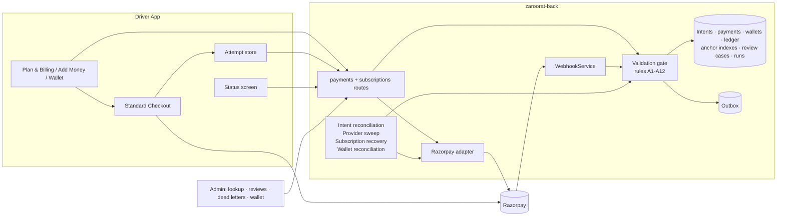
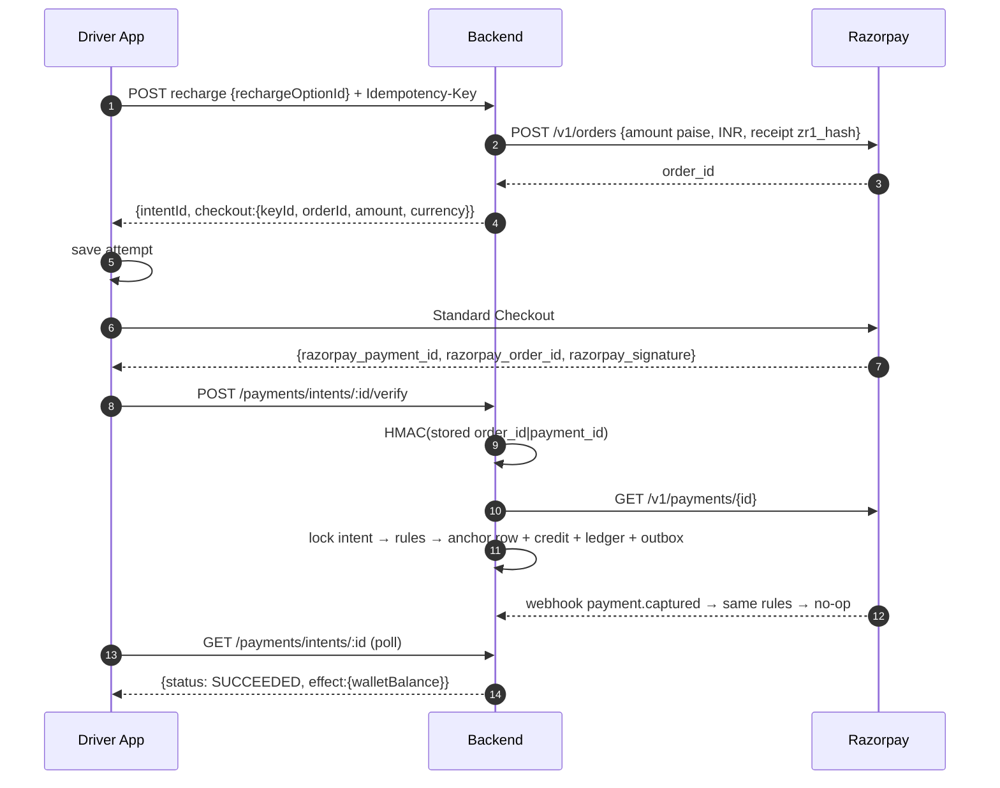

# Implementation Plan: Production-Ready Razorpay Payments for Drivers

**Branch**: `005-razorpay-driver-payments` | **Date**: 2026-10-19 | **Revised**: 2026-10-19 (production-readiness review; second review: corrected sequence, measurable gates, traceability; **third review**: master blocker register, release waves, per-purpose kill switch, renamed gates, go/no-go process; **fourth review**: every CD/MI row re-verified against code, root causes and required behaviour (register §F), high-risk coverage (§G), items the documents cannot resolve (§H), DOC-13…DOC-19) | **Spec**: [spec.md](./spec.md)

**Inputs**: [spec.md](./spec.md) (rules, invariants, requirements) · [decisions.md](./decisions.md) · [research.md](./research.md) · [data-model.md](./data-model.md) · [contracts/](./contracts/) · [quickstart.md](./quickstart.md) (tests and evidence) · [tasks.md](./tasks.md)

Generated with `/speckit-plan` (`setup-plan.ps1` with `SPECIFY_FEATURE_DIRECTORY`; no git branch created). Planning only: no code, schema, environment or provider configuration has been changed.

**Sources of truth**: business decisions live in [decisions.md](./decisions.md); normative requirements in [spec.md](./spec.md); execution order, release gates and the blocker register in this file. Where another file disagrees with one of these, the source of truth wins and the other file is corrected.

## Summary

Drivers pay the platform through Razorpay for subscription plans and commission-wallet recharges only. Customer fares never pass through Razorpay.

The integration follows Razorpay's documented standard: server-created order → Standard Checkout with that `order_id` → server signature check → server fetch of the payment from Razorpay → money moves only under the [payment application rules](./spec.md#payment-application-rules). This is also the pattern Rapido has publicly described with Razorpay (research R-1).

Three mechanisms make it production-safe:

- **Exactly-once effects**: database anchor rows and unique indexes, with the intent row lock serialising concurrent attempts (data-model §8).
- **Complete recovery**: webhook retries are accepted up to 72 h; internal → provider reconciliation; a provider → internal sweep, so every captured payment is tracked (INV-7).
- **Gated launch**: no live payment until every pre-live task is done and gates G0–G7 are signed ([Go/no-go](#go--no-go-decision)).

## Technical Context

| Area                                                            | Value (verified 2026-10-19)                                                                                                                                                                                                                                                                                                                                               |
| --------------------------------------------------------------- | ------------------------------------------------------------------------------------------------------------------------------------------------------------------------------------------------------------------------------------------------------------------------------------------------------------------------------------------------------------------------- |
| **Backend**                                                     | TypeScript strict, Node per `.nvmrc`; Fastify 5.10, Prisma 7.9, Awilix 13, zod 4, pino 10; PostgreSQL (PostGIS); Redis (ioredis 5); BullMQ 6 jobs; transactional outbox relay in the API process; Razorpay over REST `fetch` (`src/integrations/razorpay/razorpay.client.ts`), no SDK                                                                                     |
| **Driver App**                                                  | Expo SDK ~57.0.26, React Native 0.86.3, `newArchEnabled=true`, expo-router, TanStack Query 5, axios. `android/` is generated by CNG (config plugins only; precedent `plugins/withMappls.js`). EAS profiles in `eas.json`. **No `test` npm script**: tests run with `npx tsx --test` over `src/**/__tests__/*.test.ts`                                                     |
| **Admin Panel**                                                 | React 19, Vite 6, TanStack Query 5, react-router 7; `npm test` (`tsx --test`)                                                                                                                                                                                                                                                                                             |
| **Feature flags**                                               | `FeatureFlagService` (`back/src/modules/admin/system-settings/platform/services/feature-flag.service.ts`): global on/off. Seeded flags are created **ON**; a flag that does not exist reads as OFF. No per-driver targeting. Exposed to apps through `GET /api/v1/app-config` `featureFlags`. The driver app types `featureFlags` but **does not read it anywhere today** |
| **Testing**                                                     | Backend `node:test` via `tsx`; integration tests need an **isolated** PostgreSQL + Redis (the shared `zaroorat_test` is truncated by every run); Razorpay test mode; UPI intent only provable in live mode                                                                                                                                                                |
| **Performance targets**                                         | Webhook p95 < 1 s (Razorpay allows 5 s); app confirmation ≤ 10 s p95 after capture; reconciliation every 10 min; provider sweep every 30 min; load test 100 webhooks/s and 1,000 concurrent status polls (unchanged)                                                                                                                                                      |
| **Constraints**                                                 | INR only; no provider call inside a DB transaction (§8); deterministic provider idempotency (§8.3); all money checks under the intent row lock (§5); Redis is never the correctness boundary (§5.3)                                                                                                                                                                       |
| **Previously unknown, now resolved**                            | Reconciliation endpoint (TD-2); receipt format (TD-3); webhook age (D-1, pending UD-3 text); kill-switch mechanics (TD-12, per purpose); webhook processing mode (TD-15); webhook source IPs (published by Razorpay; allowlisting optional, R-10)                                                                                                                         |
| **Still unverified** (sandbox, spike, data check, DevOps input) | U1–U13 and U15 in [research.md → Open verification items](./research.md#open-verification-items), each with a task, owner, evidence and gate. Blocking for live money: U1, U2, U4, U8 (G1), U11, U12 (G2), U15 (G5), U13 (G8)                                                                                                                                             |
| **Verified against Razorpay docs 2026-10-19**                   | [research.md R-10](./research.md#r-10-razorpay-facts-re-verified-2026-10-19): endpoints, fields, receipt errors, webhook retry and disable policy, old-secret retries, refund idempotency body rule, capture timeout, webhook IPs, refund and order event payloads                                                                                                        |
| **Verified against code 2026-10-19**                            | [research.md R-11](./research.md#r-11-code-verification-register-2026-10-19): 15 existing safeguards to keep (E-1…E-15), 20 confirmed defects (CD-1…CD-20), all re-verified in the fourth review                                                                                                                                                                          |

## Constitution Check

_GATE: evaluated before Phase 0 and after design._

| Rule                                                         | How this plan complies                                                                                                                                                                                                    | Status                                                                                         |
| ------------------------------------------------------------ | ------------------------------------------------------------------------------------------------------------------------------------------------------------------------------------------------------------------------- | ---------------------------------------------------------------------------------------------- |
| §1 Module ownership                                          | Money mutation stays in `payments`; subscriptions react through their consumer; review cases and reconciliation runs live in `payments`                                                                                   | PASS                                                                                           |
| §3 Migrations additive, raw SQL partial indexes, pre-checked | One additive migration (plus T020b if D-2 is late); Q1–Q11 per environment (D-9)                                                                                                                                          | PASS                                                                                           |
| §4 Transactions; §5 locks/claims; §5.4 DB uniqueness         | Validation and effects in one transaction under the intent lock; anchor indexes (TD-17)                                                                                                                                   | PASS                                                                                           |
| §6 One idempotency mechanism                                 | Redis replay kept (keys scoped); DB unique keys are the backstop; webhook dedupe is the §6.4 exception                                                                                                                    | PASS                                                                                           |
| §7 Outbox at-least-once, idempotent consumers                | No new transport; requeue reuses rows; consumers rely on DB guarantees                                                                                                                                                    | PASS                                                                                           |
| §8 Provider I/O outside transactions; deterministic keys     | Provider fetch before the confirming transaction; receipt from the scoped key; refunds carry `X-Refund-Idempotency`                                                                                                       | PASS                                                                                           |
| §9.1 Server-authoritative                                    | Rules A1–A12; client data is a prompt only (INV-9)                                                                                                                                                                        | PASS                                                                                           |
| **§9.4 Webhook freshness**                                   | Razorpay 72 h with dedupe first (D-1)                                                                                                                                                                                     | **AMENDMENT REQUIRED** — AM-1 text pending owner approval (UD-3); T030/T031 blocked until T001 |
| §10 Authz                                                    | Ownership 404s; server-side permissions; webhook stays the only public payment route                                                                                                                                      | PASS                                                                                           |
| §12 Config via `numericEnv`, documented                      | New knobs listed in quickstart                                                                                                                                                                                            | PASS                                                                                           |
| §14 Concurrency tests                                        | TM-08, TM-29, TM-30 run real concurrent requests                                                                                                                                                                          | PASS                                                                                           |
| §15 Tests first, never weakened                              | Two existing assertions change, both because they pinned a defect: the replay test (through AM-1) and the `payments?order_id` assertion in `gateway-adapters.test.ts` (T011, CD-1). The vacuous H1 assertion is tightened | PASS                                                                                           |
| §16 Backward compatibility                                   | Additive responses and migration                                                                                                                                                                                          | PASS                                                                                           |
| §17 Metrics, append-only, redaction, staff attribution       | New metrics and alerts; triggers; audit rows                                                                                                                                                                              | PASS                                                                                           |
| Governance: no silent business policy                        | Unapproved items listed as UD-1…UD-10; the earlier invented refund guard removed                                                                                                                                          | PASS                                                                                           |

## Where each responsibility lives

| Concern                           | Razorpay Dashboard (owner)          | Backend `zaroorat-back`                                                                                  | Driver App                                                                     | Admin Panel                                     |
| --------------------------------- | ----------------------------------- | -------------------------------------------------------------------------------------------------------- | ------------------------------------------------------------------------------ | ----------------------------------------------- |
| API keys                          | Test + live pairs                   | Holds `key_secret`; sends only `key_id`                                                                  | Receives `key_id` per payment                                                  | Edits credentials (encrypted, `settings:write`) |
| Amount                            | —                                   | Computes it (plan, option, validated custom amount)                                                      | Displays it                                                                    | —                                               |
| Order                             | —                                   | `POST /v1/orders`, deterministic receipt, recovery                                                       | Never calls Razorpay's REST API                                                | —                                               |
| Checkout                          | Branding, methods                   | Returns the checkout payload                                                                             | Opens Standard Checkout (TD-1 / TD-1b)                                         | —                                               |
| UPI app visibility                | —                                   | —                                                                                                        | Config plugin: Android `<queries>` (Razorpay-documented packages), iOS schemes | —                                               |
| Success decision                  | Auto-capture **on**                 | **Only authority**: rules A1–A12                                                                         | Shows "Verifying…" and polls status                                            | Sees the result                                 |
| Webhooks                          | URL, events, secret                 | Verify, dedupe, apply, persist failures                                                                  | —                                                                              | —                                               |
| Exactly-once credit or activation | —                                   | DB anchor rows (TD-17)                                                                                   | Shows the result after confirmation                                            | Read-only                                       |
| Recovery                          | Retries webhooks for 24 h           | Intent reconciliation (10 min), provider sweep (30 min), subscription recovery (5 min), heartbeats       | Attempt store; resume on launch; same idempotency key on retry                 | Reconciliation results view                     |
| Mismatches and unmatched captures | —                                   | Review cases + holding entry (UD-2)                                                                      | "We're checking your payment" + reference                                      | Finance resolves (UD-1, UD-6)                   |
| Refunds                           | Dashboard refunds restricted (UD-7) | Reserve → idempotent provider refund → settle; unknown outcomes stay in progress                         | Shows status                                                                   | Finance approves; amount locked                 |
| Kill switch and pilot             | —                                   | One flag per purpose, both seeded OFF; pilot mode seeded ON with an empty allowlist (TD-12, TD-19, UD-4) | Hides each payment action while its flag is off                                | Toggles the flags; edits the allowlist          |

**Never in the app**: secrets, signature checks, amounts, success decisions, balance changes, Razorpay REST calls.
**Never in the admin panel**: invented values, success without a backend response, editing a reserved refund amount.

## Architecture





## Project Structure

### Documentation

```text
specs/005-razorpay-driver-payments/
├── spec.md · decisions.md · plan.md · research.md · data-model.md · quickstart.md · tasks.md
├── contracts/http-api.md · contracts/razorpay-provider.md
└── checklists/requirements.md
```

### Source code touched (three repositories)

```text
zaroorat-back/
├── src/integrations/razorpay/razorpay.client.ts                     # provider truth, receipt, sweep listing, refund header
├── src/modules/payments/services/gateway/{gateway.provider,mock.gateway,payment-gateway-resolver.service}.ts
├── src/integrations/stripe/stripe.client.ts                         # interface parity (dormant)
├── src/modules/payments/services/intent/intent.service.ts           # validation gate, statuses, verify, checkout payload
├── src/modules/payments/services/webhook/webhook.service.ts         # dedupe-first, age rule, failure persistence, dual secret
├── src/modules/payments/{repositories,utils,controllers,routes,schemas,errors,metrics,constants}/…
├── src/modules/payments/repositories/{payment-review-case,payment-reconciliation-run}.repository.ts   # NEW
├── src/modules/payments/services/review/payment-review.service.ts   # NEW
├── src/modules/payments/jobs/{payment-intent-reconciliation,reconciliation,provider-sweep}.job.ts   # provider-sweep NEW
├── src/modules/payments/controllers/{intent,commission-wallet}.controller.ts · routes/payment.routes.ts   # verify/status; confirm 404 (T027)
├── src/modules/payments/services/refund/refund.service.ts
├── src/modules/subscriptions/{services/subscription.service,consumers/subscription-payment.consumer,jobs/subscription-reconciliation.job}.ts
├── src/jobs/{queues,scheduler,workers}/index.ts
├── src/core/cache/stores/IdempotencyStore.ts · src/core/events/OutboxRepository.ts
├── src/modules/admin/system-settings/platform/{constants/platform-settings.constants,services/feature-flag.service}.ts   # per-purpose flags seeded OFF
├── src/modules/admin/payment-management/{finance.service,finance.controller,finance.schemas,payment-management.routes,payment-management.controller}.ts
├── src/config/{payment/payment.config,rate-limit/rate-limit.config}.ts · .env.example
├── prisma/schema/modules/{payment,wallet}/*.prisma · prisma/migrations/<new>/migration.sql
├── tests/unit/{payments,core,jobs}/… · tests/integration/… (+ helpers/harness.ts)
└── .specify/memory/constitution.md                                  # AM-1 after UD-3

zaroorat_driver_production_app/
├── package.json · app.json · plugins/withRazorpay.js (NEW)
├── src/services/payments/{checkout,attemptStore,usePaymentStatus}.ts (NEW) + __tests__/
├── src/services/api/{money,endpoints}.ts
├── src/design-system/AppConfigProvider.tsx                          # featureFlags accessor
├── src/features/billing/{AddMoneyScreen,PlanBillingScreen,WalletScreen,PaymentStatusScreen}.tsx · constants/plans.ts
├── app/account/payment-status.tsx (NEW) · src/features/account/AccountScreen.tsx · src/features/trip/IncomingRideDialog.tsx
└── src/design-system/tokens/strings/{en,hi,ur}.ts

zaroorat-admin-panel/
├── src/modules/driver-management/{pages/drivers/DriverDetailsPage.tsx,api/index.ts,services/index.ts}
├── src/modules/financial-operations/{payment-reviews,payment-lookup,reconciliation-runs,dead-letters}/ (NEW) · routes/routes.tsx
├── src/modules/financial-operations/refunds/components/RefundApprovalPanel.tsx
└── src/app/{router/index.tsx,layouts/Sidebar.tsx}                   # navigation entries
```

### Files shared with other in-progress work (coordinate before editing — T006)

Re-checked with `git status` on 2026-10-19. No payment, integration (other than the Google Maps client), subscription or Prisma file has uncommitted changes.

**T006 record (2026-10-19, Phase 1).**

- **Peer sessions:** two were active on this machine when Phase 1 started: `19-5b` (idle) and a memory observer. Neither claimed any payment file.
- **Ownership boundary:** Phase 1 (T010–T014, T017, T027, T035) modifies **none** of the files below.
  - T017's `.env.example` line is not needed: no test enforces it, and the existing payment knobs such as `PAYMENT_IDEMPOTENCY_TTL` are not listed there either. The new knob is documented in quickstart.md.
  - T035's flag seeds go into a new file, `platform/constants/payment-feature-flags.constants.ts`, instead of the shared `platform-settings.constants.ts`.
- **Coordinator:** for these files in later phases, the proposed coordinator is the **Owner**, because the uncommitted work in this tree comes from the Owner's own sessions. This is **not yet confirmed**: the Owner confirms or names someone before any later-phase task edits one of these files.
- **Update 2026-10-20 (Phase 2 authorization):** the **Owner is confirmed as the decision coordinator for cross-phase decisions**. Shared-file ownership is unchanged: before a task edits a file in the table above, the person or session that holds that file's uncommitted change is identified and the edit is agreed with them (uncommitted changes carry no author, so the Owner routes the question).
- **Contributor activity:** observed on 2026-10-20 in the driver app, `src/features/permissions/NotificationAccessScreen.tsx` went back to HEAD. It is not a payment file, and the change was not made by this feature.

_Snapshot of 2026-10-19, superseded by the T006 record of 2026-10-21 below._

| File                                                                                                                                            | Other work in progress (uncommitted, 2026-10-19)                                                                                           | Tasks here                                           | Coordinator (T006) |
| ----------------------------------------------------------------------------------------------------------------------------------------------- | ------------------------------------------------------------------------------------------------------------------------------------------ | ---------------------------------------------------- | ------------------ |
| `back/.env.example`                                                                                                                             | Google Maps configuration                                                                                                                  | T017, T031, T033, T037, T061                         | _tbd_              |
| `back/src/modules/admin/system-settings/platform/constants/platform-settings.constants.ts` (and the platform `schemas/`, `services/` beside it) | Platform/branding settings                                                                                                                 | T035, T037                                           | _tbd_              |
| `back/src/modules/admin/payment-management/document-compliance.service.ts`                                                                      | Document expiry work, in the **same module** as the new finance routes. Not edited here, but `payment-management.routes.ts` registers both | T064, T082, T089, T095, T097                         | _tbd_              |
| `back/src/modules/app-config/*`                                                                                                                 | App-config changes (exposes `featureFlags`)                                                                                                | none (read only, T050 and T055 consume it)           | _tbd_              |
| `app/package-lock.json`                                                                                                                         | Driver app UI/branding                                                                                                                     | T044                                                 | _tbd_              |
| `app/src/design-system/AppConfigProvider.tsx`, `app/src/design-system/index.ts`                                                                 | App config/branding                                                                                                                        | T050                                                 | _tbd_              |
| `app/src/services/api/config.ts`                                                                                                                | API config change                                                                                                                          | none (T047 edits `money.ts` and `endpoints.ts` only) | _tbd_              |
| `admin/src/modules/driver-management/pages/drivers/DriverDetailsPage.tsx`                                                                       | New driver tabs (−165/+17 lines)                                                                                                           | T090, T091                                           | _tbd_              |
| `admin/src/app/router/index.tsx`, `admin/src/app/layouts/Sidebar.tsx`, `admin/src/app/layouts/Breadcrumbs.tsx`                                  | Navigation changes                                                                                                                         | T092, T093, T096, T097                               | _tbd_              |
| `admin/src/modules/driver-management/routes/routes.tsx`                                                                                         | New unguarded `documents` route (security finding reported to the owner)                                                                   | none (not touched)                                   | —                  |

**T006 record — 2026-10-21 (Phase 3A).**

Evidence: `git status` / `git diff --numstat` / `git log -1` per file in all three repositories (uncommitted entries: back 87, app 20, admin 35).

- **Owner's role.** The Owner stays the **cross-phase decision coordinator** and routes every shared-file question.
- **Technical owners.**
  - Named only for files whose uncommitted changes are this feature's own (005 workstream).
  - For other files, the last committer from git is recorded as **evidence only**. Uncommitted changes carry no author, so the technical owner is **to be named by the Owner**. T006's done-when ("a named coordinator for every overlapping task") is met **except** those names.

**Review rule (proposed for Owner confirmation).**

- Every 005 change: an independent payments reviewer (G3).
- A shared file: that file's technical owner also reviews.
- Financial behavior (gate, ledger, refunds, review cases): checked against decisions.md, and Finance confirms the behavior, not the code.
- Migrations: the database operator also reviews.
- Disagreements go to the Owner.

| File (repo)                                                                                                                                                        | State 2026-10-21                                                                                                                                                                                    | Boundary for 005                                                                                                                                                                         | 005 tasks                         | Last committer (git, evidence)          | Technical owner                                           | Reviewer(s)                                  | Sequencing                                                                                                           |
| ------------------------------------------------------------------------------------------------------------------------------------------------------------------ | --------------------------------------------------------------------------------------------------------------------------------------------------------------------------------------------------- | ---------------------------------------------------------------------------------------------------------------------------------------------------------------------------------------- | --------------------------------- | --------------------------------------- | --------------------------------------------------------- | -------------------------------------------- | -------------------------------------------------------------------------------------------------------------------- |
| `.env.example` (back)                                                                                                                                              | Uncommitted: a maps knob (`GEO_ETA_REFRESH_MAX_INTERVAL_MS`). The Razorpay test key id and secret values that were here were **removed on 2026-10-21 (Phase 3B)**; the placeholders are empty again | 005 only appends knob names with placeholder values; never credentials                                                                                                                   | T017, T031, T033, T037, T061      | zaroorat (2026-10-16 merge)             | Maps line: **Owner to name**. Credential lines: **Owner** | Owner + payments reviewer                    | **Credential values removed by their holder before any commit and before any 005 edit**; then 005 knobs in one block |
| `src/config/payment/payment.config.ts` (back)                                                                                                                      | Uncommitted: 005 Phase 1 (+8)                                                                                                                                                                       | 005-owned                                                                                                                                                                                | T031, T033, T061                  | saqib mir (2026-09-12)                  | 005 workstream                                            | Payments reviewer                            | T031 → T033 → T061, serialized (same file)                                                                           |
| `services/webhook/webhook.service.ts`, `utils/webhook-payload-parser.ts` (back)                                                                                    | Uncommitted: 005 Phase 2                                                                                                                                                                            | 005-owned                                                                                                                                                                                | T026, T031, T033, R2-T            | saqib mir (2026-09-12)                  | 005 workstream                                            | Payments reviewer                            | T026 → T031 → T033; R2-T after T031                                                                                  |
| `repositories/webhook.repository.ts` (back)                                                                                                                        | Clean                                                                                                                                                                                               | 005-owned                                                                                                                                                                                | T026, T031                        | zaroorat (2026-08-16)                   | 005 workstream                                            | Payments reviewer                            | With T026                                                                                                            |
| `services/gateway/payment-gateway-resolver.service.ts` (back)                                                                                                      | Clean                                                                                                                                                                                               | 005-owned                                                                                                                                                                                | T033                              | saqib mir (2026-09-12)                  | 005 workstream                                            | Payments reviewer                            | After T031                                                                                                           |
| `admin/system-settings/integrations/services/admin-payment-settings.service.ts` (back)                                                                             | Clean                                                                                                                                                                                               | Admin integrations module: 005 adds the previous-secret field only                                                                                                                       | T033                              | saqib mir (2026-09-12)                  | **Owner to name** (admin integrations)                    | Admin-integrations owner + payments reviewer | After T031                                                                                                           |
| `payments/jobs/payment-intent-reconciliation.job.ts` (back)                                                                                                        | Clean                                                                                                                                                                                               | 005-owned                                                                                                                                                                                | T061, T062, T063                  | saqib mir (2026-09-12)                  | 005 workstream                                            | Payments reviewer                            | After T020 + T019c are applied to the test targets (approval)                                                        |
| `services/intent/*`, `repositories/payment-review-case.repository.ts`, `prisma/schema/modules/payment/payment.prisma`, `prisma/migrations/20261021120000_*` (back) | Uncommitted: 005 Phase 1/2                                                                                                                                                                          | 005-owned. **The generated Prisma client is shared by every workstream**: schema changes (T019c) only with a migration approval, and other workstreams are told before `prisma generate` | R1-T, T019c, T024 follow-ups      | zaroorat / saqib mir                    | 005 workstream                                            | Payments reviewer + database operator        | T019c only after the dev/test migration approval                                                                     |
| `tests/integration/helpers/harness.ts` (back)                                                                                                                      | Uncommitted: 005 additions (flags on, financial-truncate escape)                                                                                                                                    | Shared by every integration suite: **additive only**                                                                                                                                     | T018, T021                        | zaroorat (2026-10-03)                   | **Owner to name** (test infrastructure)                   | Test-infra owner + payments reviewer         | Before T018                                                                                                          |
| `admin/payment-management/finance.controller.ts`, `finance.schemas.ts`, `payment-management.routes.ts` (back)                                                      | Clean                                                                                                                                                                                               | 005 edits finance routes/schemas only; registers in the routes file without touching other registrations                                                                                 | T082, T089, T095, T097            | zaroorat (2026-10-16 merge; 2026-09-19) | **Owner to name** (admin finance module)                  | Admin-finance owner + payments reviewer      | After T081; after the `document-compliance.service.ts` change is committed or agreed                                 |
| `admin/payment-management/document-compliance.service.ts` (back)                                                                                                   | Uncommitted, other work (+2: `fileUrl`, `fileId`)                                                                                                                                                   | **Never edited by 005**                                                                                                                                                                  | none                              | zaroorat (2026-10-03)                   | **Owner to name**                                         | —                                            | Commit before T082 touches the module's routes                                                                       |
| `admin/system-settings/platform/constants/platform-settings.constants.ts` (+ schemas/services) (back)                                                              | Uncommitted, branding (+2 logo keys)                                                                                                                                                                | **Not edited by 005**: payment flags live in 005's own `payment-feature-flags.constants.ts`                                                                                              | T037 (reads only)                 | Wasi Mirza (2026-10-07)                 | **Owner to name** (branding)                              | —                                            | —                                                                                                                    |
| `src/modules/app-config/*` (back)                                                                                                                                  | Uncommitted, branding (`brand-logo` public route; causes the `route-graph` failure and one lint error)                                                                                              | Read-only for 005                                                                                                                                                                        | T050, T055 consume `featureFlags` | zaroorat / Wasi Mirza                   | **Owner to name** (branding)                              | —                                            | `route-graph` sanctioned list resolved by its owner                                                                  |
| `admin/driver-management/drivers/driver.service.ts` (back)                                                                                                         | Uncommitted, other work (+344/−2; currently fails lint)                                                                                                                                             | **Never edited by 005**                                                                                                                                                                  | none                              | zaroorat (2026-10-16)                   | **Owner to name**                                         | —                                            | Its lint errors block the repository-wide completion rule for every task until fixed by its owner                    |
| `package.json` (app)                                                                                                                                               | Clean                                                                                                                                                                                               | 005 adds the checkout dependency only                                                                                                                                                    | T044                              | zaroorat (2026-10-11)                   | 005 workstream (app)                                      | App owner + payments reviewer                | After T005 decides TD-1/TD-1b                                                                                        |
| `package-lock.json` (app)                                                                                                                                          | Uncommitted, other work (+1/−1)                                                                                                                                                                     | Regenerated by T044 only after the other change is committed                                                                                                                             | T044                              | Wasi Mirza (2026-10-07)                 | **Owner to name** (app)                                   | App owner                                    | Other change committed first                                                                                         |
| `src/services/api/money.ts`, `endpoints.ts` (app)                                                                                                                  | Clean                                                                                                                                                                                               | 005-owned edits                                                                                                                                                                          | T047                              | Wasi Mirza / zaroorat                   | 005 workstream (app)                                      | App owner + payments reviewer                | After T043 (contract)                                                                                                |
| `src/services/api/config.ts` (app)                                                                                                                                 | Uncommitted, other work (+1)                                                                                                                                                                        | Not edited by 005                                                                                                                                                                        | none                              | zaroorat (2026-10-11)                   | **Owner to name**                                         | —                                            | —                                                                                                                    |
| `src/design-system/AppConfigProvider.tsx`, `index.ts` (app)                                                                                                        | Uncommitted, other work (+26, +1)                                                                                                                                                                   | T050 reads flags through it; edits only after agreement                                                                                                                                  | T050                              | Wasi Mirza (2026-09)                    | **Owner to name** (app design system)                     | Design-system owner + payments reviewer      | Other change committed first                                                                                         |
| `src/features/billing/AddMoneyScreen.tsx`, `WalletScreen.tsx` (app)                                                                                                | Clean                                                                                                                                                                                               | 005-owned edits                                                                                                                                                                          | T049, T050                        | Wasi Mirza / zaroorat                   | 005 workstream (app)                                      | App owner + payments reviewer                | After T045–T048                                                                                                      |
| `src/features/billing/PaymentStatusScreen.tsx`, `src/services/payments/checkout.ts` (app)                                                                          | Do not exist yet                                                                                                                                                                                    | New 005 files                                                                                                                                                                            | T045, T046, T048                  | —                                       | 005 workstream (app)                                      | App owner + payments reviewer                | After T005                                                                                                           |
| `DriverDetailsPage.tsx` (admin)                                                                                                                                    | Uncommitted, other work (+122/−187)                                                                                                                                                                 | Edits only after agreement                                                                                                                                                               | T090, T091                        | zaroorat (2026-10-16)                   | **Owner to name** (driver tabs)                           | Driver-tabs owner + payments reviewer        | Other change committed first                                                                                         |
| `router/index.tsx`, `layouts/Sidebar.tsx`, `layouts/Breadcrumbs.tsx` (admin)                                                                                       | Uncommitted, navigation (+2/−2, +1/−1, +2/−1)                                                                                                                                                       | Additive route/nav entries only, after agreement                                                                                                                                         | T092, T093, T096, T097            | zaroorat (2026-10-04/05/06)             | **Owner to name** (admin navigation)                      | Navigation owner + payments reviewer         | Other change committed first                                                                                         |

**Sequencing summary.**

| Task      | Needs, beyond its tasks.md `Needs:`                                                              |
| --------- | ------------------------------------------------------------------------------------------------ |
| T031      | T001 + T026; `.env.example` credential cleanup; serialized with T033/T061 on `payment.config.ts` |
| T033      | T031 done; admin-integrations owner named                                                        |
| T061      | T020 + T019c applied to test targets (approval); `.env.example` after T031/T033                  |
| T082      | T081; admin-finance owner named; `document-compliance.service.ts` change committed or agreed     |
| App tasks | T005 → T044 (lockfile holder first) → T045–T049 → T050 (design-system owner agreement)           |

**Open for the Owner.** Name the nine technical owners marked "Owner to name", and confirm the review rule.

**T006 ownership table — 2026-10-21 (Phase 3B).** The nine workstreams marked "Owner to name".

- **No engineering owner is verifiable for any of them.**
  - Uncommitted changes carry no author.
  - Git's last committer shows who last committed a file, not who holds today's uncommitted change.
  - The local work notes link several of these changes to AI-assisted sessions run on this machine, not to a named engineer.
- **Every owner is Pending until the Owner assigns one.** The evidence column is for the Owner's assignment; it is not an assignment.

| #   | Workstream                             | Files                                                                                                                                                  | 005 tasks affected                                      | Evidence (not ownership)                                                                             | Proposed engineering owner    | Reviewer                                     | Dependencies                                                                   | Risk of overlapping edits                                                                                                                                |
| --- | -------------------------------------- | ------------------------------------------------------------------------------------------------------------------------------------------------------ | ------------------------------------------------------- | ---------------------------------------------------------------------------------------------------- | ----------------------------- | -------------------------------------------- | ------------------------------------------------------------------------------ | -------------------------------------------------------------------------------------------------------------------------------------------------------- |
| 1   | Maps / ETA configuration               | back `.env.example` (uncommitted `GEO_ETA_REFRESH_MAX_INTERVAL_MS`; the Razorpay values were removed 2026-10-21)                                       | T017, T031, T033, T037, T061 (knob lines)               | Local note "Customer Google Maps audit 2026-10-18"; last committer `zaroorat` (merge)                | **Pending (Owner to assign)** | Maps owner + payments reviewer               | The maps line committed or agreed before 005 appends knobs                     | Both workstreams append to the same file; a careless merge could reintroduce or drop lines. **Credentials must never be re-added to this tracked file**  |
| 2   | Admin integrations settings            | back `admin/system-settings/integrations/services/admin-payment-settings.service.ts` (clean)                                                           | T033 (previous-secret field)                            | Last committer `saqib mir` (2026-09-12, the payment-gateway commit)                                  | **Pending**                   | Admin-integrations owner + payments reviewer | T031 done first (same config path)                                             | Secret handling (encrypted settings): a conflicting edit could log or expose the previous webhook secret                                                 |
| 3   | Integration test infrastructure        | back `tests/integration/helpers/harness.ts` (uncommitted additions are 005's only: flags on, financial-truncate escape)                                | T018, T021                                              | Last committer `zaroorat` (2026-10-03)                                                               | **Pending**                   | Test-infra owner + payments reviewer         | Additive-only rule agreed                                                      | Every integration suite depends on this reset; a non-additive edit breaks all suites or leaks state between tests                                        |
| 4   | Admin finance module                   | back `admin/payment-management/finance.controller.ts`, `finance.schemas.ts`, `payment-management.routes.ts` (clean)                                    | T082, T089, T095, T097                                  | Last committer `zaroorat` (2026-10-16 merge; 2026-09-19)                                             | **Pending**                   | Admin-finance owner + payments reviewer      | T081; workstream 5's change committed or agreed                                | One routes file registers both finance and document-compliance handlers: a merge conflict there can unregister routes or bypass permission guards        |
| 5   | Driver documents / compliance          | back `admin/payment-management/document-compliance.service.ts` (uncommitted +2: `fileUrl`, `fileId`)                                                   | none (005 never edits it)                               | Local note "Driver documents & storage" (2026-10-16 fixes); last committer `zaroorat` (2026-10-03)   | **Pending**                   | Its owner                                    | Commit before T082 touches the module                                          | Low for 005 (no edits); sequencing only                                                                                                                  |
| 6   | Branding / app configuration (backend) | back `platform-settings.constants.ts` (+ schemas, services), `src/modules/app-config/*`, `platform/services/branding-logo-key.ts` (untracked)          | T037 (reads), T050/T055 (consume `featureFlags`)        | claude-mem observation S94 (2026-10-19, logo URL validation); last committers Wasi Mirza, `zaroorat` | **Pending**                   | Branding owner                               | Its public `brand-logo` route resolved in `route-graph` (the test fails today) | Feature flags and branding share the app-config payload: a change to its shape can break T050's flag reading. The public route is a security-review item |
| 7   | Admin driver verification              | back `admin/driver-management/drivers/driver.service.ts` (uncommitted +344/−2, currently fails lint)                                                   | none (005 never edits it)                               | Local note "Admin driver verification review" (all fixes uncommitted); last committer `zaroorat`     | **Pending**                   | Its owner                                    | Its lint errors fixed by its owner                                             | Blocks the repository-wide lint completion rule for **every** task, 005 included, until fixed                                                            |
| 8   | Driver app UI / design system          | app `package-lock.json` (+1/−1), `src/services/api/config.ts` (+1), `src/design-system/AppConfigProvider.tsx` (+26), `src/design-system/index.ts` (+1) | T044 (lockfile), T050 (flags through AppConfigProvider) | Last committers Wasi Mirza, `zaroorat`                                                               | **Pending**                   | App/design-system owner + payments reviewer  | T005 decision; the other change committed first                                | Lockfile conflicts on adding the checkout SDK; AppConfigProvider edits collide with T050's flag handling                                                 |
| 9   | Admin driver pages and navigation      | admin `DriverDetailsPage.tsx` (+122/−187), `src/app/router/index.tsx`, `layouts/Sidebar.tsx`, `layouts/Breadcrumbs.tsx`                                | T090, T091, T092, T093, T096, T097                      | Local note "Admin driver verification review"; last committer `zaroorat`                             | **Pending**                   | Admin-UI owner + payments reviewer           | Other changes committed first                                                  | Large rewrite in progress on `DriverDetailsPage.tsx`; route and nav files are guard-sensitive (an earlier unguarded `documents` route was reported)      |

**Proposed shared-file review rule (Owner to confirm).**

1. Before any task edits a file holding someone else's uncommitted change, the Owner names that file's engineering owner. The edit is agreed with them: either their change is committed first, or the edit is coordinated line by line.
2. Every change to a shared file is reviewed by that file's owner **and** an independent payments reviewer (a person other than the author; G3).
3. 005-only files: payments reviewer only.
4. Financial behavior (gate, ledger, refunds, review cases): Finance confirms the behavior against decisions.md, not the code.
5. Migrations and anything touching the generated Prisma client: the database operator also reviews, and every workstream is notified before `prisma generate`.
6. No credential in any tracked file, ever; a reviewer rejects any diff that adds one.
7. Disagreements go to the Owner (cross-phase decision coordinator).

**Decisions needed from the Owner.**

- Assign the nine owners.
- Confirm or amend the seven-point rule.
- Say whether an AI-assisted session may be recorded as an "engineering owner", or whether each workstream needs a named person.
- Name the independent payments reviewer that G3 requires.

## Release scope

The work ships in two waves, each behind its own flag (TD-12).

| Wave                   | What drivers can pay for        | Flag turned on                                                                    | Tasks                                         | Gates                                                     |
| ---------------------- | ------------------------------- | --------------------------------------------------------------------------------- | --------------------------------------------- | --------------------------------------------------------- |
| **R — recharge pilot** | Commission-wallet recharge only | `payments.driver_checkout` (with `payments.pilot_mode` ON and the UD-4 allowlist) | Every task **not** tagged `[SUB]` in tasks.md | G0–G8                                                     |
| **S — subscriptions**  | Subscription plans              | `payments.subscription_checkout`                                                  | Tasks tagged `[SUB]`: T051–T056               | G3-S, G4-S, G6-S, G8-S (below), on top of a signed wave R |

**Pre-live set (wave R)**: every P0 and P1 task in tasks.md that is not tagged `[SUB]`, except T105 (the pilot itself) and T106 (P3 documentation). The first live payment, T105's staff ₹1 recharge, may happen only when every task in the pre-live set is done **and** G0–G7 are signed. P2 tasks gate only the expansion beyond the pilot.

`payments.subscription_checkout` stays OFF for the whole of wave R. The backend refuses subscription intents while it is off, so fixing the receipt (CD-2) cannot accidentally open live subscription payments.

## Implementation sequence

Tasks are grouped by user story in tasks.md (Spec Kit convention). **Execution order is risk-first.** A step may start as soon as its "Waits for" is met. Gates are go/no-go conditions for live money, not checkpoints for starting work: each task starts when its own "Needs" are met.

| Step | Work                                                                                                | Tasks                                                                            | Waits for                                                                                        | Fixes                                | Feeds gate     |
| ---- | --------------------------------------------------------------------------------------------------- | -------------------------------------------------------------------------------- | ------------------------------------------------------------------------------------------------ | ------------------------------------ | -------------- |
| 1    | Decisions, test credentials, overlap coordination, sandbox checks, read-only data checks, SDK spike | T001–T008                                                                        | Owner (UD-3, D-8), Finance (D-2…D-11, UD-1, UD-2), Operations (D-9)                              | —                                    | G0, G1, G2     |
| 2    | Provider verification and payment identity                                                          | T010–T017, T027                                                                  | T003 (S1–S3b) before T015/T016                                                                   | CD-1, CD-2, CD-9, CD-15              | G3             |
| 3    | Database constraints and financial-integrity safeguards                                             | T018–T021 (T020b when D-2 is confirmed)                                          | T004 clean per environment                                                                       | CD-7, CD-8                           | G2, G3         |
| 4    | Common validation gate, webhook correctness, review cases, concurrency proof, payload policy        | T022–T026, T028, T030–T034, T039                                                 | Steps 2–3; T001 (UD-3) for T030/T031; UD-2 for suspense postings; UD-10 for T039                 | CD-3, CD-4, CD-5, CD-6, CD-18, CD-20 | G3, G5         |
| 5    | Flag defaults, pilot controls, kill switch, job heartbeats                                          | T035, T037, T038                                                                 | T006; UD-4 for T037. **T035 may ship alone, ahead of everything**, as the interim stop for CD-17 | CD-17 (backend part)                 | G3, G5         |
| 6    | Reconciliation, provider sweep, recovery                                                            | T060–T068                                                                        | Steps 3–4; D-3 for T062                                                                          | CD-12, CD-19                         | G4, G7         |
| 7    | Refund safety and Finance review workflows                                                          | T084–T087, then T080–T083                                                        | D-7 (T084); UD-1, UD-2, D-4, D-6 (T081); UD-6 for a second approver                              | CD-13, CD-14                         | G4, G6         |
| 8    | Commission-wallet recharge checkout                                                                 | T040–T043, then app T044–T050; T042b only if T005 selects TD-1b                  | Steps 4–5; T005 decision (TD-1 or TD-1b); UD-12 for T042b                                        | CD-17 (app part)                     | G1, G4         |
| 9    | Admin Panel workflows, alert configuration and end-to-end verification                              | T089–T099, then T100–T104                                                        | T064, T082, T095, T097 for the admin pages; the metrics of steps 4–6 for T099                    | CD-16; MI-12                         | G4, G5, G6, G7 |
| 10   | Pre-live go/no-go, then the controlled recharge pilot                                               | T105                                                                             | Pre-live set done; G0–G7 signed                                                                  | —                                    | G8             |
| 11   | Subscriptions (wave S)                                                                              | T051–T056 (`[SUB]`), then the same rollout with `payments.subscription_checkout` | Steps 2–6; G3-S, G4-S, G6-S                                                                      | CD-10, CD-11                         | G8-S           |

Refunds, review resolution, security, recovery and financial-integrity work all sit in steps 2–9, before the first live payment. None of them is deferred to after the pilot.

## Production gates

Live payments stay **blocked** until every task in the pre-live set is done and G0–G7 are signed. Expansion beyond the pilot stays blocked until G8. A gate is signed in the [sign-off record](#gate-sign-off-record) (name, role, date, evidence link). A gate is never signed because a task or document exists: only its evidence counts. TM IDs are defined in [quickstart.md → Test matrix](./quickstart.md#test-matrix); S and D IDs are quickstart scenarios and drills.

| Gate                                      | Pass criteria (all must hold)                                                                                                                                                                                                                                                                                                                                                                                                                                                                                                                | Required tasks                  | Required evidence                                                             | Sign-off                                   |
| ----------------------------------------- | -------------------------------------------------------------------------------------------------------------------------------------------------------------------------------------------------------------------------------------------------------------------------------------------------------------------------------------------------------------------------------------------------------------------------------------------------------------------------------------------------------------------------------------------- | ------------------------------- | ----------------------------------------------------------------------------- | ------------------------------------------ |
| **G0 — Decisions**                        | Recorded in decisions.md with name, role and date: Finance confirmation of D-2, D-3, D-4, D-6, D-7, D-11; UD-1; UD-2 (including the refund legs for held money); UD-3; UD-4; UD-6; UD-7 (including the `EXTERNAL_REFUND` resolution path); UD-10; UD-8 if Q4 > 0; UD-11 if Q11 finds open historical customer top-up intents; UD-12 if T005 selects TD-1b. UD-5 and UD-9 are **not** required: current behaviour and the omitted prefill stay in force. TD-1 or TD-1b recorded (T005). Every overlapping file has a named coordinator (T006) | T001, T006, T007                | decisions.md rows; coordinator column of the overlap table                    | Owner + Finance                            |
| **G1 — Provider and device verification** | S1, S2, S3, S3b, S9, S11, S13 recorded in the verification log. U1, U2, U4, U5, U8 closed. U3 and U9 recorded (they do not block). Spike T005 passed on a physical Android device in **both** a development and a release (proguard) build: success, failure, dismissal, network loss, app termination, UPI app visibility                                                                                                                                                                                                                   | T002, T003, T005                | Verification log rows; device recordings                                      | Engineering lead + Mobile lead             |
| **G2 — Data safety**                      | Q1–Q9 = 0 in staging and production, or a Finance-approved remediation was executed and the re-check returned 0. Q10 shows a `zaroorat_app_runtime` login for the API in staging and production. Q11 recorded. UD-8 decided if Q4 > 0. T020 applied to a copy of staging data without error                                                                                                                                                                                                                                                  | T004, T020 (T020b)              | Query outputs in research.md; migration log                                   | Finance + Engineering lead + DevOps        |
| **G3 — Backend financial correctness**    | TM-01…TM-15 pass twice in a row in CI on an isolated database. 0 open P0 tasks in steps 2–5. `grep -rn "payments?order_id" src` returns nothing. Every SUCCEEDED payment row created by the suites carries a `pay_` id. Every ledger group the suites write balances (Q8 run against the CI database returns 0). The full pre-existing suite still passes, including `gateway-purpose-invariant.test.ts`; the only changed assertions are the two §15 exceptions (T011, T030)                                                                | T010–T039 (non-`[SUB]`)         | CI run links; grep and Q8 output; diff of changed test assertions             | Engineering lead + an independent reviewer |
| **G4 — Client and workflow correctness**  | TM-16…TM-21 and TM-25…TM-33 pass twice in CI. Device scenarios S5, S5b, S5c, S6 and sandbox S7, S8 pass on a physical Android device with the release build. 0 open P0/P1 tasks in steps 6–9, apart from T100–T104, which feed G5–G7                                                                                                                                                                                                                                                                                                         | T040–T050, T060–T068, T080–T098 | CI; recordings; database rows per scenario                                    | Engineering lead + QA + Mobile lead        |
| **G5 — Security and performance**         | TM-34 signed with no open finding above Low. Bundle secret scan: 0 matches. The webhook is the only public payment route (route-graph test). UD-10 applied (T039) and checked on a stored test event. TM-35: webhook p95 < 1 s at 100 webhooks/s with 0 5xx and 0 parked events; 1,000 concurrent status polls with 0 5xx; SC-004 holds. TM-39: every alert in the quickstart monitoring table is configured in the monitoring system (U15) with a named recipient and a runbook link, and a synthetic trigger fired each one                | T034, T039, T099, T101, T102    | Signed security report; load report; alert configuration export; TM-39 record | Security reviewer + DevOps                 |
| **G6 — Operational readiness**            | TM-36: drills D1–D10 meet their expected results. Runbooks (T103) published, each exercised once in staging by the role that owns it. Authorised Finance users resolve ≥ 3 review cases (a REFUND, a `MULTIPLE_CAPTURES` → REFUND, and a CREDIT if UD-1 allows one) and ≥ 2 refunds, each with an audit row naming the actor. The UD-6 second-approver step exercised if UD-6 requires one. Every page-severity alert reached its named recipient in a drill (time recorded)                                                                 | T100, T103, T092–T098           | Drill records; runbook links; audit row ids                                   | Finance + Operations                       |
| **G7 — Staging soak**                     | TM-37: 7 consecutive days with SC-006 = 0 unexplained items each day; no payment-job heartbeat older than 2 × its interval; no unhandled dead letter; no uninvestigated parked event. S12 recorded                                                                                                                                                                                                                                                                                                                                           | T104                            | Daily reports                                                                 | Finance + Engineering lead                 |
| **G8 — Controlled pilot and expansion**   | Entry: pre-live set done, G0–G7 signed, go recorded. T105: a staff ₹1 live recharge **through UPI intent** (U13) and its refund reconcile to the paisa across wallet, ledger and the Razorpay Dashboard. Pilot: only UD-4 allowlisted drivers, all on the checkout build; Finance reviews daily; SC-006 = 0 and SC-009 = 100 % every pilot day. Expansion: the full UD-4 period met these numbers with no unresolved P0 incident                                                                                                             | T105                            | Live evidence; daily Finance notes                                            | Owner + Finance                            |

**Wave S additions** (signed in the same record, after wave R is live):

| Gate     | Pass criteria                                                                                                                                                 |
| -------- | ------------------------------------------------------------------------------------------------------------------------------------------------------------- |
| **G3-S** | TM-22 and TM-23 pass twice in CI (T051–T054)                                                                                                                  |
| **G4-S** | TM-24 (S10) passes on a physical device with the release build; T055 hides subscription payment while `payments.subscription_checkout` is off                 |
| **G6-S** | D3 passes; Finance resolves one `UNMATCHED_CAPTURE` case in staging                                                                                           |
| **G8-S** | A staff live purchase of the cheapest plan and its refund reconcile to the paisa; then `payments.subscription_checkout` is turned on for the UD-4 cohort only |

## Go / no-go decision

**Who decides**: the Owner chairs. Go needs an explicit "go" from the Owner, Finance and the Engineering lead. Any one of them can say no-go.

**Inputs**: the gate table above, the [master blocker register](#master-blocker-register), the open-decision table in [decisions.md §2](./decisions.md#2-unresolved-decisions) and the research.md verification log.

**No-go if any of these is true**:

- a task in the pre-live set is open;
- any of G0–G7 is unsigned;
- a P0 row in the blocker register is not resolved with linked evidence;
- a decision required by G0 is unrecorded, or was recorded by someone other than the named decision-maker;
- a security finding above Low is open;
- the production flags are not at their documented defaults (`payments.driver_checkout` OFF, `payments.subscription_checkout` OFF, `payments.pilot_mode` ON, allowlist holding only the staff accounts) at the moment of go;
- the live webhook, live keys, auto-capture (3 days) or alert email are unverified.

**Stop rule during the pilot**: turn `payments.driver_checkout` OFF and open an incident on any one of:

- a credit or activation without a matching captured payment;
- a second effect for one payment;
- an SC-006 item unexplained after 24 h;
- a review case open beyond 24 h without a Finance owner;
- a Razorpay "webhook disabled" email.

Existing intents keep confirming while the flag is off (D5).

**Record**: each go/no-go meeting adds a row to the sign-off record below, with the decision and the evidence links.

### Gate sign-off record

| Date | Gate / decision | Decision | Names and roles | Evidence |
| ---- | --------------- | -------- | --------------- | -------- |

## Master blocker register

Every row is **open** as of 2026-10-19. A row is resolved only when the evidence named in its last column is linked here and the gate owner signs. A row is never resolved because a task exists or a document changed.

**Re-verified 2026-10-19 (fourth review)** at `zaroorat-back@84cc104`, `zaroorat_driver_production_app@3b6f24d` and `zaroorat-admin-panel@bb391fa`:

- the payment, subscription, job and Prisma paths have no uncommitted changes;
- the cited lines of every CD row still show the defect;
- grep confirms that MI-1…MI-10 and MI-12 do not exist yet;
- MI-11 partly exists (§F).

Root causes, required behaviour, components and test levels are in [§F](#f-blocker-detail-root-cause-required-behaviour-components-test-levels).

**Phase 1 implementation (2026-10-20, uncommitted).** The fixes for CD-9 (T017), CD-15 (T027), the T035 part of MI-7, and the interim stop (a) of CD-17 (T035) are in the working tree, with passing local tests (tasks.md → Phase 1 status). T010–T013 exist as `todo` tests for CD-1, CD-2, CD-4 and CD-6. **Every row stays open**: G3 needs CI twice on an isolated database and an independent reviewer, and T037 (allowlist) is still missing from MI-7. Severity uses the tasks.md scale: P0 blocks any live payment; P1 is required for the pilot; P2 gates expansion; P3 is hygiene. Existing safeguards E-1…E-14 (research.md R-11) are preserved by every fix below, and no existing test is weakened.

### A. Confirmed code defects (research.md R-11)

| ID    | Sev        | Repo · component                                                | Required fix                                                                                                                                                                                                                                                                                         | Tasks                              | Tests → pass criterion                                                                                                                                                                                   | Role                                  | Depends on                | Gate       | Evidence to resolve                             |
| ----- | ---------- | --------------------------------------------------------------- | ---------------------------------------------------------------------------------------------------------------------------------------------------------------------------------------------------------------------------------------------------------------------------------------------------- | ---------------------------------- | -------------------------------------------------------------------------------------------------------------------------------------------------------------------------------------------------------- | ------------------------------------- | ------------------------- | ---------- | ----------------------------------------------- |
| CD-1  | P0         | back · Razorpay adapter, `IntentService`                        | Recovery uses `GET /orders/{id}/payments`, verify uses `GET /payments/{id}`; both go through one gate; only a `pay_…` id is ever stored as `gateway_txn_id`                                                                                                                                          | T010, T011, T015, T016, T024, T025 | TM-01, TM-02, TM-07 → no foreign-order credit; every SUCCEEDED row in the suites has a `pay_` id                                                                                                         | Engineering                           | T003 (S1, S3)             | G3         | CI links ×2; empty grep for `payments?order_id` |
| CD-2  | P0         | back · Razorpay adapter, subscriptions                          | Receipt `zr1_` + 32 hex of SHA-256(scoped key) (36 chars); any 400 → lookup by receipt, reused only on exact amount and currency match                                                                                                                                                               | T013, T016                         | TM-03 → every receipt ≤ 40 ASCII; same key → same receipt; 100,000 distinct keys → 0 collisions; S2 recorded                                                                                             | Engineering                           | T003 (S2)                 | G1, G3     | CI; S2 log row                                  |
| CD-3  | P0         | back · `WebhookService`                                         | Dedupe first (processed rows only), 72 h age limit, 200 for every terminal outcome including `TOO_OLD`, 5xx only for a retryable failure                                                                                                                                                             | T001, T030, T031                   | TM-09 → a 24 h-old event is applied once; > 72 h → `200 TOO_OLD`; duplicate → `200 isDuplicate`; no 4xx for a correctly signed event                                                                     | Engineering                           | UD-3 → T001               | G0, G3     | CI; D1 drill record                             |
| CD-4  | P0         | back · validation gate                                          | `captured`, own order id, amount in paise and currency checked on every path before any effect                                                                                                                                                                                                       | T012, T022, T024                   | TM-02, TM-06 → ±1 paisa and wrong currency → review case, 0 credits                                                                                                                                      | Engineering                           | T020                      | G3         | CI; D4 drill record                             |
| CD-5  | P0         | back · `IntentService`                                          | A downgrade after success is `STALE_IGNORED`, answered 200, metered                                                                                                                                                                                                                                  | T032                               | TM-11 → success never reversed; no 409                                                                                                                                                                   | Engineering                           | T024                      | G3         | CI                                              |
| CD-6  | P0         | back · validation gate                                          | A second capture on a SUCCEEDED intent → hold row + `MULTIPLE_CAPTURES` case; the intent stays SUCCEEDED                                                                                                                                                                                             | T012, T024                         | TM-02, TM-06 → one case, 0 extra credit; S3b recorded                                                                                                                                                    | Engineering                           | T020, T023                | G1, G3     | CI; S3b log row                                 |
| CD-7  | P0         | back · migration                                                | Four partial unique indexes plus the review-case unique (data-model §3, §5, §7)                                                                                                                                                                                                                      | T018, T019, T020                   | TM-05 → each second insert fails with SQLSTATE 23505; TM-08 → one effect in 20 of 20 runs                                                                                                                | Engineering; DevOps (deploy)          | T004 (Q1, Q3, Q4, Q9 = 0) | G2, G3     | CI; migration log on a staging copy             |
| CD-8  | P0         | back · migration                                                | Append-only and truncate triggers; `REVOKE` from the runtime role; `CHECK (balance >= 0)` once D-2 is confirmed                                                                                                                                                                                      | T018, T020, T020b, T021            | TM-05 → UPDATE, DELETE and TRUNCATE refused; a negative balance refused                                                                                                                                  | Engineering; Finance (D-2)            | D-2, Q5, Q10              | G0, G2, G3 | CI; Q10 output; T020b applied or the D-2 record |
| CD-9  | P0         | back · recharge controller, `IntentService`, `IdempotencyStore` | Store the scoped key; the replay lookup also matches the user; in-flight TTL 120 s                                                                                                                                                                                                                   | T014, T017                         | TM-04 → the same raw key from two drivers gives two separate intents, and neither response carries the other's ids; a crashed request frees its key after the TTL                                        | Engineering                           | —                         | G3         | CI                                              |
| CD-10 | P0 `[SUB]` | back · jobs                                                     | Schedule `SubscriptionReconciliationJob` every 5 min, oldest first, joined to SUCCEEDED intents                                                                                                                                                                                                      | T053, T054                         | TM-23 → 150 + 1 pending → the paid one activates in one run; job present in `JOB_NAMES`, `JOB_SCHEDULES`, `MAINTENANCE_HANDLERS`                                                                         | Engineering                           | T038                      | G3-S       | CI; staging "Job schedule registered" log line  |
| CD-11 | P0 `[SUB]` | back · subscriptions                                            | Reuse a FAILED/PENDING intent. Supersession locks the old intent and cancels it from PENDING, FAILED or EXPIRED, but never from SUCCEEDED (then the subscription activates instead). A late capture on a CANCELLED intent → `UNMATCHED_CAPTURE` case, no money, no dead letter                       | T051, T052                         | TM-22 → 0 dead letters; exactly one activation; an EXPIRED-then-superseded intent captured later → case, no revenue posting; supersession racing a capture → either activation or case, never both       | Engineering                           | T023, T024                | G3-S, G4-S | CI; S10 log row                                 |
| CD-12 | P0         | back · intent reconciliation job                                | Order by `last_reconciled_at NULLS FIRST, created_at, id`; stamp each check; include FAILED ≤ 5 days; lock TTL ≥ worst-case run; error metric                                                                                                                                                        | T060–T063                          | TM-25 → with 1,000 open intents and batch 100, every intent is checked within 10 runs; two overlapping runs → no double effect                                                                           | Engineering                           | T020; Q11                 | G4         | CI                                              |
| CD-13 | P0         | back · `finance.service`                                        | Read and update in one transaction with a row lock; `409 REFUND_AMOUNT_LOCKED` when `status ≠ PENDING`                                                                                                                                                                                               | T084, T094                         | TM-30 → approve racing dispatch: provider amount = ledger amount = reserved amount                                                                                                                       | Engineering; Finance (D-7)            | D-7                       | G0, G4     | CI                                              |
| CD-14 | P0         | back · Razorpay adapter, `refund.service`                       | `X-Refund-Idempotency: <refund.id>` with a byte-identical body on every retry. A 400 answered under that key is treated as **unknown**, never as a definitive rejection (today `isDefinitiveRejection` treats most 400s as final, `refund.service.ts:521-528`); find-before-create stays first (E-6) | T085, T086, T087                   | TM-31 → one Razorpay refund for N retries; a 400 under the key leaves the refund PROCESSING and restores nothing; S11 → a different body under the same key is rejected, and its error shape is recorded | Engineering                           | T003 (S11)                | G1, G4     | CI; S11 log row                                 |
| CD-15 | P0         | back · intent controller and routes                             | 404 for both missing and foreign intents; UUID param schema                                                                                                                                                                                                                                          | T027                               | TM-16 → identical status and body (apart from `requestId`) for missing vs foreign; non-UUID → 400                                                                                                        | Engineering                           | —                         | G4, G5     | CI; TM-34 report                                |
| CD-16 | P1         | admin · `DriverDetailsPage`                                     | Remove the fake top-up, `\|\| 1250` and 7 % column; show the backend wallet                                                                                                                                                                                                                          | T089, T090, T091                   | TM-33 → none of them render; a ₹0 wallet shows ₹0                                                                                                                                                        | Engineering                           | T006                      | G4         | CI; screenshot                                  |
| CD-17 | P0         | app · billing; back · kill switch                               | (a) T035 deployed with both payment flags OFF, so no app version can create an intent; (b) one idempotency key per attempt, so taps and retries reuse one intent and order; (c) orphan intents expire (T062)                                                                                         | T035, T046, T047, T049, T062       | TM-14 → 0 new intents while the flag is off; TM-21 → a double tap gives 1 order; Q11 backlog falls to 0 within 5 days of T062                                                                            | Engineering; Mobile                   | T005; D-3                 | G3, G4     | CI; device recording; Q11 before/after          |
| CD-18 | P1         | back · `gateway_events`                                         | Apply UD-10: what is stored, retention, access; payloads never exposed through any API                                                                                                                                                                                                               | T039, T031, T102                   | TM-34 → a stored test event contains no email, contact, VPA or card fields (or exactly what UD-10 allows); the retention step proven on a test row                                                       | Owner + Finance (UD-10); Engineering  | UD-10                     | G0, G5     | Decision record; CI; security report            |
| CD-19 | P0         | back · wallet reconciliation job                                | Keyset scan over all wallets including commission wallets; alert on `reconciliation_mismatch_total{walletType}`                                                                                                                                                                                      | T065                               | TM-28 → drift on wallet #150 and on a commission wallet detected in one run; alert fires                                                                                                                 | Engineering; Operations (alert route) | T038                      | G4, G5     | CI; alert drill record                          |
| CD-20 | P1         | back · webhook repository                                       | `INSERT … ON CONFLICT DO NOTHING` + `SELECT … FOR UPDATE`                                                                                                                                                                                                                                            | T031                               | TM-09 → two simultaneous deliveries → one effect, both answered 200                                                                                                                                      | Engineering                           | T026                      | G3         | CI                                              |

### B. Missing implementation

| ID    | Sev                | Repo · component                                                          | Required implementation                                                                                                                                                                                                                              | Tasks                       | Tests → pass criterion                                                                                                                                                                 | Role                                   | Depends on                        | Gate       | Evidence to resolve                      |
| ----- | ------------------ | ------------------------------------------------------------------------- | ---------------------------------------------------------------------------------------------------------------------------------------------------------------------------------------------------------------------------------------------------- | --------------------------- | -------------------------------------------------------------------------------------------------------------------------------------------------------------------------------------- | -------------------------------------- | --------------------------------- | ---------- | ---------------------------------------- |
| MI-1  | P0                 | back · `verify` and status routes, checkout payload                       | Routes and payload per contracts/http-api.md                                                                                                                                                                                                         | T040, T042, T043            | TM-16 → all cases pass; no secret and no prefill in the payload                                                                                                                        | Engineering                            | T024, T035                        | G4         | CI                                       |
| MI-2  | P1                 | app · checkout, attempt store, status screens, config plugin              | Per FR-050…FR-059                                                                                                                                                                                                                                    | T044–T050                   | TM-17…TM-21 → pass on a physical device, release build                                                                                                                                 | Mobile                                 | T005 (U1, U2)                     | G1, G4     | CI; recordings                           |
| MI-3  | P0                 | back · provider sweep and INV-7 report                                    | Sweep every 30 min over 48 h; daily SC-006 counts                                                                                                                                                                                                    | T066, T067, T068            | TM-26 → every case passes; SC-006 report exists                                                                                                                                        | Engineering                            | T015, T024                        | G4, G7     | CI; soak reports                         |
| MI-4  | P0                 | back · review cases and resolution                                        | Durable cases, hold rows, Finance resolution                                                                                                                                                                                                         | T022–T024, T080–T083        | TM-06, TM-29 → one winner on concurrent resolves; audit rows                                                                                                                           | Engineering; Finance                   | UD-1, UD-2, D-4, D-6              | G0, G3, G4 | CI                                       |
| MI-5  | P0                 | back · job runs, heartbeats, alerts                                       | `payment_reconciliation_runs`; job-stopped and review-age alerts                                                                                                                                                                                     | T038, T068, T083            | TM-15 → every payment job writes runs; D9 → alert within 2 intervals                                                                                                                   | Engineering; Operations                | —                                 | G3, G6     | CI; D9 record                            |
| MI-6  | P0                 | back · webhook failure persistence and parking                            | `PROCESSING_FAILED`, then `PARKED` at the attempt limit                                                                                                                                                                                              | T026                        | TM-10; D8 → webhook stays enabled; reconciliation applies the payment once                                                                                                             | Engineering                            | T020                              | G3, G6     | CI; D8 record                            |
| MI-7  | P0                 | back · per-purpose kill switch, pilot allowlist                           | Flags seeded OFF; pilot mode seeded ON with an empty allowlist; checks before any write                                                                                                                                                              | T035, T037                  | TM-14 → fresh database: both payment flags OFF, pilot mode ON; unlisted driver → 503; subscription intent refused while its flag is off, with no subscription row written              | Engineering; Owner (UD-4)              | T006; UD-4                        | G0, G3, G8 | CI                                       |
| MI-8  | P1                 | back · dual-secret rotation                                               | Previous secret accepted for 24–72 h                                                                                                                                                                                                                 | T033                        | TM-12; S8 → old-secret retries accepted only inside the window                                                                                                                         | Engineering; Owner (Dashboard)         | T002                              | G4         | CI; S8 row                               |
| MI-9  | P1                 | back + admin · dead letters, lookup, reconciliation runs, review queue UI | Per FR-061…FR-065                                                                                                                                                                                                                                    | T064, T092, T093, T095–T098 | TM-27, TM-33 → pass; server answers 403 without the permission                                                                                                                         | Engineering                            | T006                              | G4, G6     | CI                                       |
| MI-10 | P1                 | ops · runbooks and alert routing                                          | Runbooks in `docs/14_Operations/payments-runbooks.md`; every alert has a recipient                                                                                                                                                                   | T103                        | TM-36 → each runbook exercised once                                                                                                                                                    | Operations; Owner (UD-7)               | UD-7                              | G5, G6     | Runbook links; drill records             |
| MI-11 | P0                 | back · refund outcomes                                                    | **Partly exists** (E-6: timeouts, 5xx and DB loss stay PROCESSING; 5-minute reconciliation with the same reference). Missing: Razorpay `refund.processed` / `refund.failed` webhooks trigger nothing, and the 400-under-key classification (CD-14)   | T085, T087                  | TM-31 → a timed-out refund settles only from Razorpay's status; `failed` restores the reservation exactly; a `refund.processed` webhook settles the matching refund within one request | Engineering                            | T085                              | G4         | CI                                       |
| MI-12 | P1                 | ops · alert rules and routing                                             | Every alert in the quickstart monitoring table configured in the monitoring system, with a named recipient and a runbook link (`docs/14_Operations/01_incident-response.md:32` requires the link). Alert rules are not kept in this repository today | T099                        | TM-39 → each alert fired once by a synthetic trigger and reached its recipient                                                                                                         | DevOps; Operations                     | T034, T038, T065, T068, T083; U15 | G5, G6     | Alert configuration export; TM-39 record |
| MI-13 | P1 (only if TD-1b) | back + app · hosted checkout page                                         | Backend-hosted Standard Checkout page opened in Custom Tabs, with a single-use, short-lived token bound to intent and driver; Razorpay `callback_url` → the same verify path. It is a second public payment route, so it needs UD-12                 | T042b                       | TM-16 (hosted-page variant), TM-34 → token single-use, expiring, bound; no money moved by the route itself                                                                             | Engineering; Mobile; security reviewer | T005 = TD-1b; UD-12               | G1, G4, G5 | CI; security report                      |

### C. Unverified assumptions (research.md → Open verification items)

| ID  | Sev | Assumption                                                                                                               | Verification                                                          | Task       | Role                | Gate                          | Evidence to resolve                          |
| --- | --- | ------------------------------------------------------------------------------------------------------------------------ | --------------------------------------------------------------------- | ---------- | ------------------- | ----------------------------- | -------------------------------------------- |
| U1  | P0  | `react-native-razorpay` works bridgeless on RN 0.86, release build                                                       | Spike on a physical device, dev + release builds                      | T005       | Mobile              | G1                            | Recording + log row                          |
| U2  | P0  | Success data fields; failure, cancel and network-loss codes                                                              | Spike                                                                 | T005       | Mobile              | G1                            | Log row with the observed payloads (no PII)  |
| U3  | P2  | What the undocumented lookup returned (historical risk only)                                                             | S1                                                                    | T003       | Engineering         | G1 (recorded, does not block) | Log row                                      |
| U4  | P0  | Duplicate-receipt error body; lookup by receipt returns the original                                                     | S2                                                                    | T003       | Engineering         | G1                            | Log row                                      |
| U5  | P1  | No second capture on a paid order                                                                                        | S3b                                                                   | T003       | Engineering         | G1                            | Log row (A7 handles it either way)           |
| U6  | P2  | Standard orders never expire                                                                                             | S12 during the soak; T008 question to Razorpay                        | T104, T008 | Engineering; Owner  | G7                            | Log row; support reply                       |
| U7  | P1  | Refund idempotency key validity period                                                                                   | T008 written question; find-before-create (T087) regardless           | T008, T087 | Owner; Engineering  | G4                            | Support reply or recorded "no answer"; TM-31 |
| U8  | P0  | Dashboard auto-capture automatic, 3-day timeout                                                                          | S9                                                                    | T003       | Owner               | G1                            | Screenshot + log row                         |
| U9  | P2  | Whether one failing event can disable the whole webhook                                                                  | S13 (whole-endpoint behaviour); T008 question; TD-15a avoids the case | T003, T008 | Engineering; Owner  | G1 (recorded, does not block) | Log row; support reply                       |
| U10 | P1  | Which secret signs a manual resend after rotation                                                                        | S8                                                                    | T100       | Engineering; Owner  | G4                            | Log row                                      |
| U11 | P0  | Production API connects as the runtime role                                                                              | Q10                                                                   | T004       | DevOps              | G2                            | Query output                                 |
| U12 | P0  | Pre-migration data clean; intent backlog size                                                                            | Q1–Q11                                                                | T004       | Operations; Finance | G2                            | Query outputs                                |
| U13 | P0  | UPI intent hand-off works (not testable in test mode)                                                                    | Staff ₹1 live UPI-intent payment                                      | T105       | Owner; Finance      | G8                            | Live evidence                                |
| U15 | P1  | Which monitoring system routes payment alerts, and who the named recipients are (alert rules are not in this repository) | DevOps names the system and recipients                                | T099       | DevOps              | G5                            | Alert configuration export                   |

U14 (webhook source IPs) is **verified from Razorpay's documentation** (research.md R-10) and is no longer an open assumption. Whether to use an IP allowlist is a DevOps choice recorded in T102; signature verification stays mandatory either way.

### D. Pending approvals and actions (decisions.md is the source of truth)

| ID    | Sev                              | Pending                                                                                                        | Decision-maker              | Blocks tasks                                            | Gate                 |
| ----- | -------------------------------- | -------------------------------------------------------------------------------------------------------------- | --------------------------- | ------------------------------------------------------- | -------------------- |
| D-2   | P0                               | Finance confirmation: balance floor                                                                            | Finance                     | `CHECK` in T020 / T020b                                 | G0                   |
| D-3   | P0                               | Finance confirmation: 5-day recheck and expiry                                                                 | Finance                     | T062                                                    | G0                   |
| D-4   | P0                               | Finance confirmation: mismatches go to review, 24 h                                                            | Finance                     | T081, T082                                              | G0                   |
| D-6   | P0                               | Finance confirmation of the refund part (the automatic case opening in T052 is owner-approved and not blocked) | Finance                     | refund part of T081                                     | G0                   |
| D-7   | P0                               | Finance confirmation: refund amount immutable once reserved                                                    | Finance                     | T084                                                    | G0                   |
| D-11  | P2                               | Finance confirmation: ledger posting key deferred                                                              | Finance                     | none                                                    | G0                   |
| D-8   | P0                               | Action: test keys and staging webhook                                                                          | Owner                       | T002 → T003, T005                                       | G1                   |
| D-9   | P0                               | Action: run data checks                                                                                        | Operations                  | T004                                                    | G2                   |
| UD-1  | P0                               | Mismatched-payment resolution (was DR-1)                                                                       | Finance + Owner             | T081, T082 (CREDIT path)                                | G0                   |
| UD-2  | P0                               | Treatment of captured-but-unapplied funds, including refund legs (was TD-14)                                   | Finance / auditor           | T024 (suspense posting), T081                           | G0                   |
| UD-3  | P0                               | Constitution §9.4 text (AM-1): **approved by the Owner 2026-10-20**; not implemented                           | Owner                       | T001 → T030, T031 (still need authorization)            | G0                   |
| UD-4  | P0                               | Pilot cohort                                                                                                   | Owner                       | T037, T105                                              | G0, G8               |
| UD-6  | P1                               | Second approver                                                                                                | Owner + Finance             | second-approval step in T081, T082, T084                | G0 (exercised at G6) |
| UD-7  | P1                               | Dashboard refunds, and how an `EXTERNAL_REFUND` case is resolved                                               | Owner + Finance             | T103 runbook text; `EXTERNAL_REFUND` resolution in T081 | G0 (exercised at G6) |
| UD-8  | P1 (only if Q4 > 0)              | Repair of historical order-id rows                                                                             | Finance + Engineering       | backfill task, created only if needed                   | G2                   |
| UD-10 | P1                               | Webhook payload PII storage and retention                                                                      | Owner + Finance             | T039, payload part of T031                              | G0 (applied at G5)   |
| UD-11 | P1 (only if Q11 finds open ones) | Late captures on historical `CUSTOMER_WALLET_TOPUP` intents                                                    | Owner + Finance             | none unless Q11 > 0 for that purpose                    | G2                   |
| UD-12 | P1 (only if TD-1b)               | Exception to constitution §10.2 / SEC-4 for a token-authenticated hosted checkout page                         | Owner (+ security reviewer) | T042b                                                   | G1                   |
| UD-5  | P3                               | Refund during an active ride                                                                                   | Owner + Finance             | none (current behaviour kept)                           | —                    |
| UD-9  | P3                               | Phone prefill                                                                                                  | Owner                       | none (prefill omitted)                                  | —                    |

### E. Documentation inconsistencies found in the third review

All were corrected in the documents on 2026-10-19. Each stays open until an independent reviewer confirms the correction (Engineering lead, at G3).

| ID     | Sev | Inconsistency                                                                                                                                          | Correction (where)                                                                                                                                                                                                                             |
| ------ | --- | ------------------------------------------------------------------------------------------------------------------------------------------------------ | ---------------------------------------------------------------------------------------------------------------------------------------------------------------------------------------------------------------------------------------------- |
| DOC-1  | P0  | One kill-switch flag covered every purpose, so a recharge pilot would also have enabled subscription payments once CD-2 was fixed                      | Per-purpose flags `payments.driver_checkout` and `payments.subscription_checkout`, both seeded OFF; `payments.pilot_mode` seeded ON with an empty allowlist (decisions TD-12/TD-19, spec FR-058, http-api, T035, T037, T052, T055, quickstart) |
| DOC-2  | P1  | FR-004, TD-6, T014 and http-api said another driver's key is "rejected (409)", while the spec edge case said the two drivers get two separate payments | Scoped storage gives two separate intents; the defensive owner check answers a generic 409 without data only if it ever fires (spec FR-004, TD-6, T014, http-api)                                                                              |
| DOC-3  | P1  | "The first live payment requires steps 0–10" disagreed with tasks.md's own list of pre-live tasks                                                      | One rule: the pre-live set ([Release scope](#release-scope)), used by plan, tasks and gates                                                                                                                                                    |
| DOC-4  | P1  | G0 required UD-9 (which blocks nothing) and omitted UD-6, UD-7 and UD-10, which pre-live gates need                                                    | G0 list corrected; T007 corrected                                                                                                                                                                                                              |
| DOC-5  | P1  | An intent whose review case was resolved by REFUND had no terminal state: it stayed MANUAL_REVIEW, and the app would show "In review" forever          | `MANUAL_REVIEW → CANCELLED` on REFUND or NO_ACTION resolution; status `REFUNDED` in `GET /payments/intents/:id` (data-model §2, http-api, T081)                                                                                                |
| DOC-6  | P1  | A REFUND of held money had no defined ledger legs unless UD-2 chose the suspense option                                                                | UD-2 must also define the refund legs; T081 stays blocked until then (decisions UD-2, data-model §8)                                                                                                                                           |
| DOC-7  | P1  | `RESOLVED_NO_ACTION` for `EXTERNAL_REFUND` was not covered by any decision (D-4 allows only CREDIT or REFUND)                                          | Added to UD-7's question; no resolution path is assumed (decisions UD-7, data-model §5)                                                                                                                                                        |
| DOC-8  | P2  | T100 ran drills D1–D8 while G6 required D1–D9; TM-15 claimed the subscription job, which is wave S                                                     | T100 runs D1–D10; TM-15 covers T038 only; subscription registration moved to TM-23                                                                                                                                                             |
| DOC-9  | P2  | INV-2 said a payment id is "applied" at most once, but the index covers held rows too                                                                  | INV-2 now reads "applied or held"                                                                                                                                                                                                              |
| DOC-10 | P2  | U6 and U9 had no task or owner; U14 relied on a search summary                                                                                         | U6 → S12 + T008, U9 → S13 + T008, U14 verified from the docs                                                                                                                                                                                   |
| DOC-11 | P2  | The quickstart monitoring table had no alert for wallet-reconciliation mismatches (CD-19)                                                              | Alert added                                                                                                                                                                                                                                    |
| DOC-12 | P3  | Gate names differed between files and from the agreed names                                                                                            | G0–G8 names unified in plan, tasks, decisions and quickstart                                                                                                                                                                                   |

Found and corrected in the fourth review (same rule: open until an independent reviewer confirms):

| ID     | Sev | Inconsistency                                                                                                                                                                                                                                                              | Correction (where)                                                                                                                                                             |
| ------ | --- | -------------------------------------------------------------------------------------------------------------------------------------------------------------------------------------------------------------------------------------------------------------------------- | ------------------------------------------------------------------------------------------------------------------------------------------------------------------------------ |
| DOC-13 | P0  | Subscription supersession did not say what happens to a FAILED or EXPIRED old intent, or to a capture racing the supersession. An EXPIRED superseded intent could have been **applied** (revenue posted, activation event with no subscription) instead of going to review | Supersession locks the old intent; cancels it from PENDING, FAILED or EXPIRED; never from SUCCEEDED (decisions TD-11, data-model §2, spec FR-005, T051, T052, TM-22, http-api) |
| DOC-14 | P1  | The provider sweep used a pure sliding 48 h window, so a sweep outage longer than 48 h would have skipped payments for good                                                                                                                                                | The window starts at the last successful run's end, minus overlap (TD-16, data-model §6, contracts, T066, T067, TM-26)                                                         |
| DOC-15 | P1  | The TD-1b fallback had no backend task, and would add a public payment route contrary to constitution §10.2 and SEC-4                                                                                                                                                      | Conditional task T042b, conditional decision UD-12, MI-13, SEC-4 note                                                                                                          |
| DOC-16 | P1  | No task configured the alert rules; T103 only writes runbooks, and alert rules are not in this repository                                                                                                                                                                  | T099, MI-12, U15, TM-39, G5                                                                                                                                                    |
| DOC-17 | P1  | MI-11 described refund unknown-outcome handling as missing; it exists (E-6). The real gaps are the refund webhooks and the classification of a 400 under the idempotency key                                                                                               | Register MI-11 and CD-14, research.md, T085, T087                                                                                                                              |
| DOC-18 | P2  | No test asserted that every ledger group written by the suites balances, that one driver's raw key across two purposes yields two intents, or that an `order.paid` `amount_paid` mismatch is reviewed                                                                      | G3; TM-04, TM-06, TM-08, TM-29 criteria; T014, T022, T028, T080                                                                                                                |
| DOC-19 | P2  | The app's resume rule did not say which intent statuses may reopen checkout                                                                                                                                                                                                | FR-052, T046, TM-17                                                                                                                                                            |

### F. Blocker detail: root cause, required behaviour, components, test levels

Owners, tasks, pass criteria, gates and evidence are in the rows above; this table adds why each defect exists and what "fixed" means. "Re-verified" = the cited code was read again in the fourth review. Test levels: **U** unit, **I** integration, **C** real concurrency, **R** recovery drill, **S** Razorpay sandbox, **D** physical device, **A** admin UI test.

| ID    | Re-verified                                                                                                                                                    | Root cause                                                                                                                                                                                    | Required behaviour                                                                                           | Components                                                                                                    | Test levels |
| ----- | -------------------------------------------------------------------------------------------------------------------------------------------------------------- | --------------------------------------------------------------------------------------------------------------------------------------------------------------------------------------------- | ------------------------------------------------------------------------------------------------------------ | ------------------------------------------------------------------------------------------------------------- | ----------- |
| CD-1  | Present: `razorpay.client.ts:128-131`, `intent.service.ts:182`                                                                                                 | The adapter predates the gate. It treated any captured item returned for an undocumented query as proof, and its result type has no slot for a payment id, so the order id was stored instead | Documented endpoints only; the gate decides; `pay_…` stored on every path                                    | back: `razorpay.client.ts`, `gateway.provider.ts`, `mock.gateway.ts`, `stripe.client.ts`, `intent.service.ts` | U, I, S     |
| CD-2  | Present: `razorpay.client.ts:115`, `subscription.service.ts:140`                                                                                               | The receipt reused the idempotency key verbatim; scoping the key pushed it past Razorpay's 40-character limit                                                                                 | 36-character deterministic hash; any 400 → lookup by receipt with amount and currency match                  | back: `razorpay.client.ts`                                                                                    | U, S        |
| CD-3  | Present: `webhook.service.ts:82,153-155`; 300 s default at `payment.config.ts:156`                                                                             | A freshness rule designed for Stripe's signed timestamp was applied to Razorpay, whose `created_at` is constant across retries. It runs before dedupe and answers 4xx                         | Dedupe first; 72 h age; 200 for every terminal outcome; 5xx only when a retry helps                          | back: `webhook.service.ts`, `webhook.repository.ts`, `payment.config.ts`; constitution §9.4 (AM-1)            | U, I, R     |
| CD-4  | Present: `webhook-payload-parser.ts:95-96`; `intent.service.ts:146-185`                                                                                        | Parser and `applyConfirmation` carry only a status string, so amount and currency never reach the decision                                                                                    | Provider amount (paise) and currency compared with the intent before any effect, on every path               | back: parser, `intent.service.ts`                                                                             | U, I, R     |
| CD-5  | Present: `intent.service.ts:25-34,165`                                                                                                                         | The transition table treats a stale downgrade as an error, and an error rolls the webhook back                                                                                                | A downgrade after success is a recorded no-op answered 200                                                   | back: `intent.service.ts`                                                                                     | I           |
| CD-6  | Present: `intent.service.ts:164`                                                                                                                               | The same-status short-circuit compares statuses, not payment ids                                                                                                                              | Compare payment ids; a second capture → hold row + case                                                      | back: `intent.service.ts`                                                                                     | U, I, S     |
| CD-7  | Present: `payment.prisma:58-115` (no unique on order or payment id)                                                                                            | Exactly-once relied on the intent lock and application checks alone                                                                                                                           | Partial unique "anchor" indexes, so a missed check fails at the database                                     | back: schema, migration                                                                                       | I, C        |
| CD-8  | Present: runtime CRUD grant in migration `20261002130100`; no triggers on financial tables                                                                     | Append-only was applied to audit tables only                                                                                                                                                  | Triggers + guarded `REVOKE` + balance `CHECK` (after D-2)                                                    | back: migration, `helpers/harness.ts`                                                                         | I; Q10      |
| CD-9  | Present: `commission-wallet.controller.ts:68`, `intent.service.ts:70-77`                                                                                       | Subscription keys were scoped; recharge keys were not; the replay lookup checks purpose, not owner                                                                                            | Scoped storage; owner check; 120 s in-flight TTL                                                             | back: controller, `intent.service.ts`, `IdempotencyStore.ts`, `payment.config.ts`                             | U           |
| CD-10 | Present: 0 matches for `SUBSCRIPTION_RECONCILIATION` in `jobs/queues`, `scheduler`, `workers`                                                                  | Registered in DI, never added to the three scheduling tables                                                                                                                                  | Scheduled every 5 min, oldest first, writing run rows                                                        | back: `jobs/*/index.ts`, `subscription-reconciliation.job.ts`                                                 | U, I        |
| CD-11 | Present: `subscription.service.ts:102-117`; consumer `:73-77`                                                                                                  | A retry after FAILED creates a new order; the superseded intent stays payable and unlinked                                                                                                    | Reuse FAILED/PENDING; supersession locks and cancels unless SUCCEEDED; a capture on CANCELLED → A8 case      | back: `subscription.service.ts`, `subscription-payment.consumer.ts`                                           | I, C, D     |
| CD-12 | Present: `payment-intent-reconciliation.job.ts:14-15,40,53-57,75`                                                                                              | Rows are selected by `updatedAt`, but a still-pending check never updates the row, so the same 100 rows repeat forever; FAILED is excluded; the lock is shorter than a run                    | Rotation by `last_reconciled_at`; FAILED ≤ 5 days; a run fits the lock; the database makes overlap safe      | back: job, `intent.service.ts`, config                                                                        | I, C, R     |
| CD-13 | Present: `finance.service.ts:538-541,591-600`                                                                                                                  | The workflow update reads outside the transaction and rewrites `amount` from any approvable workflow state, ignoring the provider-facing `status`                                             | Locked read-modify-write; amount frozen once `status ≠ PENDING`                                              | back: `finance.service.ts`; admin: `RefundApprovalPanel.tsx`                                                  | I, C, A     |
| CD-14 | Present: `razorpay.client.ts:143-161`; `refund.service.ts:521-528`                                                                                             | Written before the header was documented; find-before-create was the only guard, and most 400s are treated as final                                                                           | Header = refund id, identical body; a 400 under the key is unknown                                           | back: `razorpay.client.ts`, `refund.service.ts`                                                               | U, I, S     |
| CD-15 | Present: `intent.controller.ts:13-15`; `caller.ts:55`                                                                                                          | The shared helper throws 403, and the controller checks existence before ownership                                                                                                            | One 404 for missing and foreign; UUID validation                                                             | back: `intent.controller.ts`, `payment.routes.ts`                                                             | I; TM-34    |
| CD-16 | Present: `DriverDetailsPage.tsx:137,229,1961,2124`                                                                                                             | Prototype UI values never replaced by API data                                                                                                                                                | Backend data only; the fake action removed                                                                   | admin: `DriverDetailsPage.tsx`, `api/`, `services/`; back: T089 endpoint                                      | A, I        |
| CD-17 | Present: `client.ts:209-211`; `AddMoneyScreen.tsx:105-110`; no SDK in `package.json`                                                                           | Intent creation shipped before checkout; the interceptor makes a new key per request                                                                                                          | Flags off until checkout ships; one key per attempt; orphan expiry                                           | back: T035; app: `features/billing`, `services/payments`, `services/api`                                      | U, D        |
| CD-18 | Present: `webhook.service.ts:90-91`                                                                                                                            | The payload is stored whole for debugging, with no retention policy                                                                                                                           | UD-10 applied, including rows already stored                                                                 | back: webhook service and repository; a reviewed data step                                                    | I; TM-34    |
| CD-19 | Present: `reconciliation.job.ts:38,107`                                                                                                                        | Written before commission wallets existed; `take: 100` without paging                                                                                                                         | Keyset over all wallets, commission included; alert                                                          | back: `reconciliation.job.ts`                                                                                 | I           |
| CD-20 | Present: `webhook.repository.ts:21-32`                                                                                                                         | Check-then-insert is not atomic under concurrency                                                                                                                                             | `ON CONFLICT` + row lock                                                                                     | back: `webhook.repository.ts`                                                                                 | C           |
| MI-1  | Absent (no `verify` route, no `fetchPayment`)                                                                                                                  | Not built                                                                                                                                                                                     | Verify and status routes per the contract                                                                    | back: intent controller, routes, schemas, errors, rate-limit config                                           | I           |
| MI-2  | Absent (no SDK, no attempt store)                                                                                                                              | Not built                                                                                                                                                                                     | FR-050…FR-059                                                                                                | app: plugin, `services/payments`, billing screens, strings                                                    | U, D        |
| MI-3  | Absent                                                                                                                                                         | Not built                                                                                                                                                                                     | Sweep every 30 min with catch-up window; daily INV-7 report                                                  | back: new `provider-sweep.job.ts`, scheduler                                                                  | I, R        |
| MI-4  | Absent                                                                                                                                                         | Not built                                                                                                                                                                                     | Durable cases; Finance resolution with audit                                                                 | back: repository, review service, finance routes; admin pages                                                 | I, C, A     |
| MI-5  | Absent                                                                                                                                                         | Not built                                                                                                                                                                                     | Run rows, heartbeat gauge, review-age gauge                                                                  | back: run repository, jobs, metrics                                                                           | U, R        |
| MI-6  | Absent                                                                                                                                                         | Not built                                                                                                                                                                                     | `PROCESSING_FAILED`, then `PARKED`                                                                           | back: webhook service and repository                                                                          | I, R        |
| MI-7  | Absent                                                                                                                                                         | Not built                                                                                                                                                                                     | Per-purpose flags, pilot allowlist, checked before any write                                                 | back: seed constants, flag service, intent and subscription services                                          | U, I        |
| MI-8  | Absent                                                                                                                                                         | Not built                                                                                                                                                                                     | Previous secret for 24–72 h                                                                                  | back: config, payment settings, resolver, webhook service                                                     | U, S        |
| MI-9  | Absent (`financial-operations/` has no payment-reviews, payment-lookup, reconciliation-runs or dead-letters)                                                   | Not built                                                                                                                                                                                     | FR-061…FR-065                                                                                                | back: finance and payment-management routes; admin modules                                                    | I, A        |
| MI-10 | Absent (no payment runbook in `docs/14_Operations/`)                                                                                                           | Not written                                                                                                                                                                                   | Runbooks in the existing template (Alert → Impact → Likely causes → Diagnose → Mitigate → Verify → Escalate) | docs: `docs/14_Operations/02_runbooks.md`                                                                     | R           |
| MI-11 | **Partly exists** (E-6). Missing: Razorpay refund webhooks trigger nothing (only internal events exist, `events/catalog.ts:11-13`), and the 400 classification | Razorpay refund events were never wired                                                                                                                                                       | Targeted refund reconciliation on `refund.*`; 400 under the key is unknown                                   | back: webhook service, `refund.service.ts`                                                                    | I           |
| MI-12 | Absent (no alert rules in the repo; metrics at `/metrics`)                                                                                                     | Monitoring lives outside the repo                                                                                                                                                             | Every monitoring-table alert configured, with a recipient and a runbook link                                 | Monitoring system (U15)                                                                                       | R           |
| MI-13 | Conditional (only if TD-1b)                                                                                                                                    | Fallback designed without its backend part                                                                                                                                                    | Token-authenticated hosted page; same verify path                                                            | back: new route; app: `checkout.ts`                                                                           | I; TM-34    |

### G. High-risk area coverage

| Area                                                             | Requirements                                                      | Blockers                        | Tasks                                    | Tests                                                             | Gate             |
| ---------------------------------------------------------------- | ----------------------------------------------------------------- | ------------------------------- | ---------------------------------------- | ----------------------------------------------------------------- | ---------------- |
| Provider payment, order, amount and currency validation          | INV-1, INV-9, FR-010…FR-014, "Authoritative payment verification" | CD-1, CD-4, CD-6, MI-1          | T010–T016, T022, T024, T025, T040, T043  | TM-01, TM-02, TM-06, TM-07, TM-16; S3, S3b                        | G3, G4           |
| Exactly-once effects and database uniqueness                     | INV-2…INV-5, FR-015, TD-17                                        | CD-7, CD-8, CD-20               | T018–T021, T028                          | TM-05, TM-08                                                      | G2, G3           |
| Idempotency across drivers and purposes                          | FR-004, TD-6                                                      | CD-9, CD-17                     | T014, T017, T046, T047                   | TM-04, TM-17, TM-21                                               | G3, G4           |
| Webhook retries, out-of-order events, dedupe races               | FR-020…FR-024, FR-032, FR-034, D-1                                | CD-3, CD-5, CD-20, MI-6, MI-8   | T001, T026, T030–T033                    | TM-09…TM-12; D1, D6, D8; S8, S13                                  | G0, G3, G6       |
| Recovery jobs, provider sweep, reconciliation                    | FR-025…FR-031, FR-033, INV-7, INV-8                               | CD-10, CD-12, CD-19, MI-3, MI-5 | T038, T053, T054, T060–T068              | TM-15, TM-23, TM-25, TM-26, TM-28; D2, D9, D10                    | G3, G4, G6, G7   |
| Subscription late-payment handling                               | FR-005, FR-027, FR-028, A8, D-6, TD-11                            | CD-2, CD-10, CD-11              | T051–T054 `[SUB]`                        | TM-22, TM-23, TM-24; D3; S10                                      | G3-S, G4-S, G6-S |
| Immutable refunds, provider idempotency, unknown refund outcomes | INV-10, FR-040…FR-043, D-7                                        | CD-13, CD-14, MI-11             | T084–T087, T094                          | TM-30, TM-31; S7, S11                                             | G1, G4           |
| Finance review workflows and balanced ledger postings            | FR-012, FR-061, D-4, UD-1, UD-2, UD-6, UD-7; E-15                 | MI-4                            | T022–T024, T080–T083, T093               | TM-06, TM-29; Q8 at G3; D4                                        | G0, G3, G4, G6   |
| Fake admin payment behaviour                                     | FR-060, D-10                                                      | CD-16                           | T089–T091                                | TM-33                                                             | G4               |
| Driver-app checkout                                              | FR-050…FR-059                                                     | CD-17, MI-2                     | T005, T041–T050 (T042b if TD-1b)         | TM-16…TM-21                                                       | G1, G4           |
| Native SDK on RN 0.86 New Architecture                           | TD-1, TD-1b                                                       | U1, U2, MI-13                   | T005, T044, T045                         | Spike (dev + release builds), TM-18…TM-21                         | G1               |
| PII retention, database permissions                              | SEC-5, SEC-7, SEC-8, UD-10                                        | CD-8, CD-18                     | T004 (Q10), T020, T039, T102             | TM-05, TM-13, TM-34                                               | G2, G5           |
| Wallet reconciliation and operational alerts                     | FR-030, FR-033, SC-011                                            | CD-19, MI-5, MI-10, MI-12       | T034, T038, T065, T068, T083, T099, T103 | TM-28, TM-39; D9                                                  | G5, G6           |
| Customer ride fares never pass through Razorpay                  | Context, E-11                                                     | — (preserved)                   | none changes the purpose allowlist       | existing `gateway-purpose-invariant.test.ts` must still pass (G3) | G3               |

### H. Items the documents cannot resolve

These stay open until the named input exists. No document change can close them.

| Needs                                 | Items                                                                                                                                                                 | Who                                          |
| ------------------------------------- | --------------------------------------------------------------------------------------------------------------------------------------------------------------------- | -------------------------------------------- |
| Owner or Finance approval             | D-2, D-3, D-4, D-6, D-7, D-11 (Finance); UD-1, UD-2, UD-3, UD-4, UD-6, UD-7, UD-10; UD-8, UD-11, UD-12 if their condition arises                                      | Owner, Finance                               |
| Razorpay sandbox                      | U3, U4, U5, U8, U9, U10, U6 (S12 during the soak); S11 error shape for CD-14                                                                                          | Engineering with the Owner's test keys (D-8) |
| Physical Android device               | U1, U2; TM-19…TM-21, TM-24; TD-1 vs TD-1b                                                                                                                             | Mobile                                       |
| Database access                       | U11 (Q10), U12 (Q1–Q11); UD-8 and UD-11 triggers                                                                                                                      | Operations, DevOps                           |
| Live payment                          | U13 (UPI intent)                                                                                                                                                      | Owner + Finance at G8                        |
| DevOps input                          | U15 (monitoring system, recipients); the IP-allowlist choice (K-17)                                                                                                   | DevOps                                       |
| Razorpay support                      | U5, U6, U7, U9 written answers (T008)                                                                                                                                 | Owner                                        |
| People                                | T006 coordinators for every overlapping file                                                                                                                          | Owner / team leads                           |
| Code inspection during implementation | Exact Razorpay error codes mapped in `isDefinitiveRejection` after S11; whether `findRefund` sees a just-created refund immediately (find-before-create relies on it) | Engineering (T085, T087)                     |

## Risks

| #    | Risk                                                                                                                                                                                                                                                                                                            | Likelihood / impact                                                   | Mitigation                                                                                                                                                                                               |
| ---- | --------------------------------------------------------------------------------------------------------------------------------------------------------------------------------------------------------------------------------------------------------------------------------------------------------------- | --------------------------------------------------------------------- | -------------------------------------------------------------------------------------------------------------------------------------------------------------------------------------------------------- |
| K-1  | `react-native-razorpay` fails on RN 0.86 New Architecture                                                                                                                                                                                                                                                       | Unknown / High                                                        | Spike T005 before app work; TD-1b fallback with the same checks                                                                                                                                          |
| K-2  | UPI intent cannot be tested in test mode                                                                                                                                                                                                                                                                        | Certain / Medium                                                      | Live ₹1 staff payments at G8, refunded                                                                                                                                                                   |
| K-3  | Conflicts with concurrent uncommitted work                                                                                                                                                                                                                                                                      | High / Medium                                                         | Overlap table above; T006 coordination before each overlapping task                                                                                                                                      |
| K-4  | Finance decisions delay money-moving tasks                                                                                                                                                                                                                                                                      | Medium / Medium                                                       | Non-money parts proceed; T081 waits; interim behaviour defined in UD-1/UD-2                                                                                                                              |
| K-5  | Razorpay behaviour differs from docs (duplicate receipt, multiple captures, order expiry)                                                                                                                                                                                                                       | Low–Medium / Medium                                                   | Sandbox S1–S3b, S11–S13; rules A7/A9 cover the unexpected; review cases instead of guesses                                                                                                               |
| K-6  | A seeded flag would be created ON                                                                                                                                                                                                                                                                               | Certain if unhandled / High                                           | TD-12 `defaultStatus: 'OFF'` (T035), with a test asserting the default                                                                                                                                   |
| K-7  | `FeatureFlagService.isEnabled` re-seeds (upserts) on every call                                                                                                                                                                                                                                                 | Certain / Low                                                         | Acceptable at payment volume; cache 30 s if load test shows cost                                                                                                                                         |
| K-8  | Redis outage blocks new payment requests                                                                                                                                                                                                                                                                        | Low / Low                                                             | Fail closed is safe; DB backstops unaffected; documented                                                                                                                                                 |
| K-9  | Single provider outage                                                                                                                                                                                                                                                                                          | Low / Medium                                                          | Kill switch, clear app message, existing balances unaffected                                                                                                                                             |
| K-10 | Historical order-id payment rows                                                                                                                                                                                                                                                                                | Unknown / Low                                                         | Q4; UD-8 backfill if needed                                                                                                                                                                              |
| K-11 | Razorpay disables the webhook after 24 h of continuous failures                                                                                                                                                                                                                                                 | Medium during an incident / High                                      | Reconciliation + sweep keep applying payments; TD-15a parking; alert email to on-call; re-enable runbook (T103)                                                                                          |
| K-12 | Dashboard auto-capture timeout set below the 3-day default                                                                                                                                                                                                                                                      | Low / Medium                                                          | S9 records it; FR-071; Razorpay auto-refunds payments authorised after the timeout, so the change is detectable but loses sales                                                                          |
| K-13 | Production API connects as the schema owner, so the REVOKE layer has no effect                                                                                                                                                                                                                                  | Unknown / Medium                                                      | Q10 at G2; triggers still apply; SEC-7                                                                                                                                                                   |
| K-14 | Backlog of orphan PENDING intents (one per Pay tap today, CD-17) floods the first reconciliation runs                                                                                                                                                                                                           | Likely / Low                                                          | Q11 sizes it; batch size and lock TTL in T061; the EXPIRED rule clears them after 5 days                                                                                                                 |
| K-15 | Refund idempotency key validity is undocumented                                                                                                                                                                                                                                                                 | Unknown / Medium                                                      | Find-before-create before any late retry (T087); U7 asked of Razorpay (T008)                                                                                                                             |
| K-16 | Older app versions in drivers' hands keep calling the payment endpoints                                                                                                                                                                                                                                         | Certain / Low                                                         | Backend flags refuse intents for anyone outside the allowlist; pilot drivers are confirmed to be on the checkout build before go (G8)                                                                    |
| K-17 | Razorpay changes its webhook source IPs                                                                                                                                                                                                                                                                         | Unknown / Medium if an allowlist is used                              | Prefer no allowlist; if one is used, the runbook re-checks Razorpay's page and the "no webhooks received" alert catches a block                                                                          |
| K-18 | All payment calls share `rl:payment` (20 per hour per user, `rate-limit.config.ts:27-32`); network-loss retries of `verify` could hit it                                                                                                                                                                        | Low / Low (no money risk)                                             | A 429 on verify leaves the app on "Verifying"; webhook and reconciliation still apply the payment (T043 test); the limit is re-checked in the load test                                                  |
| K-19 | Since T017 (Phase 1), recharge keys are stored scoped (`recharge:{driverId}:{key}`, about 82 characters). The adapter still sends the key as the Razorpay `receipt` (40-character limit) until T016, so **real** Razorpay would reject recharge orders exactly as it already rejects subscription orders (CD-2) | Certain on real Razorpay until T016 / none while the switches are OFF | Both payment switches are seeded OFF (T035), so no order reaches Razorpay. **T016 must ship before either switch is turned on in any environment that uses Razorpay**; the mock gateway ignores receipts |
| K-20 | The admin "test connection" action creates a ₹1 unpaid Razorpay order straight through the gateway (`admin-payment-settings.service.ts:247`), outside IntentService and the kill switches                                                                                                                       | Existing / Low (no payment, no intent, no money)                      | Out of this feature's scope; reviewed in T102. The provider sweep ignores uncaptured orders                                                                                                              |

## Complexity Tracking

| Addition                                             | Why needed                                                                | Simpler alternative rejected because                                                   |
| ---------------------------------------------------- | ------------------------------------------------------------------------- | -------------------------------------------------------------------------------------- |
| Constitution amendment AM-1                          | Razorpay's documented 24 h retries are rejected by the current 300 s rule | Keeping §9.4 as written loses payments after any 5-minute outage                       |
| `payment_review_cases`                               | Durable Finance queue for every captured payment we cannot apply          | Logs are not a queue; `PaymentDispute` requires a ride                                 |
| `payment_reconciliation_runs`                        | Proof that jobs ran, plus sweep evidence                                  | Logs cannot drive "job stopped" alerts                                                 |
| Provider sweep job                                   | Finds captured payments our records do not know about (INV-7)             | Internal → provider checks miss unknown orders and dashboard refunds                   |
| `gateway_events` failure columns                     | Persisted processing failures; correct retry semantics                    | Rolling back left no trace                                                             |
| Parking after N attempts (TD-15a)                    | One failing event must not risk Razorpay disabling the whole webhook      | Retrying forever; an admin re-process tool (reconciliation already recovers the money) |
| Two partial unique indexes on `payment_transactions` | DB-level exactly-once for every payment effect                            | Application checks alone                                                               |
| Pilot allowlist (TD-19)                              | Flags cannot target drivers                                               | Global launch on day one                                                               |
| A second payment flag (TD-12)                        | A recharge pilot must not open subscription payments                      | One flag would expose both purposes at once                                            |
| `react-native-razorpay`                              | Razorpay's documented native checkout                                     | Fallback kept, but it must also be proven                                              |
