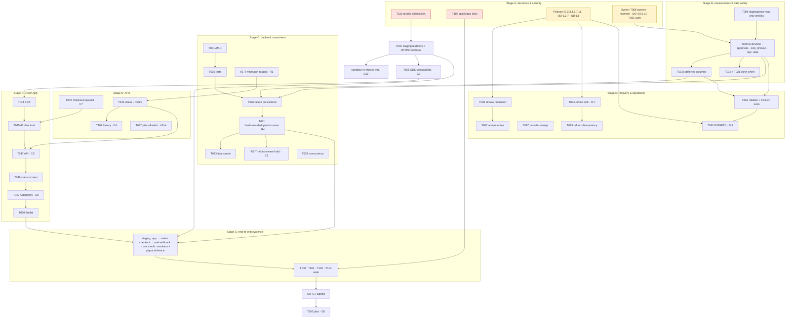

# Stage A Readiness Report — Decisions, Security Preparation, Dependencies

**Feature**: `005-razorpay-driver-payments` · **Date**: 2026-10-21 · **Authorization**: Stage A only. Decision preparation, documentation consistency, security-remediation instructions, dependency/readiness report.

No code, schema, migration, database write, staging/production access, Razorpay API call, credential change or switch change was made. **Production: NO-GO.**

The sources of truth stay where they were. This report summarizes and points to them:

- decisions: [decisions.md](./decisions.md) §2b, §2c;
- tasks: [tasks.md](./tasks.md), including the new T107–T110;
- the plan: [e2e-integration-plan.md](./e2e-integration-plan.md);
- Finance consequences: [finance-decision-packet.md](./finance-decision-packet.md).

---

## 1. Decision register C1–C8

Full text, affected files and relation to earlier decisions: decisions.md §2c.

| ID  | Subject                                                                                                                                                                 | Status                                               | Approver            | Conflict with a recorded decision?                                                              |
| --- | ----------------------------------------------------------------------------------------------------------------------------------------------------------------------- | ---------------------------------------------------- | ------------------- | ----------------------------------------------------------------------------------------------- |
| C1  | Order created first; orphan unpaid order accepted (TD-3)                                                                                                                | **Approved (Owner)**                                 | Owner               | None: identical to TD-3 (§2b)                                                                   |
| C2  | Native SDK compatibility first; **no automatic hosted fallback**; stop and decide if incompatible                                                                       | **Approved (Owner)**                                 | Owner               | Narrows T005's "select TD-1 or TD-1b". TD-1b now needs an explicit Owner decision **and** UD-12 |
| C3  | No outbound Razorpay call in the webhook transaction; check durable refund records; hold and reconcile asynchronously when a refund may exist or the state is uncertain | **Approved (Owner)**                                 | Owner               | None. The exact hold mechanism (event outcome value) needs data-model §4 text in R2-T           |
| C4  | Driver payment-history endpoint                                                                                                                                         | **Proposal requested (Owner)**; API **not approved** | Owner (contract)    | None. Proposed as T107                                                                          |
| C5  | Durable append-only state-transition history                                                                                                                            | **Open (UD-13)**                                     | **Owner + Finance** | None. Proposed as T108, blocked by UD-13                                                        |
| C6  | Sandbox webhook evidence only via HTTPS staging; no tunnel without approval                                                                                             | **Approved (Owner)**                                 | Owner               | None: consistent with T002                                                                      |
| C7  | Prefill disabled until UD-9                                                                                                                                             | **Approved (Owner)**                                 | Owner               | None: consistent with UD-9 and the contract                                                     |
| C8  | Same key for retries of one attempt; no new attempt until resolved or permitted; unknown ≠ failed                                                                       | **Approved (Owner)**                                 | Owner               | None: consistent with TD-8 and INV-8                                                            |

**Owner-only items still open.**

- C4 contract approval (T107).
- UD-13 (with Finance).
- UD-4 pilot cohort.
- UD-6 (with Finance).
- UD-9.
- UD-10 (with Finance).
- UD-11 and UD-12 (conditional).
- T006: the nine workstream owners, the independent payments reviewer, and the review rule.
- T001 authorization.
- Owner actions: T002 staging keys and webhook; D-3 Dashboard evidence; T008 questions to Razorpay (including TD-3 order idempotency); T110 key revocation.
- A named signature on decisions §2b/§2c (T007).
- A named signatory per gate in plan.md's sign-off record (release ownership).

**TD-3 itself is decided** (§2b); its only open item is Razorpay's answer to T008.

## 2. N1–N4 task definitions

Full definitions and acceptance criteria are in tasks.md, "Stage A additions".

| N   | Task                                                                | Status                                   | Key acceptance criteria                                                                                                                                                |
| --- | ------------------------------------------------------------------- | ---------------------------------------- | ---------------------------------------------------------------------------------------------------------------------------------------------------------------------- |
| N1  | **T107**: driver payment history                                    | Proposed; contract approval pending (C4) | The session-derived driver only; keyset pagination; one shared status mapper; no provider ids or PII; a BOLA case; tests pass twice                                    |
| N2  | **T108**: durable state-transition history                          | Proposed; **blocked by UD-13**           | One row per transition in the same transaction; append-only + truncate guard; retention and privacy decided; tests pass twice                                          |
| N3  | **T109**: split the shared Google Maps credential (Maps workstream) | Proposed; operator steps in §4b          | Old key deleted and refused; each new key works only on its surface; no key in any tracked file; the customer app's tracked `.env` removed from the index by its owner |
| N4  | **T110**: revoke the old Razorpay test pair                         | Proposed; operator steps in §4a          | Old pair → 401, new test pair → 200, recorded without values; only the new pair in active configuration                                                                |

## 3. Finance approval checklist

Definitions and approvers exactly as in decisions.md §1–§2. Consequences and evidence: finance-decision-packet.md.

**Nothing here is approved on Finance's behalf.**

First step: Finance confirms that it is the decision-maker for each row (the packet's "proposed decision-maker"), or names who is.

| ☐   | Item        | Decision as recorded (decisions.md)                                                                                        | Recorded approver                                   | What Finance returns                                                                         | Blocks                                   |
| --- | ----------- | -------------------------------------------------------------------------------------------------------------------------- | --------------------------------------------------- | -------------------------------------------------------------------------------------------- | ---------------------------------------- |
| ☐   | D-2         | Commission-wallet balance never below ₹0, by database `CHECK`                                                              | Owner-approved · **Finance confirmation pending**   | Confirm / amend                                                                              | T020b                                    |
| ☐   | D-3         | Recheck unpaid/failed for 5 days, then EXPIRED only if nothing captured/authorized; late success still applied and alerted | Owner-approved · **Finance pending**                | Confirm / amend (Owner supplies the Dashboard timeout evidence separately)                   | T062                                     |
| ☐   | D-4         | Mismatches → MANUAL_REVIEW, no financial effect; Finance resolves within 24 h; CREDIT or REFUND only                       | Owner-approved · **Finance pending**                | Confirm; staffing for the 24 h target                                                        | T081, T082                               |
| ☐   | D-6         | Unmatched subscription capture → automatic case; any refund only via Finance                                               | Owner-approved · **Finance pending (refund part)**  | Confirm the refund part                                                                      | Refund part of T081                      |
| ☐   | D-7         | Refund amount immutable once reserved                                                                                      | Owner-approved · **Finance pending**                | Confirm (it restricts a current Finance action)                                              | T084                                     |
| ☐   | D-11        | No ledger posting key; append-only ledger + unique anchor rows                                                             | Owner-approved · **Finance pending** (non-blocking) | Confirm                                                                                      | —                                        |
| ☐   | UD-1        | How a mismatched payment is resolved: options (a)/(b)/(c); A7 can only be REFUND                                           | **Open**: Finance + Owner                           | Choose; approve or amend the per-kind table (packet §UD-1), incl. a "no money moved" closure | T081, T082                               |
| ☐   | UD-2        | Ledger treatment of held money **and** its refund legs: options (a)/(b)/(c)                                                | **Open**: Finance / auditor                         | Choose; name the accounts                                                                    | Suspense posting in T024; T081           |
| ☐   | UD-7        | Dashboard refunds (prohibit + detect vs allow + import) **and** the `EXTERNAL_REFUND` correction rule                      | **Open**: Owner + Finance                           | Choose; approve or amend the six-stage workflow (packet §UD-7)                               | EXTERNAL_REFUND resolution in T081; T103 |
| ☐   | UD-13 (new) | Durable state-transition history (C5)                                                                                      | **Open**: Owner + Finance                           | Decide yes/no; if yes: retention, access, privacy                                            | T108                                     |
| —   | UD-8        | Historical order-id rows                                                                                                   | Conditional (Finance + Engineering)                 | Only if staging/production Q4c is true                                                       | R5-T                                     |

How a confirmation is recorded: name, role, date and the option, written into decisions.md word for word (T007).

## 4. Credential incident procedures (no secret values anywhere)

**Treat the old Razorpay test secret as compromised** until 4a step 5 is recorded. Never paste a credential into chat, tickets, commits or this repository.

### 4a. N4 / T110: revoke and verify the Razorpay Test Mode pair

| #   | Step                                                                                                                                                                                                                                                                                                                                       | Who                                            | Evidence to record (no values)                                      |
| --- | ------------------------------------------------------------------------------------------------------------------------------------------------------------------------------------------------------------------------------------------------------------------------------------------------------------------------------------------ | ---------------------------------------------- | ------------------------------------------------------------------- |
| 1   | In the Razorpay Dashboard, **switch to Test Mode**. In the API-keys area, find the key whose id ends with the same 4 characters as the old local key, then **deactivate it or regenerate it**. Generating a new key without deactivating the old one is **not** sufficient (the 2026-10-21 check showed the old pair still authenticating) | Owner                                          | Date, mode = Test, last 4 characters of the deactivated key id      |
| 2   | Before changing any local file, run the read-only check below against the **current** `.env.development` (still the old pair)                                                                                                                                                                                                              | Authorized operator                            | `old pair: HTTP 401` (a 200 means step 1 did not take effect: stop) |
| 3   | Place the replacement **test** pair in `zaroorat-back/.env.development` (git-ignored) with a local editor or the secret manager: never through chat or a tracked file. If staging or the admin integration settings hold the old pair, replace it there by the same secure process                                                         | Owner                                          | Which stores were updated (names only)                              |
| 4   | Run the same check again                                                                                                                                                                                                                                                                                                                   | Authorized operator                            | `new pair: HTTP 200`, key id prefix `rzp_test_`                     |
| 5   | Record steps 1–4 in the research.md verification log. Then the residual local copies listed in the 2026-10-21 audit (transcripts, claude-mem, one unreachable git object) are handled **only** under a separately approved cleanup plan                                                                                                    | Engineering (record); Owner (cleanup approval) | Log row                                                             |

**Read-only check** (the operator saves it outside the repository, for example as `rzp-auth-check.mjs`). It reads the pair from `.env.development`, refuses anything that is not a test key, calls one read-only endpoint, and prints only the HTTP status:

```js
import { readFileSync } from 'node:fs';
const env = readFileSync('zaroorat-back/.env.development', 'utf8');
const get = (k) =>
  (env.match(new RegExp(`^${k}=(.*)$`, 'm'))?.[1] ?? '').trim().replace(/^"|"$/g, '');
const id = get('RAZORPAY_KEY_ID'),
  secret = get('RAZORPAY_KEY_SECRET');
if (!id.startsWith('rzp_test_')) {
  console.log('refused: not a Test Mode key');
  process.exit(2);
}
const res = await fetch('https://api.razorpay.com/v1/orders?count=1', {
  headers: { Authorization: 'Basic ' + Buffer.from(`${id}:${secret}`).toString('base64') },
  signal: AbortSignal.timeout(15000),
});
console.log('HTTP', res.status); // print nothing else
```

Engineering will run it only after a separate authorization following the rotation; Stage A forbids Razorpay calls.

### 4b. N3 / T109: split the shared Google Maps credential (Maps workstream)

| #   | Step                                                                                                                                                                                                                                                                                                                                                 | Who                    | Evidence (no values)                                      |
| --- | ---------------------------------------------------------------------------------------------------------------------------------------------------------------------------------------------------------------------------------------------------------------------------------------------------------------------------------------------------- | ---------------------- | --------------------------------------------------------- |
| 1   | In Google Cloud Console, open the project that owns the shared key. Record which APIs are **enabled**, and the key's current application and API restrictions                                                                                                                                                                                        | Maps owner (via Owner) | Screenshot or list, key value hidden                      |
| 2   | Create a **server** key: application restriction = backend egress IP addresses; API restriction = only what the backend calls: Directions, Distance Matrix, Geocoding, Places API (New) (inventory 2026-10-21)                                                                                                                                       | Maps owner             | Key name, restrictions                                    |
| 3   | Create a **browser** key for the admin panel: HTTP-referrer restriction = admin domains (plus approved development origins); API restriction = Maps JavaScript API (plus Places only if the admin map uses it)                                                                                                                                       | Maps owner             | Key name, restrictions                                    |
| 4   | Create **mobile** keys: Android (package names of the driver and customer apps + debug, release and EAS signing SHA-1s), iOS (bundle ids, where iOS ships); API restriction = Maps SDK for Android / Maps SDK for iOS                                                                                                                                | Maps owner             | Key names, restrictions                                   |
| 5   | Put each key only into its surface's secret store or **untracked** env. Remove the shared value from the customer app's tracked `.env` (its staged deletion belongs to another contributor: coordinate per T006 #1/#6) and make sure `.env` is git-ignored. Keep tracked templates as empty placeholders (the admin template was blanked 2026-10-21) | Each workstream owner  | A secret scan of the four repositories shows no key value |
| 6   | Deploy or rebuild each surface; verify maps, places and routes work with the new keys; verify each key is refused from another surface                                                                                                                                                                                                               | Maps owner + QA        | Pass/fail per surface                                     |
| 7   | **Delete** (not just restrict) the old shared key; verify a request with it is refused                                                                                                                                                                                                                                                               | Maps owner             | Date, refusal observed                                    |

History rewriting is not needed once the old key is deleted. Any history rewrite is a separate decision.

## 5. Dependency graph for the next stages

Nothing below is authorized; edges follow each task's `Needs:` in tasks.md and the corrections in phase3-preparation.md §4 (migration first; **T026 before T031**; T006 open).



## 6. Release gates G0–G8 (2026-10-21)

PASS = evidence recorded, reviewed, approved. FAIL = actionable but not met. BLOCKED = waits on access, a device or a decision outside engineering.

| Gate                      | Status             | Evidence that exists                                                                                                         | Missing                                                                                                                                                |
| ------------------------- | ------------------ | ---------------------------------------------------------------------------------------------------------------------------- | ------------------------------------------------------------------------------------------------------------------------------------------------------ |
| G0 Decisions & ownership  | **BLOCKED**        | Owner: D-1, D-5, D-10, UD-3, R1, R4, R6a–c, TD-3, C1–C3, C6–C8 recorded                                                      | Finance §3 checklist; UD-13; C4 contract; UD-4, UD-6, UD-9, UD-10; T006 owners + independent reviewer; named signatures (T007)                         |
| G1 Provider & device      | **FAIL / BLOCKED** | Sandbox S1, S2, S3, S3b, S9, S11 (direct API + web checkout, 2026-10-20)                                                     | T110 (old key valid); T005 (U1/U2); S13; D-3 Dashboard evidence (U8); **no physical Android device**                                                   |
| G2 Data safety            | **BLOCKED**        | Dev T004 (seed anomalies only); operator runbook; readiness checklist                                                        | Staging/production T004; representative-data verification; approvals per target; staging rehearsal                                                     |
| G3 Backend correctness    | **FAIL**           | Local: unit 2,077/2,086 (5 pre-existing unrelated failures); payment integration 111/111 ×2 on an isolated DB; T022 10/10 ×2 | CI; committed code; independent review; T018, T025, T028, T030, T026, T031, T032                                                                       |
| G4 End-to-end             | **FAIL**           | —                                                                                                                            | T042, T043, T044–T050, T002; journeys on emulator **and** physical device                                                                              |
| G5 Security & performance | **FAIL**           | Confirm route answers 404 without disclosure (BOLA test); tracked templates cleaned                                          | T110 (old key); T109 (shared Maps key committed/pushed); residual-copy cleanup approval; TM-34 review; bundle secret scan; T101 load test; T099 alerts |
| G6 Operations             | **FAIL / BLOCKED** | Review cases open safely (T022)                                                                                              | T080–T087 (Finance); T038, T061, T067; T103 runbooks; drills D1–D10; R-B relief migration; PITR confirmation                                           |
| G7 Staging soak           | **BLOCKED**        | —                                                                                                                            | Staging + all of the above (T104)                                                                                                                      |
| G8 Live pilot             | **BLOCKED**        | Both switches OFF everywhere                                                                                                 | T037 + UD-4; G0–G7 signed; go decision                                                                                                                 |

**Overall: NO-GO.**

## 7. Blockers that prevent Stage B

Stage B = T002 staging keys and webhook; T004 on staging/production; migration readiness and application to dev/`zaroorat_test`; T019c; T018/T021.

| #   | Blocker                                                                                                                                                                                                               | Unblocked by                                                                                           |
| --- | --------------------------------------------------------------------------------------------------------------------------------------------------------------------------------------------------------------------- | ------------------------------------------------------------------------------------------------------ |
| 1   | **The old Razorpay test pair still authenticates**; the new pair is not configured (T110)                                                                                                                             | Owner: §4a steps 1–3; then authorization for engineering to run the step-2/4 checks                    |
| 2   | Staging HTTPS endpoint, staging test keys and the test webhook not configured (T002, C6)                                                                                                                              | Owner                                                                                                  |
| 3   | No authorized staging/production database access for T004 (runbook P1–P8)                                                                                                                                             | Owner approval per environment + DevOps logins (read-only + API role) + the restricted output location |
| 4   | Migration approvals do not exist: target list, exact migration list (dev also needs two other-team migrations), whether to add `lock_timeout` to T020 (this requires re-creating the retained `zaroorat_rzp005_test`) | Owner                                                                                                  |
| 5   | Representative non-empty verification needs a **new** disposable clone and a synthetic dataset                                                                                                                        | Owner approval                                                                                         |
| 6   | T019c is a schema change (Prisma + migration)                                                                                                                                                                         | Owner authorization of T019c, isolated test DB first                                                   |
| 7   | T006 owners not named: other-team migrations, test harness (T018), Prisma client regeneration notice                                                                                                                  | Owner                                                                                                  |
| 8   | No independent payments reviewer for the migration and schema changes                                                                                                                                                 | Owner                                                                                                  |
| 9   | Point-in-time recovery confirmation (before any staging/production migration; not needed for dev/test)                                                                                                                | DevOps                                                                                                 |

Finance decisions do **not** block Stage B, except D-2 for T020b.

## 8. File-by-file summary of Stage A changes

All are documentation in `specs/005-razorpay-driver-payments/` (untracked; nothing staged or committed):

| File                          | Change                                                                                                                                                                                                                         |
| ----------------------------- | ------------------------------------------------------------------------------------------------------------------------------------------------------------------------------------------------------------------------------ |
| `decisions.md`                | Added the **UD-13** row (C5) to the open-decisions table; added **§2c** "Stage A decisions C1–C8" (status, approver, relation to earlier decisions, affected files/tasks; open Owner items). No existing decision text changed |
| `tasks.md`                    | **T002**: C6 note. **T005**: C2 note. **T047**, **T049**: C8 notes. New section "Stage A additions": **T107 (N1)**, **T108 (N2)**, **T109 (N3)**, **T110 (N4)**, all proposed. Existing task IDs and text unchanged            |
| `e2e-integration-plan.md`     | Pointers from §2 (C1–C8) to decisions.md §2c, and from §5 (gates) to this report §6. No other changes                                                                                                                          |
| `stage-a-readiness-report.md` | **New** (this file)                                                                                                                                                                                                            |

Not touched: application code, Prisma schema, migrations, contracts (the C4 contract text waits for T107's approval), databases, env files, Maps/Driver App/Admin Panel files, git state.
